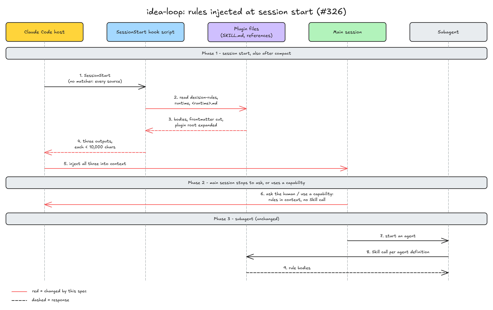

# 开场注入 decision-rules 与 runtime

> #326 存在：#313 的规则回放里，改后那一遍摆出了范围题却没读 `idea-loop:decision-rules`，新规则没起作用（3 次中 1 次），详情在「问题陈述」

## 问题陈述

### 1. 主会话停下问人时，规则不一定在上下文里

`idea-loop:decision-rules`（自己定还是问人、要人定的怎么摆成题）和 `idea-loop:runtime`（定时任务、会话管理、浏览器、向人提问这些能力在当前运行环境里怎么做）都是按需调用的 skill。会话开场的 SessionStart 钩子只往上下文里放一行「当前运行环境：X，用到能力时照 idea-loop:runtime 做」，规则正文要会话自己去调。

复现：#313 的回放用例 `decision-rules-scope-recommend`（`idea-loop/evals/retro/cases/decision-rules-scope-recommend/annotations.md`「人定的三次重跑」，2026-11-14，仓库里的新版 runner）。被验的会话在一场 issue 讨论里摆出范围题（冒出的改进并进当前 PR 还是另开）。三次里：

| 次 | 改后那一遍读没读 `decision-rules` | 范围题的推荐 |
|---|---|---|
| 1 | 自己调了 | 照新规则推荐，过 |
| 2 | **没读** | 把不影响交付的改进也推荐并进，runner 判「用例没测到改动」 |
| 3 | 自己调了 | 照新规则推荐，但改前也答「是」，判「用例没抓住问题」 |

本该是：每次摆题时规则都已经在上下文里。范围题常在 issue 会话的自由讨论里冒出来（#174 题 5，两轮 review 之间），那一刻没有哪一步要求先调 `decision-rules`；`idea-loop:issue-session` 只在「边界」里写了一句「停下问人先对 `idea-loop:decision-rules`」。

规则没被读到的频率只有这一组样本（3 次中 1 次），更大范围查不到：会话日志里没有「该读没读」的记录。

### 根因

两份几乎每个会话都要用的规则挂在按需调用的指针后面，取不取由会话自己判断；钩子已经每个会话都跑，却只注入一行指针（`idea-loop/hooks/hooks.json` 的 SessionStart → `scripts/runtime-detect.mjs --line`，对着 `main` e259f3f 查，2026-11-15）。

## 方案

1. **用户得到什么**：装了 idea-loop 的项目里，每个主会话开场（以及 resume、clear、compact 之后）上下文里就有 `decision-rules` 的正文、`runtime` 的正文、当前运行环境那一份 reference 的全文。停下问人、用某个能力时，不用先调 skill，规则已经在。决定注入什么的只有两个输入：插件里这三份文件的当前内容，和检测到的运行环境（`IDEA_LOOP_RUNTIME` → `MAGI_SESSION_ID` → `claude-desktop`，规则不变）。
2. **做法**：扩展已有的 SessionStart 钩子，不加新组件（人在 #313 会话的原话：「runtime 以及 决策方式在session 开始的hook 注入我觉的是可以的，不在需要其他skill 调用了」）。钩子分三段输出，每段一条钩子命令：`decision-rules` 正文、`runtime` 正文（第一行仍是「当前运行环境：X」）、`references/<运行环境>.md` 全文。每段去掉 frontmatter，`${CLAUDE_PLUGIN_ROOT}` 换成插件的真实路径（skill 被调用时宿主会做这一步，钩子输出不会），开头一行写明「以下是 `idea-loop:<名>` 的正文，开场注入，不必再调它」。
3. **中间状态**：
   - 三段各自独立：`IDEA_LOOP_RUNTIME` 写了不认识的名字时，runtime 两段照旧报错退出（现在的行为），`decision-rules` 那段照常注入。
   - compact 之后上下文被压缩，钩子在 `compact` 来源上再跑一次，三段重新注入。
   - 子代理收不到 SessionStart 的注入，照旧在 agent 定义里开工时自己调（图里阶段 3，不变）。
4. **其他入口**：
   - 纳入：主会话里所有 skill 的「用 Skill 工具调 `idea-loop:decision-rules` / `idea-loop:runtime`」指针（改成按名字引用，见「实现决策」）。
   - 纳入：规则回放 runner 的改动核对（`exercisedBy`）：改动动到注入的三类文件时，被验会话不再需要读或调它们，核对要认这条路。
   - 排除：子代理（`agents/*.md`）。理由：收不到开场注入，保留并补齐开工时的调用。
   - 排除：`scripts/codex-prompt.mjs` 给 Codex 拼 prompt 时塞进 `decision-rules` 路径。理由：Codex 不是 Claude Code 会话，不跑插件钩子。

## User Stories

只修问题，每个问题一行期望行为：

1. 期望行为：主会话在任何时刻停下问人或用运行环境能力时，`decision-rules`、`runtime` 正文和当前运行环境的 reference 已经在上下文里，包括 compact 之后；不再依赖会话自己去调这两个 skill。

## 实现决策

- **skill 本身留着**，是注入的唯一来源：钩子读的就是 `skills/productivity/decision-rules/SKILL.md`、`skills/productivity/runtime/SKILL.md` 和 `runtime/references/<名>.md`，改规则只改一处。子代理和人显式调用照旧能用。依据：`idea-loop:writing-for-agents`「剪枝」的单一事实来源。
- **三段分开输出，每段 < 10,000 字**。依据：Claude Code hooks 文档（`code.claude.com/docs/en/hooks.md` 的「JSON output」，2026-11-15 查）：单个钩子的输出上限 10,000 字，超出的存成文件、上下文里只留路径和前 2,000 字预览，且不提示会话去读；多个钩子各自计算。现有大小：`decision-rules` 主体 1139 字、`runtime` 主体 1495 字、`claude-desktop.md` 7252 字、`magi.md` 6063 字，合成一段 ≈ 9,900 字，加上头行会过线，分开每段都远低于上限。测试钉住每段的上限。
- **reference 注入全文，不做摘要**。依据：全文已在单段上限内；摘要是同一内容的第二份来源，跟上一条冲突。代价：每个会话多付约 1.0 万字上下文（`decision-rules` + `runtime` + 一份 reference），人在 issue 里写下了这个量，方向已定。
- **钩子不写 matcher**：startup、resume、clear、compact（自动和手动）、fork 都注入。依据：同一份 hooks 文档的 SessionStart matcher 表，不写 matcher 即全部来源都触发；现有钩子已是这样。
- **主会话的指针改成按名字引用**：skill 里「用 Skill 工具调 `idea-loop:decision-rules`」「用 Skill 工具调 `idea-loop:runtime`，读当前运行环境的『X』」改成「照 `idea-loop:decision-rules` 的「X」」「照『X』（`idea-loop:runtime`）」。按名字引用小节的句子（如「照 `idea-loop:decision-rules` 的「核心」」）不动。对的杠杆：上下文指针（正文已在上下文，「去取」的指令变成重复）。
- **子代理补齐开工时的调用**：agent 定义收不到注入。已在开工调 `decision-rules` 的（implementer、pr-reviewer、issue-triager）不动；会走到运行环境能力的 agent 在开工那一行加「用 Skill 工具调 `idea-loop:runtime`」，判法是机械的：agent 定义的正文，或它点名要调的 skill（连同那个 skill 的 references）里出现『<能力名>』（`runtime` 能力清单第一列），就算会走到。2026-11-15 按这个判法粗查是 implementer、ui-reviewer、designer、design-steward、issue-triager、uiux-imaginer，实现时以判法重算为准，文档测试照同一判法守着。在开工那一行加「用 Skill 工具调 `idea-loop:runtime`」。依据：`runtime` SKILL.md「怎么用」第 1 步写明子 agent 收不到开场那一行；skill 被子代理加载时按名字的引用不保证触发调用。
- **`runtime` SKILL.md「怎么用」第 1 步改写**：主会话开场已注入本正文和当前运行环境的 reference，直接照做；子代理照现在的 1–3 步自己认环境、读 reference。
- **`decision-rules` 不拆**：在注入那段的头行加一句适用范围：「核心」一节针对有 spec 的工作；没有 spec 的会话里，把「spec」读作人这次交代的事。依据：Harold 的用户级约定「先扩展已在用的工具，不为一件事新增组件」；拆成两份 skill 是新增组件，头行一句话就能消除误读（在这个仓库、任何装了 idea-loop 的项目的普通对话里，会话会读到「spec 之外的事不在这次做」）。
- **规则回放的改动核对认注入**：`exercisedBy` 在改动集合含注入的三类文件之一时，记为用上，途径 `injected`。依据：runner 用 `--plugin-dir` 起被验会话，插件的 SessionStart 钩子每次都跑；不认这条路，改 `decision-rules` 的规则回放会被判「用例没测到改动」，因为会话不再去读它。已知限制：不从事件流核实钩子真的跑了（钩子报错时会误判为用上），钩子本身有单元测试守着。
- **版本档**：patch，0.1.19 → 0.1.20。人在 PR #330 合并前定（2026-11-15）：「升级为patch」。起草时按 `REVIEW.md`「额外要求」定的是 minor（改了流程的行为，老用法照样能用）；#327（0.x 的行为改动升 patch）还开着，这是同一类选择又一次选了 patch。
- **README**：`idea-loop/README.md` 里 hooks.json、runtime-detect.mjs 两行的说明、`idea-loop:runtime` 一行同步改（`REVIEW.md`「额外要求」第一条）。

## 测试决策

| 变的是什么 | 仪器 | 本次 |
|---|---|---|
| 纯逻辑、数据转换、状态机 | TDD 单元测试 | 碰到：钩子三段的输出、改动核对的 `injected` |
| API 契约（路由、schema、序列化） | TDD API 测试 | 不涉及 |
| DB schema、迁移、并发与事务语义 | 真 DB 测试 | 不涉及 |
| LLM 输出质量（prompt 改动） | eval（确定性断言） | 碰到：skill 与 agent 的指针改动；不加新 eval，跑现有回放用例看注入后规则是否都用上（见下） |
| 视觉正确性 | UI 实现环 | 不涉及 |
| 端到端用户流程 | 浏览器端到端测试 | 不涉及；换成一次无头会话的探针（见下） |

- **seam**：
  - 钩子命令本身：照 `hooks.json` 里登记的命令，经 shell 跑（宿主就是这样跑的），读 stdout。能抓到：漏注入、超上限、没去 frontmatter、占位符没展开、选错 reference、matcher 被加上；漏掉：宿主真的把输出放进上下文。
  - `exercisedBy`（已有）。能抓到：注入文件的改动被判用上；漏掉：钩子在真实会话里没跑。
  - 文档测试（已有一类 `*-doc.test.mjs`）：`skills/` 下（除这两个 skill 自己）不再出现「用 Skill 工具调 `idea-loop:decision-rules`」「用 Skill 工具调 `idea-loop:runtime`」；上面点名的 agent 定义含开工调用。能抓到：指针回潮、agent 漏补；漏掉：措辞变体。
- **增量功能测试**：
  - 前置：插件根目录；`MAGI_SESSION_ID` 设与不设各一遍。步骤：照 `hooks.json` 跑 SessionStart 的全部命令。期望：三段输出；每段 < 10,000 字；第一段含 `decision-rules` 的「## 护栏」，不含 `name: decision-rules`；runtime 段第一行是「当前运行环境：<名>」；reference 段是对应运行环境那份；输出里没有字面的 `${CLAUDE_PLUGIN_ROOT}`。覆盖：期望行为 1。
  - 前置：`IDEA_LOOP_RUNTIME=foo`。期望：`decision-rules` 段照常输出，runtime 两段非零退出、stdout 为空。覆盖：期望行为 1。
  - 前置：改动集合只含 `skills/productivity/decision-rules/SKILL.md`，事件流里没有任何 Read / Skill。期望：`exercisedBy` 返回 `hit`、途径 `injected`。改动集合只含别的 skill 时仍是 `miss`。覆盖：期望行为 1。
  - 探针（实现完跑一次，不进测试套件）：用这个分支的插件起一个无头会话，prompt 要它不调任何工具、复述 `decision-rules`「护栏」的第一条；期望答对且事件流里没有工具调用。
  - 回放趋势（实现完跑，不作门槛，结果记进用例的 annotations.md）：`decision-rules-scope-recommend` 用这个分支的插件跑 3 次，看改后那一遍的改动核对是否 3 次都是用上。
- **照着谁写**：`idea-loop/scripts/runtime-detect.test.mjs`（经 shell 跑 hooks.json 里的命令）、`idea-loop/evals/retro/` 下 `exercisedBy` 的现有测试、`idea-loop/scripts/runtime-tripwire.test.mjs`（扫 `skills/`、`agents/` 的文档测试）。

## Out of scope

- 子代理的注入（SubagentStart 钩子能带 `additionalContext`，但注入是否进到子代理的上下文没核实，本次探针被权限拦下没跑）。核实了可以另开 issue，让 agent 定义也去掉开工调用。
- 改 `decision-rules`、`runtime` 的规则内容本身。
- 让注入随项目定制（本机覆盖，#295）。

## 关联

- raw：无（从 issue 起草，没有对话）。
- 相关 spec：`scope-recommend-by-delivery`（#313，已合）：它的回放暴露了本问题。
- 相邻未完成的 issue：#295（runtime 的本机覆盖）：不重叠；它若落地，覆盖内容要进注入的 runtime 段，本 spec 先做。#327（版本档规则）：只影响本 PR 的版本档，见「实现决策」。#302（wiki-conventions 超长）：无重叠。
