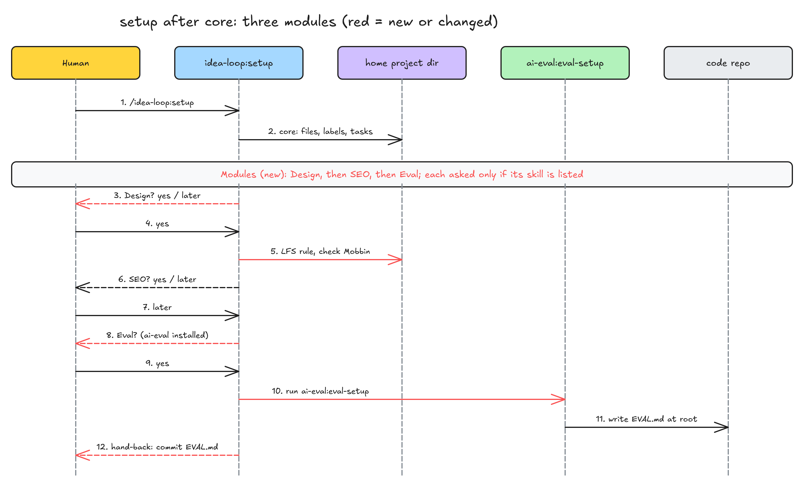
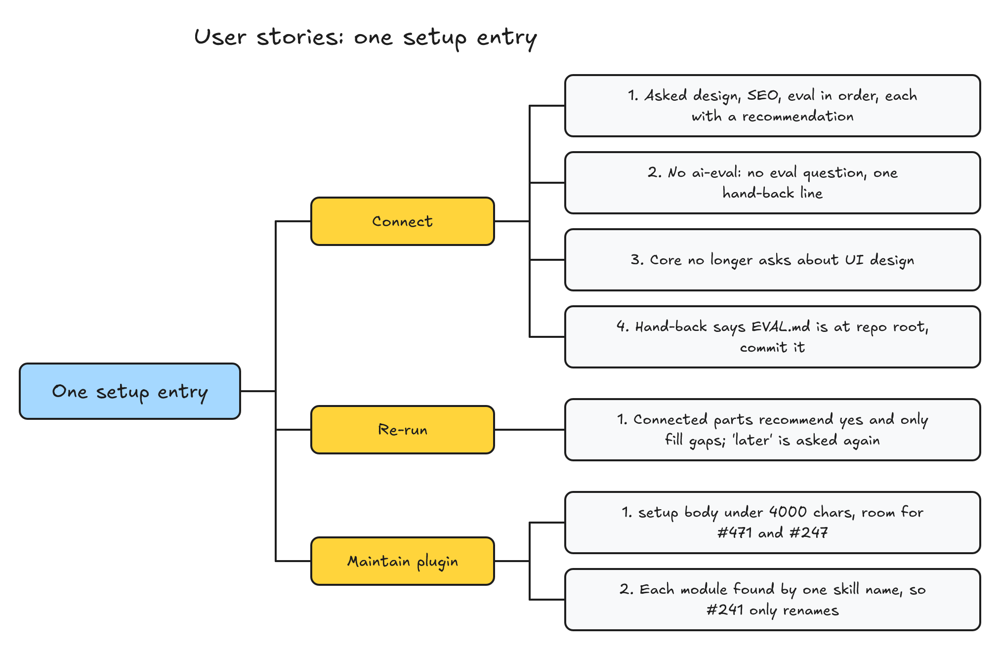

# 一个 setup 入口：设计、SEO、评测三段

> #420 存在：接一个项目仍要知道两个入口（`/idea-loop:setup`、`ai-eval:eval-setup`），setup 不提评测；setup 正文 4499 字，离 4500 字的线只剩 1 字，详情在「问题陈述」

## 问题陈述

现状对着 `origin/release/idea-loop-0.2.0`（283ed7da，2026-11-24）核。issue 正文写的「三个 setup」是 2026-11-20 对着 `issue/293-eval-writing` 量的；之后 #340（提交 879e27ad）已把 `seo-setup` 并成 setup「模块」一节的唯一一项「SEO」，所以现在是两个入口。

### 1. 评测要人自己知道去跑另一个插件的 setup

一个装了 idea-loop 和 ai-eval 的项目跑 `/idea-loop:setup`：核心写完，「模块」一节只问 SEO 一道题，交回里也没有评测。setup 目录里 `grep -i eval` 零命中。人得自己记得 ai-eval 有个 `eval-setup`、再敲一次。2026-11-20 #293 的会话里人问过「eval-setup 能不能并进 idea-loop 的 setup」，原话见 issue 正文「证据」。

### 2. 设计的配置散在核心里，不像一个模块

设计没有单独的 setup，两处配置混在核心步骤里：问人清单里的「做不做 UI 设计」（答「做」才在「写」一步配设计档案素材的 Git LFS），和预检表里可选的 Mobbin 一行。不做 UI 的项目照样要答这道题、看这一行。SEO 是模块、设计不是，入口的分段因此不一致。

### 3. setup 正文已经没有篇幅

按 `AGENTS.md`「标准 plugin 目录结构」的量法，`setup/SKILL.md` 主体 4496 字（283ed7da），#471 合进来后 4499 字（640eaf17），`dyna spec skill-lint` 的线 4500。要往里加的：

| 谁 | 要加什么 | 状态 |
|---|---|---|
| #420（本 spec） | 评测、设计两段 | triage |
| #471 | 「选运行环境」「照模板生成新环境说明」两步 | 已合进集成分支（PR #484，640eaf17），合后正文 4499 字 |
| #247 | 「迁移」一节的一行指针（现在写着「待补」） | todo |

### 根因

- 问题 1：仓库根 `AGENTS.md` 写 plugin 之间相互独立、可单独安装，ai-eval 的 setup 因此没并进 idea-loop；setup 也没有「另一个插件装了就接它」的写法。
- 问题 2：#340 并 `seo-setup` 时只建了 SEO 一个模块，设计的两处没跟着挪。
- 问题 3：#340 把正文重写到 4496 字，四个定时任务一样的小节（规则回放 runner、每周对账、每周分拣、调度）各占一节、各写一遍完成条件，交回把每一节的细节又列了一遍。

## 方案

图里红色是这次新增或改动的：「模块」一节按固定顺序走三段，每段先看对应插件的 skill 在不在，在就出一道「接 / 以后再说」，接了照那段的步骤做。

**用户得到什么**：跑一次 `/idea-loop:setup`，核心（home、引导文件、label、定时任务）写完后依次看到设计、SEO、评测三道题，每道带推荐答案和出处。没装 ai-eval 的项目看不到评测题，交回里多一行「项目有调模型的流水线的，装 ai-eval 后再跑 setup 接评测段」。答案由两样决定：对应插件装没装（决定出不出题），探查到的项目情况（决定推荐「接」还是「以后再说」）。

**三段**（顺序：前两段是 idea-loop 自己的、写进 home 的项目目录；评测是另一个插件、写进代码仓库，放最后）：

| 段 | 出不出题：看这个 skill 在不在本会话的 skill 清单里 | 推荐「接」的依据（探查） | 接了做什么 |
|---|---|---|---|
| 设计 | `idea-loop:uiux-imagine` | 代码仓库有前端界面（页面、组件目录） | 设计档案素材的 Git LFS 规则写进 `<项目目录>/.gitattributes`；查 Mobbin MCP（可选，只报状态和修法） |
| SEO | `idea-loop:seo-scan` | 有对外的营销站或博客 | 照现有 `references/seo/steps.md`，不变 |
| 评测 | `ai-eval:eval-setup` | 代码里有调模型的依赖（如 `@anthropic-ai/sdk`、`openai`） | 用 Skill 工具调 `ai-eval:eval-setup`，它写代码仓库根的 `EVAL.md` |

**中间状态**：

- 插件没装：那段不出题，交回写一行「装了 <插件> 再跑 setup 接这段」。设计、SEO 现在都在 idea-loop 里，总会出题；以后 #241 把它们拆成插件，只换表里的 skill 名。
- 选「以后再说」：交回里记一行，再跑 setup 时照样再问。
- 已接过再跑（设计：`.gitattributes` 已有那条 LFS 规则；SEO：项目目录有 `SEO.md`；评测：代码仓库根有 `EVAL.md`）：题照出，推荐「接」，各段原有的写法本来就是只补缺的。
- 评测段写出的 `EVAL.md` 在代码仓库根、不进 home，setup 不替人提交：交回里写它在哪、要人在代码仓库里提交。它是 ai-eval 的文件，setup「代码仓库里没有新增的 idea-loop 文件」那条完成条件不管它。
- `eval-setup` 中途停下问人（它读不到的列成「待确认」）：照它的问法在本会话里答，答完回到 setup 交回。

**腾篇幅**（对的杠杆：正文只留步骤和指针，细节在参考文件里）：

- 「规则回放 runner」「每周对账」「每周分拣」「调度」四节并成一节「定时任务」：一张表（任务、建在哪、步骤文件），一条完成条件。各自的步骤文件不动。
- 「交回」只留按节列的骨架，每节要报的细项挪进一份交回参考文件。
- 「写」里的 LFS 一条、预检表的 Mobbin 一行、问人清单的「做不做 UI 设计」挪进设计段。
- 目标：主体 ≤4000 字（#471 的两步已在里面），给 #247 的一行指针和以后的改动留出约 500 字。

**同一件事的其他入口**：

| 入口 | 纳入 / 排除 |
|---|---|
| setup 的 frontmatter description（「接完按模块问要不要接 SEO」） | 纳入：改成三段 |
| `idea-loop/README.md` 的 setup 一行（「SEO is the only module so far」） | 纳入 |
| `ai-eval:eval-run` 读到 `EVAL.md` 缺项时自己调 `eval-setup` | 排除：ai-eval 一字不改，它仍是单独可装的插件（人 2026-11-24：「seo、ai-eval 其实完全可以独立插件」） |
| ai-eval 的 README、eval-setup 正文 | 排除，同上 |
| to-spec 测试决策表里提 ai-eval 的那一行 | 排除：讲的是实现时怎么验，不是接入 |
| 运行环境说明「装与设置」里的 Mobbin 一条 | 排除：内容不变，只是引用它的地方从预检表挪到设计段 |
| `references/seo/` 下的 SEO 步骤 | 排除：不变 |
| #247 的「迁移」一节 | 排除：#247 自己补，本 spec 只给它留篇幅 |

## User Stories

**接入**

1. 作为接入项目的人，我想要核心写完后依次被问设计、SEO、评测要不要接，每道带推荐和出处，以便一次 setup 接完，不用自己记还有哪个入口
2. 作为接入项目的人，我想要没装 ai-eval 时不被问评测、只在交回里看到一行怎么接，以便没装的插件不打扰我
3. 作为接入项目的人，我想要不做 UI 的项目不在核心里被问设计的事，以便核心只问每个项目都要答的
4. 作为接入项目的人，我想要接了评测后在交回里看到 `EVAL.md` 写在代码仓库根、要我自己提交，以便知道这份文件不在 home 里

**再跑**

1. 作为再跑 setup 的人，我想要已接过的段推荐「接」、只补缺的，选过「以后再说」的段再问一次，以便再跑不重写、也不漏

**维护插件**

1. 作为维护插件的人，我想要 setup 正文降到 4000 字以内（含 #471 已加的两步），以便 #247 要加的指针和以后的步骤放得下
2. 作为维护插件的人，我想要每段只靠一个 skill 名认插件装没装，以便以后 #241 拆插件时只换名字

## 实现决策

- **认插件装没装看本会话的 skill 清单**：模型开场就有可用 skill 的清单，看 `<插件>:<skill>` 在不在，不跑命令。不用 `claude plugin list`：本机实测（2026-11-24）它按每个项目、每个作用域各列一行，idea-loop 一项就列了上百行，判不出当前项目启用了哪个。
- **段的顺序固定：设计 → SEO → 评测**。依据见「方案」：前两段属于 idea-loop、写项目目录，评测属于别的插件、写代码仓库，放最后，交回时集中说要人提交的东西。
- **设计段的步骤写成一份参考文件**，跟 SEO 的 `references/seo/steps.md` 并排；评测段步骤只有「调 `ai-eval:eval-setup`、交回写清 `EVAL.md` 的位置」，也放一份短参考文件，正文只留表和指针。
- **「定时任务」合并后每个任务的完成条件不变**：表里一行一个任务，节末一条「每个任务都已有、建好、人拒绝，或记下了没建的原因」；规则回放 runner 不是定时任务但也是「建一个设备级的东西」，并进同一张表。
- **不加新的 dyna 命令**：issue 原想把预检、查小节缺失、建 label 交给脚本。现在预检表每行已是一条命令（`dyna home where`、`dyna version`、`gh auth status`……），建 label 已是 `dyna issues labels`，SEO 的小节检查已是 `dyna seo parse`；剩下「核心引导文件缺哪些小节」由模型对着模板补，加一条命令省不下篇幅（指针还在）。依据：home 固定文案「先扩展已在用的工具，不为一件事新增组件」，这里连扩展的需要都没找到。人要的话再开 issue。
- **插件版本不升**：idea-loop 已是 0.2.0，0.2.0 合进 main 时统一定（`386-merged` 笔记：「按 #331 0.2.0 合进 main 时一次升」）。ai-eval 不碰，不升。
- **单仓库模式不在这里**：2026-11-15 home grill A1 定了「单仓库是 home 与代码仓库合一的特例」，但 `dyna` 里没有这条判断，只有一个仓库的人跑 setup 照样建 `~/home`。在用的两个项目都在多仓库的本机上，找不到单仓库的真实用户，记成已知限制；要做另开 issue（人 2026-11-24 问到，raw A4）。

## 测试决策

| 变的是什么 | 仪器 | 本次 |
|---|---|---|
| 纯逻辑、数据转换、状态机 | TDD 单元测试 | 不涉及：没有代码改动 |
| API 契约（路由、schema、序列化） | TDD API 测试 | 不涉及 |
| DB schema、迁移、并发与事务语义 | 真 DB 测试 | 不涉及 |
| LLM 输出质量（prompt 改动） | eval | 改的是 setup 的 SKILL.md 和参考文件：按 `AGENTS.md` §5 不做 quantitative eval；结构用文档测试守，行为用下面一次手动走查 |
| 视觉正确性 | UI 实现环 | 不涉及 |
| 端到端用户流程 | 浏览器端到端测试 | 不涉及 |

- **seam**：setup 的文档本身（SKILL.md 和参考文件），一条新的文档测试读它。能抓到：段缺了、顺序错了、skill 名写错、链接断了、设计的两处没挪干净；漏掉：模型跑起来是不是真的按表出题，这个靠手动走查。
- **增量功能测试**：
  - 文档测试（先在改前的文本上看它失败，照 `setup-seo-module-doc.test.mjs` 用环境变量指向旧文本）：「模块」一节按设计、SEO、评测的顺序列出三段，各带 `idea-loop:uiux-imagine`、`idea-loop:seo-scan`、`ai-eval:eval-setup` 和一个能打开的步骤链接；预检表没有 Mobbin 一行、问人清单没有「做不做 UI 设计」、「写」里没有 LFS 一条；评测段的参考文件写明 `EVAL.md` 在代码仓库根、setup 不提交。覆盖：接入 1、2、3、4，维护插件 2。
  - 篇幅：`dyna spec skill-lint` 过；PR 描述里写按 `AGENTS.md` 量法量出的主体字数，≤4000。覆盖：维护插件 1。
  - 手动走查（前置：临时 git 仓库，`HOME`、`IDEA_LOOP_HOME` 指向临时目录，用本分支的插件；仓库里放一个前端目录和一个含 `openai` 依赖的 `package.json`）：步骤——跑 `/idea-loop:setup` 到「模块」；期望——依次出设计、SEO、评测三道题，设计和评测推荐「接」并给出处；去掉 ai-eval 再跑一次，评测题不出、交回多一行。结果贴进 PR 描述。覆盖：接入 1、2，再跑 1。
- **照着谁写**：`idea-loop/scripts/setup-seo-module-doc.test.mjs`（同样守 setup 的模块和链接）、`setup-single-source.test.mjs`。

## Out of scope

- 把 design、seo 拆成独立插件（#241，人 2026-11-24 定保持暂缓）。
- 改 ai-eval 的任何文件，包括把 `EVAL.md` 挪进 home。
- 单仓库（home 与代码仓库合一）模式。
- 新的 dyna 命令。

## 关联

- raw：[[2026-11-24-setup-modules-grill]]。
- [[skill-rewrite]]（#340）：把 `seo-setup` 并成 setup 的模块，本 spec 在它之上加两段。
- [[runtime-ops-in-docs]]（#471，PR #484 已合进集成分支，640eaf17）：给 setup 加了两步，正文到 4499 字。本 spec 在它之上改，压篇幅时把那两步一起算进去。
- #247（todo，spec `migrate-to-home` 在分支 `issue/247-migrate-to-home`）：补「迁移」一节，同样用本 spec 腾出的篇幅；人 2026-11-24 定不合并，#247 照旧最后 done。
- #241（backlog）：插件拆分；本 spec 的表按 skill 名认插件，拆了只换名字。
- 其余相邻的 0.2.0 子 issue：#438、#456 的分支对集成分支的差异里没有 setup 的文件（2026-11-24 查）；#451、#452 改 spec 与 PR 结构，不碰 setup。无重叠。
