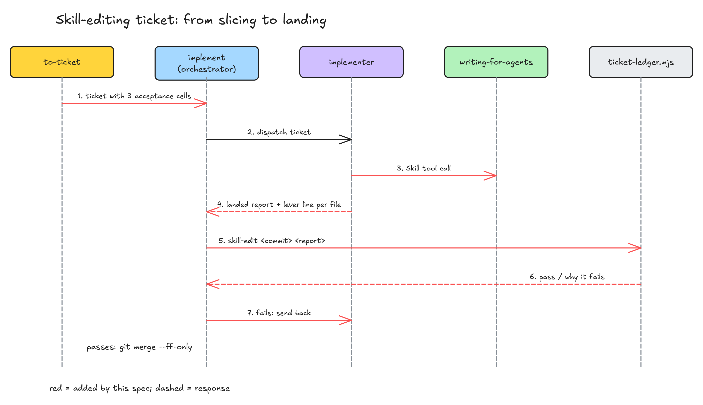

# 改 skill 的工单自带验收格，落地时机械核对

> #311 存在：#304 里改 pr-review 的执行方只读了工单里引的一句规则原文、没调 `writing-for-agents`，交回照样被收下落地；`to-ticket` 现在不给改 skill 的工单加任何专门的验收格（2026-11-14 对着 `origin/main 4af7902` 核）。

## 问题陈述

### 1. 改 skill 的执行方大约一半没用过 `writing-for-agents`

`writing-for-agents` 是插件里管「skill、agent 定义、`AGENTS.md` 怎么写」的 skill：主文件只放每次都走的路、只有部分运行才走到的分支放到指针后面、不为守字数删范围外的句子，等等。

issue 里的统计（2026-11-14 扫本机全部 2058 份子代理记录，挑出用 Edit 或 Write 改过 skill、agent 定义或 skill 参考文件的 111 个；用 Skill 工具调过或读过 `writing-for-agents` 就算用过）：

| 谁改的 | 个数 | 用过 `writing-for-agents` |
|---|---|---|
| 执行方（`idea-loop:implementer`），10-30 之前 | 63 | 17（27%） |
| 执行方，10-30 及以后（加了「先读写法规范」那句之后） | 38 | 19（50%） |
| 通用子代理（派的人在 prompt 里直接点了名） | 10 | 10（100%） |

读过目标仓库 `CODING_STANDARDS.md`、却没顺着它的链接去读 `writing-for-agents` 的执行方有 13 个：执行方定义「开工前」第 5 步要它先读 `CODING_STANDARDS.md`、再在里面找到指向 `writing-for-agents` 的那条链接，要走两跳。

### 2. 没读的交回照样被收下

真实例子：#304（PR 「测试按阶段分层」）的提交 2be5d8e 改了 pr-review 的 `SKILL.md`。执行方交回里写法规范那一行原文是：

> 读了哪几份写法规范 | 读 | 工单里 writing-for-agents 的规则原文（已在工单 C1 一格引用）

它没调 `writing-for-agents`，只读了工单里引的一句。编排者（`idea-loop:implement` 的「核对与落地」）只核提交数、工单号、每格勾没勾，这一行不核，交回被收下落地。同一个 PR 的第 1 轮 review 里，人推翻了执行方为守 5000 字删掉的范围外句子（「人触发的轮次也计入」「上限只约束自动起，不约束人」），批示「先都不压」。

另一个结果：implement 的 `SKILL.md` 正文从 10-14 的 3885 字长到现在 9414 字（2026-11-14 对着 `4af7902` 按 `AGENTS.md` 的量法量），是约 25 个功能提交一段段内联加进去的（#137 的评论）。

### 根因

- 对问题 1：执行方被引到 `writing-for-agents` 要两跳，工单里也没有一格要它调。证据是上表 13 个读了 `CODING_STANDARDS.md` 没读下去的执行方。
- 对问题 2：「核对与落地」对 landed 交回只核提交、工单号和勾选，不核写法规范那一行。证据是 2be5d8e 的交回。
- 修正：issue 原先说 2be5d8e 的交回「没写 `writing-for-agents`」，实际写了这个名字，但方式是「读」、读的是工单里的一句引文。所以机械检查不能只搜这个名字，要核方式是「调」。

## 方案

改完之后：implement 的 `SKILL.md` 正文回到 5000 字以内（只有部分运行才走到的分支挪进它的参考文件）；每张改 skill、agent 定义或 skill 参考文件的工单，验收末尾固定带三格；执行方必须调 `writing-for-agents`、逐个改到的文件写明对的哪条杠杆；编排者落地前跑一条脚本核对，不过就退回执行方。决定它的输入只有一个：这张工单的提交改没改到这类文件。

0. **预重构 implement**：照「实现决策」里「压回上限内」那条把分支挪出主文件，行为不变，排在下面三步之前。
1. **切票（`idea-loop:to-ticket`）**：工单要改这类文件的，验收末尾带三格（格子原文见「实现决策」）。
2. **执行方（`idea-loop:implementer`）**：「开工前」第 5 步直接点名：工单改 skill、agent 定义、skill 参考文件，用 Skill 工具调 `writing-for-agents`，不再经 `CODING_STANDARDS.md` 转一跳。交回的 `verified` 多一种行：每个改到的这类文件一行「杠杆 | <文件> | <对的哪条杠杆>」。
3. **编排者（`idea-loop:implement` 的「核对与落地」）**：landed 的核对里加一项：跑 `ticket-ledger.mjs` 新加的子命令，传提交号和交回文本；提交改到了这类文件、而交回里写法规范那一行不是「调 · writing-for-agents」，或有改到的文件没有对应的杠杆行，就退回执行方（跟现有核对不过同一个处理：SendMessage 退回，第二次不过按 failed）。

「这类文件」的判据（脚本和 to-ticket 共用这一条）：路径以 `SKILL.md` 结尾；或在某个 `skills/` 目录下、以 `.md` 结尾（skill 的参考文件）；或是某个 `agents/` 目录下直接的 `.md` 文件（agent 定义，含 `.claude/agents/`）。工单文件（`docs/spec/*/tickets/`）不算。

同一行为的其他入口：

- **不走工单直接改 skill 的**（issue 会话自己改、`/idea-loop:dreaming` 改文档、retro 批了规则直接改）：排除。没有工单和交回可核；它们的写法由 review 的 Standards 轴审。
- **目标项目里自己的 skill 和 agent**：纳入。判据按路径，不看是哪个仓库。
- **`AGENTS.md` / `CLAUDE.md`**：排除。issue 只点了 skill、agent 定义、skill 参考文件三类；执行方第 5 步照旧会被引到写法规范。

## User Stories

只修问题，每个问题一行期望行为：

1. 改 skill 类文件的执行方，开工时被直接引去调 `writing-for-agents`，工单里有一格要它交代每个文件对的哪条杠杆。
2. 交回没调 `writing-for-agents`、或漏了某个文件的杠杆行，编排者在落地前退回，不收下。2be5d8e 那份交回会被退回。

## 实现决策

- **三格的原文**（to-ticket 照抄进工单验收末尾，依据：issue「要改的地方」，第 2 格见下面「压回上限内」那条）：
  1. 调过 `writing-for-agents`，交回 `verified` 里每个改到的 skill、agent 定义、skill 参考文件一行杠杆。
  2. 改到的 `SKILL.md` 正文按 `AGENTS.md` 的量法在上限内；超了就把只有部分运行才走到的分支挪进这个 skill 的参考文件，不删工单范围以外的句子（见下面一条决定）。
  3. 照执行方定义「改规则的工单：怎么证明 skill 真的变了」选了一种证明并做完：能机械判定的做成检查、先在历史错误上见红；要判断的写回放用例并跑过，大用例写明待跑、由编排者当场跑（#174 落地的跑法）。只改措辞、行为没变的写「不涉及：只改措辞」。
  
  第 3 格只指向执行方定义里已有的那一节，不复述（单一事实来源）。
- **机械检查放进 `ticket-ledger.mjs` 加一个子命令**，不新建脚本：「核对与落地」的 landed 核对已经在调它的 `of` 子命令（依据：`~/.claude/CLAUDE.md`「先扩展已在用的工具」）。输入是提交号和一个装着交回原文的文件，输出不过的原因；纯函数部分（判路径、解析交回）单测。
- **「调」才算**：写法规范那一行方式必须含「调」且名单里有 `writing-for-agents`。依据：issue 第 1 格写的是「调过」，2be5d8e 正是「读」了一句引文。
- **杠杆行逐文件核，不逐处改动核**：issue 写的是「每处改动」，但一处改动在哪、算几处脚本判不了；文件是能核的最细粒度。杠杆的叫法用 `writing-for-agents` 里的词（上下文指针、渐进披露、完成条件、引导词、剪枝等），脚本只核行在、第三栏非空，不核叫法对不对：对不对由 review 判。
- **量法不在这里改**：`AGENTS.md` 的上限从字符改成 token 和行数，issue 写明「跟 #137 一起定」，归 #137。这里第 2 格量什么、量多少，都指向 `AGENTS.md` 的现行量法。

### 改到的 `SKILL.md` 已经超上限：这张工单就压回上限内

第 2 格原文：「改到的 `SKILL.md` 正文按 `AGENTS.md` 的量法在上限内；超了就把只有部分运行才走到的分支挪进这个 skill 的参考文件，不删工单范围以外的句子。」依据：人在本 issue 会话里（2026-11-14）对「超上限时要做到什么」选了「照 issue 原文压回上限」，没选「只要不更超、存量归 #137」。

所以这份 spec 自己也要做：它往 implement 的「核对与落地」加一句，implement 正文现在 9415 字（2026-11-14 对着 `4af7902` 量），要压到 5000 字以内。做法是**预重构**，排在加规则之前：

- 只挪不删：只有部分运行才走到的分支整段挪进 implement 自己的 `references/`，主文件原处留一行指针（写明什么情况去读哪份）。挪的候选（字数是整节，2026-11-14 量）：「没活了就停下」里的「人回复后」「重派」「等 CI」和第 4 步两个分支、`大用例待跑`（3405 字的大部分）、「多个仓库」（566）、「设计变更」（359）、「账本」里会话断了的恢复。每次都走的（前提、开 PR、账本、派工、核对与落地、回收的步骤）留在主文件。
- 别处按节名引用的标题保留：pr-review 引「派工」「核对与落地」「回收」「等 CI」「设计变更」，pr 的 review-loop 参考引「没活了就停下」。整节挪走的，标题留在主文件、下面一行指针，按节名找过来的读者顺着指针读到。
- 原来按文字断言 implement 的文档检查（23 个测试文件提到 implement），断言跟着文字挪到参考文件里；断言的内容不改。

量法照 `AGENTS.md` 现行的（UTF-8 字符，去掉 frontmatter）；改成 token 和行数归 #137（issue 写「跟 #137 一起定」）。

## 测试决策

| 变的是什么 | 仪器 | 本次 |
|---|---|---|
| 纯逻辑、数据转换、状态机 | TDD 单元测试 | 碰到：`ticket-ledger.mjs` 的路径判据、交回解析、不过的原因；implement 正文字数（新加一个文档检查：按 `AGENTS.md` 量法 < 5000） |
| API 契约 | TDD API 测试 | 不涉及 |
| DB schema、迁移、并发与事务语义 | 真 DB 测试 | 不涉及 |
| LLM 输出质量（prompt 改动） | eval | 不涉及回放：三处规则文字都是「必含的格子、字段、核对项」，能机械判定，按执行方定义做成文档检查 |
| 视觉正确性 | UI 实现环 | 不涉及 |
| 端到端用户流程 | 浏览器端到端测试 | 不涉及 |

- **seam**：三个。implement 正文字数检查，抓得到主文件又长回去，漏掉挪得对不对（由 review 对着 writing-for-agents 判）；`ticket-ledger.mjs` 的导出函数（喂路径列表和交回原文，读出不过的原因），抓得到判据和解析错，漏掉编排者会不会真去调它；规则文字的文档检查（读三份文档，断言格子、字段、核对项在），抓得到文字被删，漏掉 agent 照不照做。
- **增量功能测试**：
  - 前置：2be5d8e 的改动文件列表和它的交回原文（取自 #303 会话记录）。步骤：喂给检查。期望：不过，原因是方式只有「读」、pr-review 的 `SKILL.md` 没有杠杆行。覆盖：期望行为 2。
  - 前置：同一提交、交回改成「调 · writing-for-agents」并带 pr-review 的杠杆行。期望：过。覆盖：期望行为 2。
  - 前置：只改了脚本和工单文件的提交。期望：过（不算这类文件）。覆盖：期望行为 2。
  - 文档检查先对着改前的三份文档跑、见红，改完见绿。覆盖：期望行为 1、2。
  - implement 字数检查对着改前的 9415 字见红，预重构后见绿；原有提到 implement 的文档检查全绿（断言跟着挪，内容不改）。
- **照着谁写**：`ticket-ledger.test.mjs`（同一个脚本的单测）、`implementer-standards-doc.test.mjs`（执行方定义的文档检查）。

## Out of scope

- 把 implement 以外超长的 `SKILL.md` 压回上限（wiki-conventions、thumbnail-gen 等）、`AGENTS.md` 改用 token 量、按 #137 的其余写法规则重写 implement（决策历史移出、否定句改正向等）：#137。这里对 implement 只挪分支。
- 核对执行方是不是真的调过 Skill 工具（读子代理记录）：只核交回自报，自报不实由 review 抓。

## 关联

- #137（按写法规则重写插件里的 skill，开着）：它处理已经长了的和量法，这份防止以后再写长。重叠一处：这份先把 implement 的分支挪出主文件（人的决定），#137 之后重写 implement 时在这个基础上做。
- #302（wiki-conventions 超长，开着）：同 #137 的存量，不重叠。
- #174（规则回放的大用例当场跑，已合并，spec `replay-run-large-now`）：第 3 格引它的跑法。
- #303（测试按阶段分层，已合并，spec `test-layering-ci-full`）：2be5d8e 和「先都不压」的出处。
- #161（explorer 定义和 implementer 读 spec 的范围不一致，开着）：同改 `agents/` 下的定义，不同段落，不重叠。
