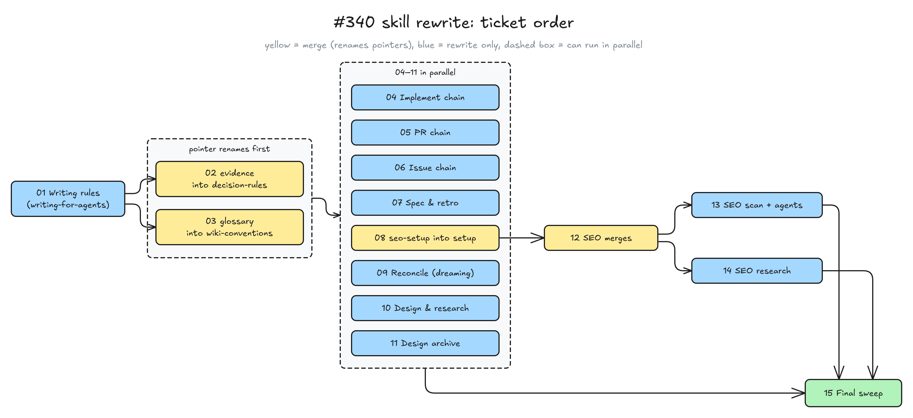

# idea-loop 的 skill 逐份重写与合并

> #340 存在：2026-11-19 对着 `release/idea-loop-0.2.0` 的 `da89648` 量，42 个 SKILL.md 里 16 份主体在 4700–5000 字、加一句就超线，ui-reviewer agent 定义 6767 字；决策历史（日期、人的原话、「依据：」）出现在 27 份文件里；详情在「问题陈述」

## 问题陈述

### 1. 主文件没有余量，新分支只能内联

量法照仓库 `AGENTS.md`（去掉 frontmatter，`LC_ALL=en_US.UTF-8 wc -m`），对着 `da89648`（2026-11-19）：

| 主体字数 | 份数 | 例子 |
|---|---|---|
| > 5000 | 2（都是 agent 定义） | ui-reviewer 6767、pr-reviewer 5241（#339 删） |
| 4700–5000 | 16 | implementer 4999、link-prospecting 4998、setup 4997、issues 4997、seo-outreach 4991、dreaming 4987、seo-setup 4984 |
| < 4700 | 41 | tdd 1250、browser 864 |

issue 里的真实路径：implement 的主体从 10-14 的 3885 字涨到 11-13 的 9589 字，约 25 个功能提交各往主文件里内联一个分支（多仓库 +1724、设计变更 +1092、等 CI +570），#311 才压回 4849。现在 implementer、dreaming 只剩 1、13 字，#339 改它们时只能做等长替换（[[idea-loop-cli]] 的「跟 #340 怎么分」）。

开工前对着集成分支 `e30dcd8a`（#339 合入、main 同步到 #431 之后，2026-11-20）复核：SKILL.md 41 份（#339 删了 `runtime`、`browser`、`seo-check`；main 同步进来 `og`、`cover`）、agent 定义 16 份；主体超过 4500 的 25 份，最紧的是 ui-reviewer 6632、dreaming 4999、seo-setup 4984、link-prospecting 4965、seo-outreach 4957、implementer 4943。

### 2. 主文件里有决策历史和只有部分运行才走到的分支

`grep -cE '20[0-9]{2}-[0-9]{2}-[0-9]{2}|人定|原话|依据：'` 在 59 份文件里有 27 份命中，最多的是 decision-rules 7 处、uiux-imaginer 6、uiux-imagine 6、retro 6、to-spec 5、design-change-sync 5。例：implement 里的「依据：…人定于 2026-10-30：…」。分支的例子：implementer 的「停，还是延后」整节（约 900 字）只在停下或延后的那次才用，dreaming 的「只跑一部分」只在人点名部分运行时才用，都在主文件里。

### 3. 同一条规矩写在几处，命令写在步骤里

- 「PR 从 spec 提交就挂着」`pr` 和 `implement` 各写一遍；implement、pr-review 里转述 `decision-rules`。
- 行内 `gh` / `git` 命令 124 行、54 个文件（[[skills-no-tool-commands]]，对着 main `f300d8f`）；回放里 worker 不带 `gh` 登录，照「`gh issue view <号> --comments`」这一步跑先撞墙。

### 根因

写法规则在 `writing-for-agents` 里，但重写从没逐份做过：每个功能提交只看自己的 diff，主文件的分支结构没人整份看；加东西安全、删东西有风险，于是沉积。挡住它的结构检查是 #341，不在这里。

## 方案

改完：idea-loop 的每份 SKILL.md 和 agent 定义主体都不超过 4500 字；主文件只放每次都走的路，部分运行才走到的分支在指针后面；没有决策历史；共享的规矩只写一处；步骤写要拿到什么，命令只写 `dyna` 和查不到的坑。skill 从 41 个减到 36 个（这里合 5 组），agent 16 个不变（#339 已删 pr-reviewer）。

图是工单的先后：先改规则来源（writing-for-agents），再做两组改指针最多的合并，其余按调用链各自重写，最后整体核一遍。

### 每份文件的重写核对

#340 正文的六条加上并进来的两条（[[skills-no-tool-commands]] 的归类表、[[idea-loop-cli]] 的命令），每份文件逐条过。能机械判的写成工单验收里的一条命令，要判断的由 review 的 Standards 轴对着 `writing-for-agents` 判。

| 核对项 | 改成什么 | 怎么验 |
|---|---|---|
| 只有部分运行才走到的分支移出主文件 | 进这个 skill 自己的 `references/`（idea-loop 每份参考资料归一个 skill），主文件留一行指针，写明什么条件下去读 | review 判；主体字数是机械的那一半 |
| 开头写目标和交付物，每步结尾一句完成条件 | 照 `writing-for-agents`「步骤与完成条件」 | review 判 |
| 没有决策历史 | 日期、人的原话、「当时为什么移到 X」删掉；理由要改变 agent 行为的，留理由本身，不带日期和原话。原话和日期已在 `docs/raw/` 与 ADR 里，没在的靠 git 历史 | `grep -nE '20[0-9]{2}-[0-9]{2}-[0-9]{2}|人定|原话|依据：'` 没有输出（例子里的日期、`captured:` 这类格式说明除外，逐条在交回里写明为什么留） |
| 否定句只用在硬护栏上，后面跟着该做什么 | 照 `writing-for-agents`「引导词」末段 | review 判 |
| 反复出现的长句定义收成一个词 | 先找现成的词；新词只在一份 skill 内定义、不进 `GLOSSARY.md`。要进 `GLOSSARY.md` 的停下问人（`decision-rules` 护栏：术语只由人定） | review 判 |
| 共享的规矩只写一处 | 照下面「规矩的归属」，别处只留指针，不转述 | review 判 |
| 调脚本用命令行的子命令 | 写 `dyna <模块> <命令>`，以插件最低版本那份登记表为准；其余手写的 `git` / `gh` / 静态服务器 / DESIGN.md lint 改成对应命令（[[idea-loop-cli]] 留给 #340 的那部分） | #339 的扫描测试 |
| 不写外部工具的具体命令和次序 | 照 [[skills-no-tool-commands]] 的归类表：目标型只写要拿到什么，约束型写成结果约束，坑留 flag 加理由，适配层不动 | 工单里一次性 `grep -nE '`(gh|git) [a-z]'`，命中的只剩适配层文件和标了「坑」的行；常驻的绊线归 #341 |

主体字数：每份 SKILL.md 和 agent 定义改完都不超过 4500 字（Harold 2026-11-19 选「主体都不超过 4500」），量法照仓库 `AGENTS.md`。参考文件不受这条约束，但重写一份 skill 时它指向的参考一起量、一起剪（`writing-for-agents`「剪枝」）。

### 规矩的归属

重写时碰到的共享规矩，按这张表留在一处，别处只指过去。表外新发现的，在交回的 `found` 里写一行（规矩、出现在哪几处、建议归谁），由编排者在后面的工单里处理。

| 规矩 | 归谁 |
|---|---|
| 依据只认三种、要人定的写成一道题、证据怎么写 | `decision-rules` |
| 知识库落地、项目目录、frontmatter、术语表的收录与格式 | `wiki-conventions` |
| issue 的状态、正文格式、blocked by | `issues` |
| PR 描述、汇报、review loop 文件、PR 从 spec 提交就挂着 | `pr` |
| red → green、什么测试值得留、只在系统边界 mock | `tdd` |
| 运行环境的能力做法 | `dyna runtime show <能力>`（#339） |
| 写法本身（杠杆、量法、命令归类） | `writing-for-agents` |

### 五组合并

| 合并 | 合进 | 原来的去哪 | 调用方式 | 牵动 |
|---|---|---|---|---|
| `evidence` → `decision-rules` | `decision-rules` | 「证据是什么」「整体风格」「配什么图」进正文；`ui-flow.md`、`gif.md` 进 `decision-rules/references/` | 模型可调；整份正文开场注入（Harold：「我其实感觉evidence也是属于在开场注入的」） | 引用 `idea-loop:evidence` 的 20 个文件（skill、agent、README，不含它自己）改指 `decision-rules`；SessionStart 注入的文字是 `decision-rules` 正文，长度从约 1400 字到约 2700 字 |
| `glossary` → `wiki-conventions` | `wiki-conventions` | 收什么、格式、谁能写、怎么读进 `wiki-conventions/references/glossary.md`，主文件一行指针 | 不变 | 4 个文件的引用；`glossary check` 的 hook 不动；description 加「术语表」这个触发词 |
| `seo-brief` → `seo-writing` | `seo-writing` | 写 brief 成为一个分支，进 `seo-writing/references/brief.md` | 不变 | triage 起草 SEO spec 时调 `seo-writing` 的 brief 分支；1 个文件的引用 |
| `seo-setup` → `setup` | `setup` | setup 接完项目后按模块问要不要接（现在只有 SEO 一个模块），答是就走原 seo-setup 的步骤，放 `setup/references/seo/` | 只能人调，不变 | 11 个文件的引用改成 `/idea-loop:setup` 的 SEO 模块；仓库 `AGENTS.md`「调用方式」那一条去掉 `seo-setup` |
| `link-prospecting` → `seo-outreach` | `seo-outreach` | 找候选站点成为一个分支，进 `seo-outreach/references/` | 不变 | 2 个文件的引用；seo 的 README |

不合的（2026-11-18 已定）：`tdd` 与 `implement`、`pr` 与 `pr-review`、`keyword-research` 与 `keyword-clustering`。

`seo-coach` 不合，独立保留、模型可调，照核对表重写；发现没配置时让人跑 `/idea-loop:setup`。这推翻了 2026-11-18 清单里的「`seo-coach` 并进 `seo-setup`」：Harold 2026-11-19 问「coach为什么要合并进入setup？我其实感觉setup全局只有一个，但是setup可以询问用户每个模块是否需要？」，看过 coach 在本机全部转录里被调用 0 次（同期 `seo-brief` 13 次、`seo-writing` 7 次）后选「coach 独立保留」。

合并后 SKILL.md 的 description 照 `writing-for-agents` 的 `SKILL-MECHANICS.md`「调用方式」写：每个分支一个触发词，同义词合并。

### implementer 与 dreaming 怎么腾出余量

| 文件 | 现在 | 移出去的 | 去哪 | 预计 |
|---|---|---|---|---|
| implementer | 4943 | 「停，还是延后」整节和延后、半成品提交的格式（约 900 字）；「输入」里半成品分支、被叫回来两条（约 250 字）；「做」里转述 `tdd` 的一句；「开工前」第 5 步收成一句「改 skill 类文件调 `writing-for-agents`，其余读 `CODING_STANDARDS.md` 链到的写法」 | `implement/references/` 一份「停下与延后」（implementer 已经读 implement 的 `ui-tickets.md`、`rule-tickets.md`，同一处） | 约 3700 |
| dreaming | 4999 | 「只跑一部分」整节（约 500 字）；「回滚」「中间物何时删」「幂等」「推送只有三种情况」（约 600 字） | 「只跑一部分」进 `dreaming/references/partial-runs.md`；后四条并进 `proposal-table.md` | 约 3900 |

implementer 保留定义（钉模型、新上下文、并行、交回机械核对，2026-11-18 已定）；交回的字段格式每次都用、会被机械核对，留在主文件。

### 同一行为的其他入口

- **SKILL.md 正文、skill 的 references、agent 定义**：纳入。
- **SessionStart 注入的 decision-rules 文字**：纳入，随第一组合并改（#339 留给 #340 的）。
- **插件 `README.md`、`skills/seo/README.md`、仓库 `AGENTS.md`**：纳入，跟着合并同步改 skill 清单和调用方式。
- **文档测试（`*-doc.test.mjs`，61 个）**：纳入。一份文件重写时，它的文档测试一起改：守硬规矩的断言跟着内容挪到新位置；钉决策历史或已删措辞的断言删掉；钉命令原文的 12 个改钉结果约束（[[skills-no-tool-commands]]）；钉字数的（`implement-slim`、`implementer-slim`、`pr-review-slim`、`design-modeling-slim`）线改成 4500。
- **hook**：排除。`hooks.json` 由 #339 改成 `dyna … --hook`，这里不碰。
- **evals 用例**：排除，回放用例照真实会话原样记。
- **`docs/`（spec、ADR、raw）**：排除，是当时的记录。

## User Stories

只修问题，不加能力：

1. 期望行为（对应问题 1）：给任何一份 skill 或 agent 定义加一个新分支时，主体还有至少 500 字余量，不用先删别的句子；新分支按指针放进 references。
2. 期望行为（对应问题 2）：agent 读主文件只读到每次都走的步骤和完成条件，不读到日期、人的原话和只在部分运行才用的分支。
3. 期望行为（对应问题 3）：一条共享规矩改一处就全插件生效；回放 worker、magi 会话、没有 `gh` 登录时照 skill 做不卡在某条命令上。

## 实现决策

- **基准分支**：`release/idea-loop-0.2.0`。工单从集成分支 `e30dcd8a` 起做（#339 已合入，main 已同步到 #431）；#339 删的 3 个 skill、1 个 agent 和它改成 `dyna` 的命令以那时的样子为准；main 同步进来的改动（设计收敛改由人定、pr-review 最多 5 轮、夜间模式、`og` / `cover`）是重写的输入，行为照留。
- **一个 PR**：全部工单落在 `issue/340-skill-rewrite` 一条分支、一个 PR，开到集成分支。#356 跟这个 PR 一起关。
- **工单与顺序**（每张写明改哪些文件；Blocked by 照下表）：

  | 工单 | 改的文件 | Blocked by |
  |---|---|---|
  | 01 写法规则 | `writing-for-agents`（加 [[skills-no-tool-commands]] 的归类、本 spec 的核对表与 4500 线；它自己 4675 也压到 4500 内） | — |
  | 02 decision-rules ← evidence | `decision-rules`、`evidence`；引用 evidence 的 20 个文件只改指针；SessionStart 注入文字 | 01 |
  | 03 wiki-conventions ← glossary | `wiki-conventions`、`glossary`；4 个引用 | 01 |
  | 04 实现链 | `implement`、`tdd`、`to-ticket`、`ui-measure`、implementer、explorer | 02、03 |
  | 05 PR 链 | `pr`、`pr-review` | 02、03 |
  | 06 issue 链 | `issues`、`issue-session`、`issue-dispatch`、`issue-triage`、issue-triager | 02、03 |
  | 07 起草与复盘 | `to-spec`、`grill`、`retro`、`agent-builder` | 02、03 |
  | 08 setup ← seo-setup | `setup`、`seo-setup`；11 个引用；仓库 `AGENTS.md` | 02、03 |
  | 09 对账 | `dreaming`、adr-reconciler、design-steward | 02、03 |
  | 10 设计发散与调研 | `uiux-imagine`、`uiux-refine`、`uiux-research`、`design-change-sync`、uiux-imaginer、designer、uiux-researcher、ui-master、results-analyst | 02、03 |
  | 11 设计档案 | `design-archive`、`design-modeling`、ui-reviewer（6767 → ≤4500） | 02、03 |
  | 12 SEO 合并 | `seo-writing` ← `seo-brief`、`seo-outreach` ← `link-prospecting`、`seo-coach` | 08 |
  | 13 SEO 扫描 | `seo-scan`、backlink-analyst、geo-analyst、keyword-miner、page-optimizer、technical-auditor | 12 |
  | 14 SEO 研究与出图 | `seo-audit`、`competitor-analysis`、`keyword-research`、`keyword-clustering`、`seo-geo`、`og`、`cover` | 12 |
  | 15 整体核对 | 不改 skill：全插件跑一遍核对表里能机械判的几条、全部测试，README 与 skill 目录对得上 | 04–14 |

  依据：01 是规则来源，后面每张都照它；02、03 改的指针遍布全插件，先做完后面的工单才不跟它们抢同一批文件；08 先把 SEO 的配置挪进 setup，12 里 coach 才能指向它；13、14 引用 12 合并后的名字。04–11 之间、13 与 14 之间改的文件不相交，可以并行。
- **每张工单的验收**都带这几格：改到的每份文件主体 ≤4500（贴改前改后字数）；决策历史的 grep 没有输出或逐条说明；行内命令的 grep 只剩适配层和坑；改到的文件对应的文档测试绿；交回的「杠杆」一行写清每份文件对的是核对表哪几条。
- **合并的 skill 删除**：被合并的目录整个删掉，不留重定向的空 skill；0.2.0 一次发布（依据：#333 定的「只认 home、不留中间状态」，#339 同样不留旧路径）。
- **开会话统一成一条命令**（Harold 2026-11-20 在 PR #432 定，落成 19 号工单）：调度交出 issue 时开会话，桌面端与 magi 都调 `dyna runtime handoff`，环境差别收进命令；侧边栏分组、定时任务、会话收尾这些 dyna 包不了的（桌面端只有模型能调的 MCP 工具，官方命令行没有对应命令），留在各自的工作环境说明里开场注入。cmux 暂不纳入。
- **跟 #341 的分界**：#340 不加常驻的检查，验收里的 grep 只在工单里跑一次。#341 加以后每个改 skill 的 PR 都跑的结构检查：`spec check` 要求「杠杆诊断」一节、报主文件增长、retro 先判能不能做成检查、[[skills-no-tool-commands]] 的行内命令绊线；用一个通用的字数检查替掉四个逐份写的字数测试时，线照这里的 4500。
- **已知限制**：
  - 重写只看文字，不跑 eval（`AGENTS.md` §5：skill 输出主观，跳过 quantitative eval）；改规则的工单照 `implement` 的 `rule-tickets.md` 判要不要回放。
  - 04–14 并行时，编排者落地顺序不同，指针改名都在 02、03、08、12 里先做完，所以并行的几张不会同时改同一处指针。

## 测试决策

| 变的是什么 | 仪器 | 本次 |
|---|---|---|
| 纯逻辑、数据转换、状态机 | TDD 单元测试 | 不涉及：不改脚本和命令行 |
| API 契约（路由、schema、序列化） | TDD API 测试 | 不涉及 |
| DB schema、迁移、并发与事务语义 | 真 DB 测试 | 不涉及 |
| LLM 输出质量（prompt 改动） | eval（确定性断言） | 碰到，改的是全部 skill 与 agent 定义的文字；不加 eval（`AGENTS.md` §5）。改了硬规矩位置的，由改写后的文档测试钉住新位置 |
| 视觉正确性 | UI 实现环 | 不涉及 |
| 端到端用户流程 | 浏览器端到端测试 | 不涉及 |

- **seam**：一个，插件的文档树（`skills/`、`agents/`、README）。文档测试和工单里的 grep 都从这里读；能抓到字数、决策历史、行内命令、死掉的 skill 引用，漏掉的是分支有没有真的挪对、完成条件写得锐不锐，那部分交给 review。
- **增量功能测试**：
  1. 前置：15 号工单之前全部落地。步骤：对 `skills/*/*/SKILL.md` 和 `agents/*.md` 逐份按 `AGENTS.md` 的量法量主体。期望：每份 ≤4500。覆盖：期望行为 1。
  2. 步骤：在 `skills/`、`agents/` 下 `grep -rnE 'idea-loop:(evidence|glossary|seo-brief|seo-setup|link-prospecting|runtime|browser|seo-check)\b'`。期望：没有输出（`/idea-loop:setup` 的 SEO 模块不算）。覆盖：期望行为 3。
  3. 步骤：决策历史的 grep。期望：没有输出，或剩下的每处在 15 号工单的交回里有一行理由。覆盖：期望行为 2。
  4. 步骤：开一个新会话。期望：开场注入里有 decision-rules 的「依据只认三种」和「证据是什么」两节。覆盖：期望行为 3。
  5. 步骤：在 `idea-loop/` 下跑全部测试。期望：全绿；行内命令的 grep 只命中适配层文件和标了「坑」的行。覆盖：期望行为 3。
- **照着谁写**：文档测试照现有的 `implement-slim-doc.test.mjs`（字数）、`decision-evidence-principles-doc.test.mjs`（钉一条规矩的位置）。

## Out of scope

- 常驻的结构检查（字数增长、杠杆诊断、行内命令绊线）：#341。
- 命令行本身、全路径调用改成 `dyna`、删 runtime / browser / seo-check / pr-reviewer：#339。
- 知识库迁移：#247。
- 改任何 skill 的行为：这里只改写法和位置；重写中发现行为本身有问题的，照 `issues` 的「开一个 issue」开出去。

## 关联

- 决定记录：[[340]]（本会话 Harold 定的四题）；父会话 2026-11-18 的合并清单见 [[idea-loop-cli]] 的关联与决定记录 [[339]]。
- [[idea-loop-cli]]（#339，todo，实现会话在跑）：先于本 issue；它删 3 个 skill、1 个 agent，改全路径调用；分工照它的「跟 #340 怎么分」，没有重叠。
- [[skills-no-tool-commands]]（#356，blocked by #340）：归类表是本 spec 核对表的一条，在同一遍里做；#356 随本 PR 关。
- #341（结构检查，triage）：在本 issue 之后，分界见「实现决策」。
- #247（迁移，todo）：最后做，不碰 skill 文字，没有重叠。
- [[skill-body-limit-backlog]]（#137）、[[wiki-conventions-slim]]：之前两次单份压字数，本 spec 是全量的一遍。
- 四个子 issue 都被父 issue #331 挡着。
