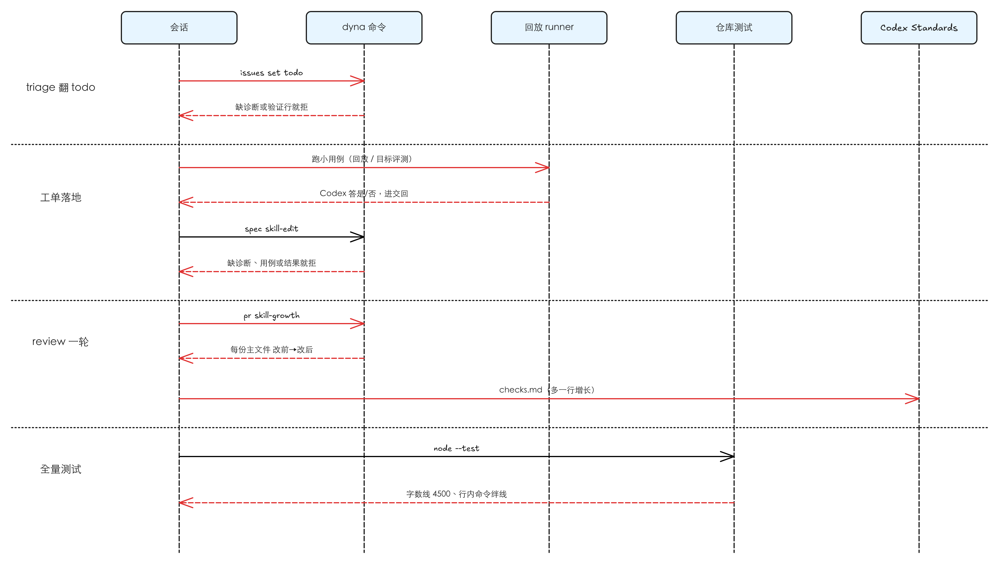

# 改 skill 的结构检查

> #341 存在：2026-11-20 对着 `release/idea-loop-0.2.0` 的 `e30dcd8a` 查，30 份 spec 里只有 1 份有「杠杆诊断」一节；57 份 idea-loop 主文件只有 4 份有字数测试；31 份 spec 里 15 份把「LLM 输出质量」标成不涉及，改了 skill 有没有生效没人必须验，详情在「问题陈述」

## 问题陈述

### 1. 改 skill 的 spec 跳过杠杆诊断，没有东西拦

`to-spec` 第 3 步写着：改给 agent 读的文档时，先调 `writing-for-agents` 逐条杠杆下诊断，「方案」从诊断推出。这一步只靠起草的人记得。

真实例子：#303（测试按阶段分层）的 spec `test-layering-ci-full`，它的 PR #304（合并提交 `c47cc097`）改了 `implement`、`pr-review` 的 SKILL.md 和 implementer agent 定义，可 spec 全文一次「杠杆」都没出现。#304 第 1 轮 review 时，它靠删句子凑字数被打回（S2）。

量的结果（集成分支 `e30dcd8a`，2026-11-20）：`docs/spec/` 下 30 份 spec 里，有 25 份提到 skill 或 agent 定义的路径，其中只有 `skill-body-limit-backlog` 一份带「杠杆诊断」小节。

### 2. 字数只有 4 份逐份写的测试，增长没人看见

主体字数（量法照仓库 `AGENTS.md`）只有 `implement`、`implementer`、`pr-review`、`design-modeling` 四份有测试（`*-slim-doc.test.mjs`），每份各写一遍上限；其余 53 份没人量。`e30dcd8a` 上 idea-loop 有 26 份主文件超过 4500 字，1 份超过 5000。

没有测试时，增长谁也看不见：`implement` 的主体从 10-14 的 3885 字涨到 11-13 的 9589 字，中间约 25 个功能提交每次往主文件里内联一个分支，单看哪个 diff 都合理（[[skill-rewrite]]「问题陈述」1）。有测试的几份又是另一种问题：测试只有一条线，过线就红，于是逼出删句子的修法（#304 第 1 轮 S2）。review 时没人报「这个 PR 让主文件多了多少字」，审查者看不出该不该把新内容挪到指针后面。

### 3. 行内 `gh` / `git` 命令清一次还会长回来

[[skills-no-tool-commands]] 量过：对着 main `f300d8f`，54 个文件里有 124 行行内 `gh` / `git` 命令。#340 会逐份清一遍（它的核对表最后一行），可是清完之后，新写进来的命令没人拦。

### 4. retro 把能做成检查的纠正写成文字

`retro` 的落点表（第 3 节）写了「能机械判定 → 优先做成检查」，但没说做成检查后原来那段文字怎么办，候选的「新文」照样往 skill 里加一段。人在 #137 的第二条 idea-loop 评论里给的方向是：反复出现的纠正做成检查，文字删掉。

### 5. 改了 skill，有没有生效没人必须验

现在验证 skill 行为的手段只有一种：retro 回放（`idea-loop/evals/retro/`）。它拿一个历史决策点（当时的提交，加人那时让 skill 产出东西的那句话），用改前、改后的插件各跑一遍，由 Codex 回答一道是/否题；改前「否」、改后「是」，才算这段规则真的让 skill 变了。现有 15 个用例，13 个小、2 个大，全部出自 retro 候选。

它有两个缺口：

- **跑不跑靠各自判。** 对着 `e30dcd8a` 查，31 份 spec 的「测试决策」里，「LLM 输出质量」那一行有 15 份写「不涉及」。其中不少明明改了 skill 文字，理由是「skill 文字改动不走 eval」（例如 `dispatch-day-night-modes`、`home-bootstrap`）；提到回放的只有 8 份，还包括写「不做回放」的。依据是仓库 `AGENTS.md` §5：skill 输出主观，跳过 quantitative eval，只留两个例外。
- **新能力没法验。** 回放用例必须有人当时的原话（`cases.mjs` 的 `quote` 字段），只能判一个出过错的点。新加的能力没有历史错误可以回放，产出达没达到 spec 想要的目标，只能写「判不了」。

人在本会话（2026-11-20）给的方向：skill 的评测分两类，一类看 skill 的输出，由 Codex 判有没有实现预期目标；一类对着对应的用例，看有这一段和没这一段有没有区别。

### 根因

写法规则（`writing-for-agents`、`AGENTS.md` 的字数线、[[skills-no-tool-commands]] 的归类表）都写下来了，可是没有一处是自动执行的：杠杆诊断靠起草人记得，字数靠逐份补测试，命令靠 #340 清一次，评测靠工单自己判要不要跑。规则在，结构没跟上，skill 就会长回去（#137 第二条评论「为什么原则在，还是长成这样」）。

## 杠杆诊断

这份 spec 改五处给 agent 读的文字：`to-spec`、`to-ticket`、`implement` 的 `references/rule-tickets.md`、`retro`、`pr-review` 的「跑一轮」参考。另外改仓库 `AGENTS.md` §5。其余全是检查（`dyna` 命令、回放 runner、仓库测试）。

**to-spec**：调用方是 `issue-session` 的 triage / todo 会话，以及人；每次都读「过程」和 `<spec-template>`。

- **步骤与完成条件**：第 3 步要求「逐条杠杆下诊断」，可是诊断不落在 spec 的哪个地方，所以完成与否没法核。改成：模板里固定有「杠杆诊断」一节，每处改动带一行「验证：」（格式见「实现决策」），不涉及就写「不涉及」。第 3 步的完成条件就是这一节写好了。命令靠这一节判，跟「前端交互」是同一种做法。
- **信息层级**：模板只多一节，每份 spec 都要写，所以内联在模板里，不进参考文件。「测试决策」表里「LLM 输出质量」那一行改成指向这一节，不再各写一遍。
- 验证：目标评测，新用例 `to-spec-verification-lines`（期望行为 1、5）：给一个改 skill 的 issue 起草 spec，问「杠杆诊断里每处改动都有一行验证，写的是五种之一」。

**to-ticket 与 `rule-tickets.md`**：调用方是 triage 之后的切票（to-ticket）和 implementer（只在做改规则的工单时读 `rule-tickets.md`）。

- **上下文指针**：`rule-tickets.md` 现在自己按「能机械判 / 要判断」选验证方式，跟 spec 的诊断是两处判断。改成：照 spec「杠杆诊断」里这处改动写的那行验证做，`rule-tickets.md` 只写每种验证怎么做（多一种目标评测）。to-ticket 把那一行原样抄进工单的验收。
- 验证：回放，现有用例 `to-ticket-walk-request-chain` 照旧过（改前改后都该答「是」，证明没改坏）；加的抄写一步由文档测试钉住。

**retro**：调用方是 `issue-session` 的「收尾」，以及人说「retro 一下」；每次都读第 3 节「候选的形状」。

- **引导词**：落点表里「能机械判定」排在第三行，跟另外两行并列。改成第一步先判「能不能做成检查」，能做成的，「新文」写删掉原来的文字。用正向写法：写出目标行为，不写「不要加文字」。
- 验证：目标评测，新用例 `retro-check-first`（期望行为 4）：拿一场有一条可机械判定的纠正的会话跑 retro，问「这条候选的落点是检查、新文是删除」。

**pr-review 的 `references/run-a-round.md`**：只有跑一轮的时候读，在「机械检查」一节。

- **步骤与完成条件**：机械检查的命令清单多一条主文件增长报告，结果原样交给 Standards 进程，跟现在的几条检查一样。不加新步骤。
- 验证：检查，文档测试钉住清单里有这条命令。

**仓库 `AGENTS.md` §5**：读者是在这个仓库里改 plugin 的 agent。

- **引导词**：§5 现在开头是「跳过 quantitative eval」，再列两个例外，所以改 skill 的人读到的第一句是「不用验」。改成先写「改 skill、agent 定义，在 spec 的杠杆诊断里写怎么验；回放与目标评测是常规手段」，`uiux-research` 的标注基线照旧作为唯一例外留着。
- 验证：不改行为，是给人和 agent 读的规矩；落地的护栏（「方案」第二条）才是执行它的地方。

## 方案

改完，每个改 skill 的改动在三个点被自动核：spec 翻 todo 时、工单落地时、review 跑一轮时。没人记得也照样核。每处改动必须交代怎么验：要么有一个会变红的东西（检查、回放、目标评测），要么明写不改行为或判不了的原因。另外加一个仓库测试，全量测试一跑就量全部主文件、扫行内命令。

两类评测都长在现有的回放 runner 上，不另做一套：

| | 回放（已有） | 目标评测（新加） |
|---|---|---|
| 问的是 | 有这一段和没这一段，结果有没有区别 | 改后的 skill 产出，有没有达到 spec 想要的目标 |
| 跑几遍 | 改前、改后插件各一遍 | 只跑改后插件一遍 |
| 是/否题从哪来 | 人当时的原话（`quote`），或 spec 的一条期望行为 | spec 的一条期望行为 |
| 算过 | 改前答「否」、改后答「是」；改前就「是」说明用例没抓住问题 | 改后答「是」 |
| 都要 | 改后那遍真的读到了改动的文件（runner 现有的 `exercised` 核对）；Codex 判、人可推翻记在 `annotations.md` | 同左 |

图里五方：会话（照 skill 做的主会话或子代理）、`dyna` 命令、回放 runner、仓库测试、Codex 的 Standards 进程。红色的是新增或改动的。

| 检查 | 触发点 | 结果 | 范围 |
|---|---|---|---|
| spec 有「杠杆诊断」一节；不是「不涉及」的，至少有一行「验证：」且每行是五种之一 | triage 翻 todo（`dyna issues set todo`） | 没有就拒绝翻，说出该补哪一节、哪一行 | 每份 spec |
| 改了 skill 的工单，诊断不能写「不涉及」；工单写的回放或目标评测用例要在、要有结果 | 工单落地（`dyna spec skill-edit`，implement 落地时已经在跑） | 提交改了 skill 或 agent 定义、spec 却写「不涉及」或缺这一节，拒绝；工单写的小用例不在仓库里、格式不过，或交回里没有它的结果，拒绝；大用例交回写「大用例待跑」就放行 | 每个项目 |
| 回放与目标评测 | 工单落地前，implementer 当场跑小用例；大用例在 PR 开出后由编排者跑（现有做法） | Codex 判是/否题，结果进交回 | 用例在 harold-skills 的 `idea-loop/evals/retro/` |
| 主文件增长报告 | review 跑一轮的机械检查（新命令 `dyna pr skill-growth <base-ref>`） | 只报事实：每份变了的 SKILL.md 或 agent 定义，改前多少字、改后多少字、差多少；退出 0，由审查者判这次增长是不是该挪到指针后面的分支 | 每个项目 |
| 主体字数线 4500 | 仓库全量测试 | 任何一份 idea-loop 的 SKILL.md 或 agent 定义主体超过 4500 字就红，报文件和字数 | 只管 harold-skills 的 idea-loop |
| 行内 `gh` / `git` 绊线 | 仓库全量测试 | `skills/`、`agents/` 里写了行内 `gh` / `git` 命令就红，报文件和行号；适配层文件，以及标了「坑」的行放行 | 只管 harold-skills 的 idea-loop |

触发点照 [[idea-loop-cli]] 定下的原则：lint 只由自动触发器跑，skill 不调 lint；要等一组改动做完才能判的检查，放进落地命令当护栏。「杠杆诊断」要等 spec 写完才能判，所以不做成写文件时的 hook，放在翻 todo、工单落地这两个落地命令里。增长报告不判对错，只是给 review 的输入，跟现有的 `dyna pr diagnostics filter` 同一类。

一个真实例子：#303 的 spec 如果放在今天，triage 翻 todo 时会被拒：「spec 里没有『杠杆诊断』一节：改了给 agent 读的文档，就逐条杠杆下诊断、每处写一行验证；不涉及写『不涉及』」。补上诊断，`implement` 那处改动写「验证：目标评测 `implement-runs-touched-tests`（期望行为 1）」，问「执行方只跑了改动涉及的测试，全量留给 CI」。第一张工单落地时，用例在、交回里有「目标评测 implement-runs-touched-tests：是，$1.8」，放行；交回里没有这一行，拒绝并提示先跑用例。review 跑一轮时，机械检查里多一行：`implement/SKILL.md 3885 → 4310（+425）`。

同一行为的其他入口：

- **todo 会话自己起草的 spec**（不经过 triage 翻 todo）：纳入，但只在工单落地时核（第二条）。已知限制：这类 spec 如果改 skill 又没写诊断，要等第一张工单落地才被拦。
- **`dyna spec check`**：排除。它扫全部 spec，现有 30 份都没有这一节，加进去会对每份旧 spec 永远报问题。issue 里写的「`spec check` 拒绝」改由翻 todo 时核那一份 spec 来做。
- **`AGENTS.md` / `CLAUDE.md`**：排除在落地核对和增长报告之外。路径规则沿用 `spec skill-edit` 现有的那条（`SKILL.md`、`skills/` 下的 `.md`、`agents/` 下直接的 `.md`），让两处认的「这类文件」是同一个集合。spec 的诊断仍然覆盖它们（`to-spec` 第 3 步本来就点了名）。
- **其他插件的 SKILL.md**（`content-creator/thumbnail-gen` 15224 字、`happy-life/daily-coffee-oracle` 13064 字）：排除，因为 issue 只管 idea-loop；[[skill-body-limit-backlog]] 已经定过这两份留作已知存量（2026-11-16 人定只改 idea-loop）。
- **字数的棘轮**（11-16 issue 评论：全部 SKILL.md 都量，只要求不再变长）：被 4500 的线取代。棘轮是为了不逼当时超过 5000 的文件压回去；#340 做完之后每份都在 4500 以内，[[skill-rewrite]] 写明「#341 用一个通用的字数检查替掉四个逐份写的字数测试时，线照这里的 4500」。这条线以下的增长交给增长报告，由审查者判，不再靠红灯。

## User Stories

只修问题，不加能力：

1. 期望行为（对应问题 1）：改 skill 的 spec 没写杠杆诊断，翻 todo 时被拦，提示说出补哪一节；改了 skill 的工单，spec 的诊断写「不涉及」，落地时被拦。
2. 期望行为（对应问题 2）：任何一份 idea-loop 主文件超过 4500 字，全量测试就红；review 的机械检查列出这个 PR 让哪几份主文件变长了、各多少字。
3. 期望行为（对应问题 3）：有人往 skill 或 agent 定义里写了行内 `gh` / `git` 命令，全量测试就红，并报出文件和行号。
4. 期望行为（对应问题 4）：retro 遇到能机械判定的纠正，候选的落点是检查，「新文」是删掉原来的文字。
5. 期望行为（对应问题 5）：改 skill 的每处改动在 spec 里写明怎么验；写了回放或目标评测的，用例在仓库里、跑过、结果在交回里，否则工单落不了地。新加的能力能用目标评测验，不再只能写「判不了」。

## 实现决策

- **基准分支与起点**：`release/idea-loop-0.2.0`。等 #340 的 PR 合进集成分支之后再开始做：`to-spec`、`retro`、`pr-review`、四个 slim 测试、`writing-for-agents` 都会被 #340 重写，这里改的是重写之后的样子。一条分支、一个 PR，开到集成分支。
- **「杠杆诊断」这一节**（人 2026-11-20 选「每份 spec 都写」）：`to-spec` 的模板在「问题陈述」与「方案」之间固定加 `## 杠杆诊断`。改给 agent 读的文档时，逐份写调用方、各读哪几块、每条改动对哪条杠杆；不改的写一行「不涉及：不改给 agent 读的文档」。怎么判「不涉及」，跟「前端交互」用同一条规则（这一节以「不涉及」开头）。理由：从正文猜一份 spec 改不改 skill 不可靠。回测对着 `e30dcd8a` 的 30 份 spec 漏判 7 份（例如 `dispatch-day-night-modes` 只写裸名 `issue-dispatch`），对着 TOFEL-demo 的 16 份误判 5 份（`motion-reduce:animate-none`、`node:test` 也被当成 skill 引用）。
- **翻 todo 的护栏**：`dyna issues set todo` 在 triage → todo 的前提里加一条，放在「等人定的」「冻结摘要」两条旁边：spec 没有「杠杆诊断」一节，或不是「不涉及」却没有一行「验证：」、有一行不在五种之内，就拒绝。只核这一次要翻的 issue 覆盖的那份 spec，旧 spec 不受影响。
- **落地的护栏**：`dyna spec skill-edit <commit> <交回文件>` 已经会算出这个提交改到哪些 skill 文件，并核交回文件。新加一条：改到的文件里有 SKILL.md 或 agent 定义时，通过提交的 Ticket 行找到工单所在的 spec，它的「杠杆诊断」缺失或写「不涉及」就拒绝，报错说出 spec 路径和下一步（补诊断再落地）。用例与结果的核对见「落地时核用例」。只改 skill 参考文件的提交也算在内，因为路径规则不变。
- **「验证：」一行的格式**（人 2026-11-20 定「评测并进 #341」）：「杠杆诊断」里每处改动下一行，五种之一：
  - `验证：检查 <测试文件或 dyna 命令>`：能机械判的，照 `rule-tickets.md` 先在历史错误上看它红。
  - `验证：回放 <用例>`：有这一段和没这一段该有区别的。用例可以是已有的，也可以新写。
  - `验证：目标评测 <用例>（期望行为 <编号>）`：新能力，或改前没有可对比的错误。
  - `验证：不改行为：<理由>`：只挪位置、改措辞、改给人看的文字，由文档测试钉位置。
  - `验证：判不了：<原因>`：上面都做不到的，原因要具体，由 review 的 Standards 轴判原因成不成立。
  
  翻 todo 的护栏只核每行在这五种里、用例名合法；落地的护栏核用例与结果（下一条）。
- **落地时核用例**：`dyna spec skill-edit` 从工单的验收里读出它要跑的回放和目标评测用例：用例目录要在这个提交的树里、`case.json` 过格式校验；小用例要在交回的 `verified` 里有一行「<回放|目标评测> <用例>：<结果>」，结果是「过」才放行，人推翻过的以 `annotations.md` 为准；大用例写「大用例待跑：<用例>」放行，由编排者在 PR 开出后跑（现有做法）。只核 harold-skills 仓库：用例目录不在这个仓库里的项目，落地不核用例，只核诊断不是「不涉及」。
- **目标评测用例**：`case.json` 加一个 `kind` 字段，`replay`（默认，现有 15 个用例不用改）或 `goal`。`goal` 用例不要 `quote`，改要 `story`：spec 的 slug 加期望行为编号，是/否题照那一条写。回放用例的题也可以从 `story` 来（新规则还没有人的原话时），`quote` 与 `story` 二选一。runner 遇到 `goal` 只跑改后插件一遍，评委只答改后那份；`exercised` 核对、Codex 评委与回退到 Claude、`annotations.md` 推翻都照现有的。prompt 不许露出「这是测试」的词，跟现有规则一样。
- **评测花费**：小用例当场跑，一个约 1 到 3.5 美元（回放两遍加一次判定；目标评测一遍加一次判定，约一半）；跑之前在交回里写预计花多少（现有做法）。大用例照旧在 PR 开出后跑。不设每个 PR 的上限，花费写进交回和 PR 描述，由人看。
- **仓库 `AGENTS.md` §5**：改写成「改 skill、agent 定义，在 spec 的杠杆诊断里写怎么验；回放与目标评测是常规手段，用例与 runner 在 `idea-loop/evals/retro/`」。原来的第二个例外（retro 回放）并进正文，`uiux-research` 的标注基线留作唯一例外。
- **增长报告**：新命令 `dyna pr skill-growth <base-ref>`，调用方是会话。对 `<base-ref>...HEAD` 里变了的每份 SKILL.md 和 agent 定义（路径规则同上，参考文件不算主文件），按 `AGENTS.md` 的量法输出改前、改后、差值；新增的文件改前记 0，删掉的改后记 0；没有变的不列。永远退出 0。`pr-review` 的 `references/run-a-round.md`「机械检查」列上它，结果原样进 `checks.md`。
- **字数线**：仓库加一个测试，量 `idea-loop/skills/**/SKILL.md` 和 `idea-loop/agents/*.md` 的主体，线是 4500，只写在这一处。四个 `*-slim-doc.test.mjs` 里量字数的断言删掉，其余断言（某节在不在、指针对不对）留着。`dyna test skill-doc` 里「主体不到 5000 字」那一条去掉，只保留小节指针的核对，免得同一条线有两个来源。仓库 `AGENTS.md`「要点」和 `REVIEW.md`「额外要求」里写 idea-loop 字数线的地方指向这个测试；其他插件仍按 `AGENTS.md` 的 < 5000。
- **行内命令绊线**：照 [[skills-no-tool-commands]]「方案」的最后一段，以及 `no-project-leak.test.mjs`、`runtime-tripwire.test.mjs` 的写法：扫 `idea-loop/skills/`、`idea-loop/agents/` 的 `.md` 里行内代码开头是 `gh <子命令>` 或 `git <子命令>` 的地方。放行两类：一是适配层文件（issues 的 GitHub 参考、setup 写进目标仓库的 issue-tracker 模板与前置检查表；具体文件以 #340 合并后的树为准，测试里逐个列出并写明理由）；二是同一行带「坑」字的行。frontmatter 的 `allowed-tools` 行也放行，跟 runtime 绊线一样。`dyna …` 不在扫描范围，归登记表的扫描测试管。
- **retro**：第 3 节先判「能不能机械判定」。能判的，落点是检查（`dyna` 的护栏或仓库测试），「旧文 / 新文」写成删掉那段文字（或收成一句指向检查报错的话），「验证」写检查的名字并在历史错误上看它红（现有写法）。不能判的再按问题出在哪选落点。
- **版本**：改了 `dyna/` 就照 `DEVELOPMENT.md`「命令行 dyna」升 dyna 版本、存登记表；`pr-review` 开始写 `dyna pr skill-growth`，插件的 `dyna-version` 下限要提到那一版。登记表扫描测试会钉住顺序：那一版必须已经发布，提了下限的 skill 改动才能合。发不发、什么时候发由人定（0.0.4 还没发，父会话的推荐是 0.2.0 收尾时一起发）。插件 `plugin.json` 升 minor：翻 todo 和工单落地会多拒绝一种情况，是流程行为的改动。
- **已知限制**：
  - todo 会话自己起草的 spec 只在落地时核（见「方案」）。
  - 字数线和绊线只管 harold-skills 的 idea-loop。目标项目自己的 skill 只有增长报告和杠杆诊断两道。
  - 增长报告不判对错，增长该不该挪走靠 review 的 Standards 轴判。
  - 评委是 Codex，判得准不准没有自动核，靠人在 `annotations.md` 推翻（现有做法）；runner 的 `exercised` 只证明改后那遍读到了改动，不证明它照着做了。
  - 「判不了」「不改行为」两种写法机械上都能过，成不成立靠 review 判。这是故意留的口子：硬要每处都配用例，会逼出凑数的用例。
  - 目标项目自己的 skill 没有用例目录，落地只核诊断，不核用例。

## 测试决策

| 变的是什么 | 仪器 | 本次 |
|---|---|---|
| 纯逻辑、数据转换、状态机 | TDD 单元测试 | 碰到（`go test`）：翻 todo 前提多一条、`spec skill-edit` 的新规则、`pr skill-growth` 的计算（新增、删除、没变、参考文件不算） |
| API 契约（路由、schema、序列化） | TDD API 测试 | 碰到：`pr skill-growth` 的输出形状、登记表多一条命令（登记表测试守着）；`case.json` 的 `kind` / `story` 字段（`cases.mjs` 的格式校验测试） |
| DB schema、迁移、并发与事务语义 | 真 DB 测试 | 不涉及 |
| LLM 输出质量（prompt 改动） | eval（确定性断言） | 碰到：每处改动怎么验写在「杠杆诊断」的「验证：」行。新写两个目标评测用例 `to-spec-verification-lines`、`retro-check-first`；`to-ticket-walk-request-chain` 回放照旧要过；其余由文档测试钉位置 |
| 视觉正确性 | UI 实现环 | 不涉及 |
| 端到端用户流程 | 浏览器端到端测试 | 不涉及 |

- **seam**：三个。
  - 回放 runner（测试用现有的假评委与 `RETRO_JUDGE_ORDER`，照 `retro-replay.test.mjs`）：能抓到 `goal` 用例跑了两遍、评委答错了那份、`exercised` 没核；漏掉的是真 Codex 判得准不准，那部分靠人在 `annotations.md` 推翻。
  - `dyna` 命令本身（测试起子进程调编出来的二进制，读输出和退出码，照现有各模块的 `cmd_test.go`）：能抓到护栏判错、报告算错、报错里没有下一步；漏掉的是 skill 有没有真的在那个时候调它。
  - 插件文档树（仓库测试读 `skills/`、`agents/` 的文本）：能抓到超线、行内命令、模板缺节；漏掉的是诊断写得对不对，那部分交给 review。
- **增量功能测试**：
  1. 前置：一份没有「杠杆诊断」一节的 spec，`issues:` 列着一个 triage 状态的 issue。步骤：`dyna issues set <docs> todo <号>`。期望：拒绝，提示里点名「杠杆诊断」。补上「不涉及：…」后再翻，放行。覆盖：期望行为 1。
  2. 前置：spec 的诊断写「不涉及」，一个带这张工单 Ticket 行的提交改了某份 SKILL.md。步骤：`dyna spec skill-edit <commit> <交回文件>`。期望：退出 2，说出 spec 路径。诊断写成真的诊断后，退出 0。覆盖：期望行为 1。
  3. 前置：一个分支在基准上把一份 SKILL.md 加了 300 字，新增一份 agent 定义，改了一份参考文件。步骤：`dyna pr skill-growth <base>`。期望：列出两行（SKILL.md +300，agent 定义 0 → N），参考文件不列，退出 0。覆盖：期望行为 2。
  4. 前置：把某份 idea-loop SKILL.md 补到 4501 字。步骤：全量测试。期望：字数测试红，报文件和字数。覆盖：期望行为 2。
  5. 前置：在某份 SKILL.md 正文写一行 `` `gh issue view 1 --comments` ``。步骤：全量测试。期望：绊线红，报文件和行号；同一行加上「坑：…」就放行。覆盖：期望行为 3。
  6. 前置：改后的 retro。步骤：跑目标评测 `retro-check-first`。期望：评委答「是」，`exercised` 里有 retro 的 SKILL.md。覆盖：期望行为 4。
  7. 前置：spec 的诊断有一行「验证：随便看看」。步骤：`dyna issues set <docs> todo <号>`。期望：拒绝，报出那一行和五种写法。覆盖：期望行为 5。
  8. 前置：工单验收写了「目标评测 `x`」，提交里没有 `x` 的用例目录，或交回里没有它的结果。步骤：`dyna spec skill-edit <commit> <交回文件>`。期望：退出 2，分别报「用例不在」「交回里没有结果」；补上后退出 0。覆盖：期望行为 5。
  9. 前置：一个 `kind: goal` 的用例，用假评委。步骤：`retro-replay.mjs --case <用例>`。期望：只起一次改后会话，`result.json` 只有改后那份的答案，`kind` 是 `goal`。覆盖：期望行为 5。
- **照着谁写**：护栏照 `issues` 包里「冻结摘要」那条前提及其测试；`skill-edit` 照它现有的测试；绊线照 `no-project-leak.test.mjs`、`runtime-tripwire.test.mjs`；字数照 `implement-slim-doc.test.mjs` 的量法；目标评测照 `retro-replay.test.mjs`、`retro-case.test.mjs`。

## Out of scope

- 把现有 skill 压到 4500 以内、清掉现有的行内命令：#340。
- 给 `docs/` 里已有的 spec 补「杠杆诊断」一节：它们是当时的记录，护栏只核翻 todo 的那一份。
- 其他插件的字数与命令检查。
- 给现有 15 个回放用例补 `kind` / `story`：缺省就是 `replay`，不用改。
- 每个 PR 的评测花费上限：先不设，花费写进交回和 PR 描述。

## 关联

- 决定记录：[[341]]（本会话 Harold 定的一题）。
- [[skill-rewrite]]（#340，todo，实现会话在跑）：本 issue 在它之后；分界照它「实现决策」里的「跟 #341 的分界」，没有重叠：它清一次存量，这里加常驻检查。
- [[idea-loop-cli]]（#339，已合入集成分支）：登记表、「lint 只由 hook 触发，组改动的检查放进落地命令」的原则、`issues set` 和 `spec skill-edit` 的护栏写法都照它。
- [[skills-no-tool-commands]]（#356，随 #340 关）：归类表与绊线的放行判据出自它的「方案」。
- [[skill-body-limit-backlog]]（#137）：拆出本 issue 的地方；字数棘轮的原始提法，以及其他插件留作存量的决定。
- #376（给仓库加 CI，backlog，人定排在 #339 之后再商量）：没有重叠。这里的字数线和绊线是仓库测试，现在由 review 的全量测试跑；CI 上线后它们随全量测试自动进 CI，不用改。
- #247（迁移，todo）：最后做，不碰检查，没有重叠。四个子 issue 都被父 issue #331 挡着。
