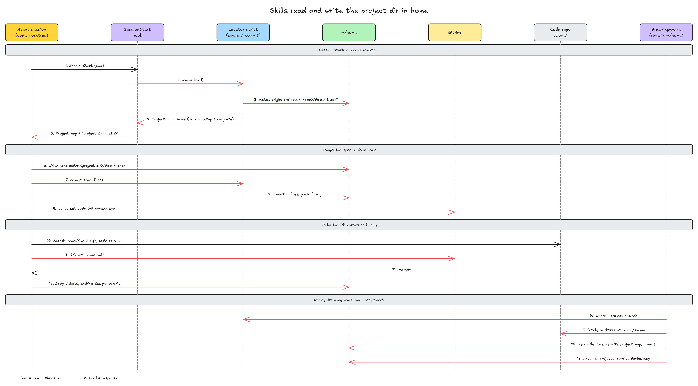
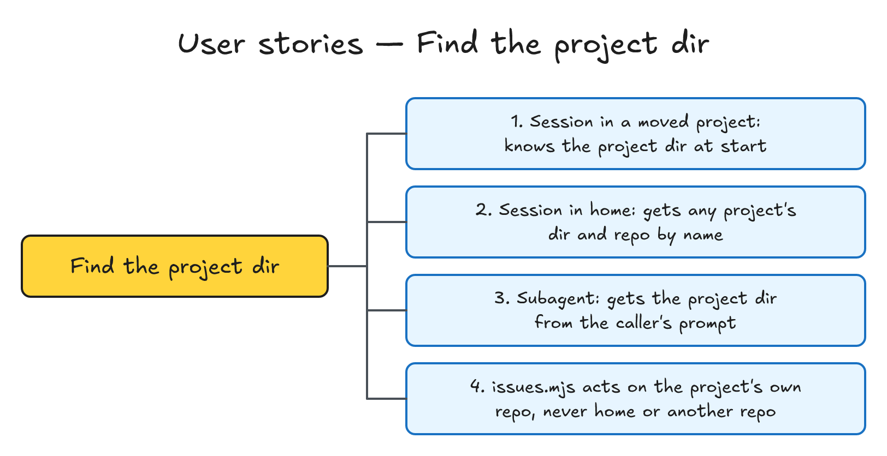
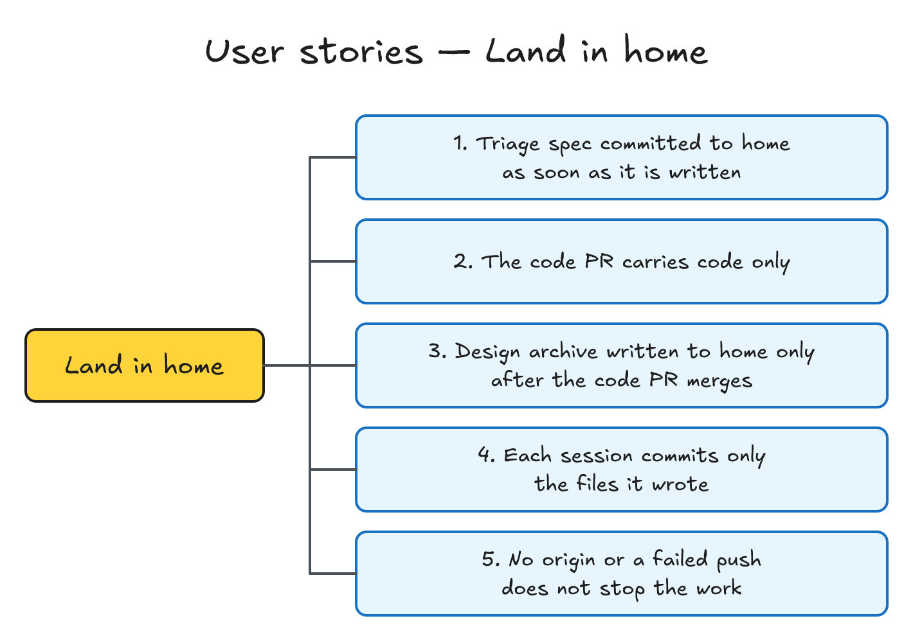
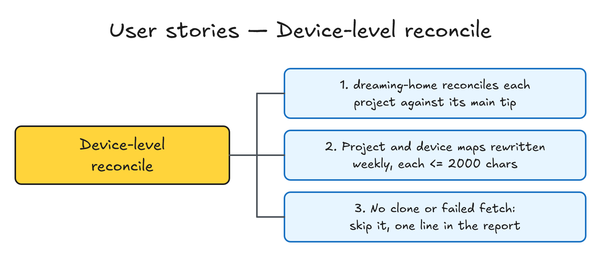
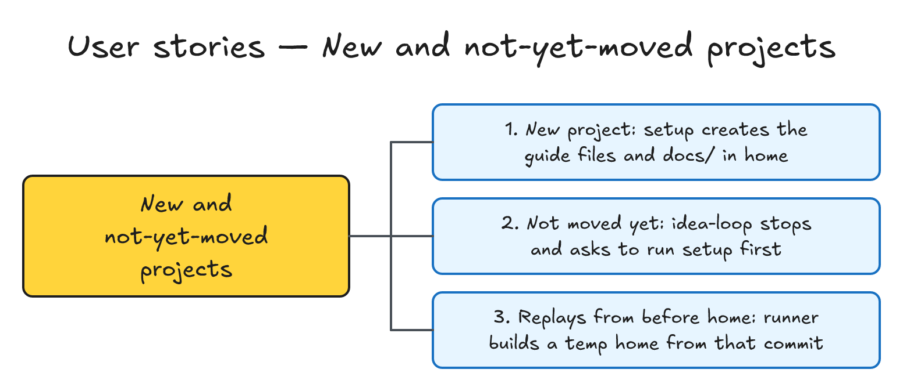

# skill 从 home 读知识库和引导文件

> #333 存在：2026-11-16 把 harold-skills 的 `docs/` 和 `ISSUE_TRACKER.md` 复制进一个假 home，再跑 `issues.mjs show <假 home 的 docs> 333`。假 home 没有远端时报「no git remotes found」；有远端时不报错，读回的是远端那个仓库的 #333，不是 harold-skills 的。详情在「问题陈述」。

## 问题陈述

0.2.0 定了：idea-loop 生成的引导文件和 `docs/` 搬进 `~/home/projects/<名字>/`，代码仓库只留自己的 `AGENTS.md` / `CLAUDE.md` 和自己的工具（决定记录 `docs/raw/issue-workflow/2026-11-15-home-repo-grill.md` 的 Q3）。搬家本身是 #247 的事。这份 spec 要解决的是：搬完以后，idea-loop 的 skill、agent、脚本还能不能找到这些文件、能不能写对地方。下面四处都在 `release/idea-loop-0.2.0` 的 `64208e8` 上核过（2026-11-16）。

### 1. 脚本把「`docs/` 的上一级」当成代码仓库

`issues.mjs` 的每个命令都收一个 `<docs>` 参数。它从 `<docs>` 的上一级读 `ISSUE_TRACKER.md` 和 `AGENTS.md`（「issue 分类」一节），并在 `<docs>` 目录里跑 `gh` 和 `git`。所以 `gh` 操作的是 `<docs>` 所在的那个 git 仓库。知识库搬进 home 以后，这个仓库就成了 home。

复现：把 harold-skills 的 `docs/`、`ISSUE_TRACKER.md`、`DEVELOPMENT.md` 复制进一个临时目录 `home/projects/harold-skills/`，把 `home/` 初始化成 git 仓库，再跑 `issues.mjs show home/projects/harold-skills/docs 333`。

| home 的远端 | 结果 | 本该是 |
|---|---|---|
| 没有远端（公司虚拟机上就是这样，Q1） | 报错「no git remotes found」，什么都没读到 | harold-skills#333 的状态、PR、spec |
| 有远端（Mac 上 home 会推到 GitHub 私有仓库，Q1；复现时临时用 `cli/cli` 当远端） | 不报错，返回 `cli/cli#333`「Add ability to clone a repo」，状态 done | 同上 |

第二种更糟：它不报错，读回来的是另一个仓库的 issue，`set` 也会照样改到那个仓库的 label 上。

其余按 git 顶层目录找东西的脚本：`seo-check-hook.mjs` 找 `SEO.md`，`design-archive-mcp.mjs` 找 `docs/design/prod/`。知识库搬走以后，这两个也找不到。

### 2. skill 和 agent 的文字把位置写死在仓库里

`<docs>` 在各处的定义都是「当前 worktree 的 `docs/`」，引导文件写的是「仓库根目录的 `DEVELOPMENT.md`」。2026-11-16 在 `64208e8` 上用 grep 数了 idea-loop 里 211 个 skill、agent、脚本文件（不含测试）：

| 位置 | 写到知识库（`<docs>` 或 `docs/`） | 写到仓库根的引导文件（`DEVELOPMENT.md` `REVIEW.md` `CODING_STANDARDS.md` `PRODUCT.md` `ISSUE_TRACKER.md` `GLOSSARY.md` `DESIGN.md` `SEO.md`） |
|---|---|---|
| `skills/engineering` | 29 | 25 |
| `skills/design` | 19 | 15 |
| `skills/productivity` | 19 | 16 |
| `skills/seo` | 3 | 19 |
| `agents` | 6 | 15 |
| `scripts` | 19 | 14 |
| 合计 | 95 | 104 |

子代理不触发 SessionStart，拿不到 #252 注入的项目地图，只能读调用方给它的路径。现在调用方给的也是仓库里的路径。

### 3. 知识库的改动绑在代码分支上

`idea-loop:wiki-conventions` 的「知识库落地」规定：spec、raw、冻结的设计、工单、设计档案归档，都提交在需求的工作分支上，跟代码同一个 PR 合进主分支。有 9 个 skill 文件引用这条或者直接写了 `git add -f`。没有代码 PR 可跟的改动（dreaming 的执行段、「不做」记录、不在 issue 会话里的 retro 决定记录），各开一个只改 `docs/` 的 PR 再自己合（#298）。

决定记录 Q12 改成了：home 只有 main，改了直接提交，只 add 自己的文件；spec 不再跟代码同一个 PR。现在没有一个 skill 这样做。

### 4. 对账绑在每个仓库各自的定时任务上

dreaming 现在由每个仓库自己的定时任务 `dreaming-<仓库名>` 起。它在那个仓库的主 checkout 里跑，用主 checkout 的目录名去找自己的执行记录，以此确定增量范围（dreaming 的 `incremental-scope.md`）。#332 的 triage 定了：一台设备只剩一个 `dreaming-home` 定时任务，开在 `~/home`，先整理记忆，再逐个对账项目清单里的项目。Harold 原话：「我倾向于设备纬度只有一个dreaming任务」。这个任务怎么从 home 对账各项目，归这份 spec。现在的 dreaming 开在 home 里的话，既不知道该对哪个项目，也取不到执行记录。

### 根因

idea-loop 处处假设知识库、引导文件和代码在同一个 git 仓库里：项目根目录就是 `<docs>` 的上一级，也就是 git 顶层目录；改动跟着代码分支走。四处问题各是这个假设的一种用法：

- 问题 1：`issues.mjs` 用 `dirname(docs)` 当项目根，在 `<docs>` 目录里跑 `gh`；
- 问题 2：skill 和 agent 的文字写死了「当前 worktree」和「仓库根」；
- 问题 3：落地规则写死了「同一个分支、同一个 PR」；
- 问题 4：dreaming 拿 cwd 的主 checkout 当项目。

## 方案

改完后，一个项目搬进 home 之后，idea-loop 在这个项目上的所有读写都落在 `~/home/projects/<名字>/`（下文叫**项目目录**）。代码仓库里不再出现 idea-loop 的文件。知识库的改动直接提交到 home 的 main，代码 PR 里只有代码。插件里只有这一种布局：0.2.0 上线时就把用着 idea-loop 的项目全部搬进 home（#247），不留「没搬的项目照旧读仓库」的中间状态。在没搬的项目里调 idea-loop，它停下，让人先跑 `/idea-loop:setup` 迁移。

决定一次读写落在哪的输入只有三样：

- 会话或脚本在哪个目录（它的 git 远端）；
- `~/home/AGENTS.md` 的项目清单；
- 项目目录里有没有 `docs/`。

图里有四方：会话（开在代码 worktree 或 home 里）、认项目脚本（#252 建、这里扩展）、home、代码仓库。红色是这份 spec 新增或改动的消息，虚线是返回。

### 项目目录：一个脚本说了算

扩展 #252 的认项目脚本，不另起机制（Q5「不新增组件」）。它现在由 SessionStart hook 调用，按 `origin` 认出项目、注入项目地图。这里给它加两个命令：

- **`where`**：输入是当前目录，或者 `--project <名字>`；可选 `IDEA_LOOP_HOME`。输出一份 JSON：项目名、项目目录、`docs`、代码仓库的 `owner/repo`、本地 clone 路径，以及「在不在 home」。判法：
  - 项目清单里有这个项目，且 `~/home/projects/<名字>/docs/` 存在：项目目录就是 `~/home/projects/<名字>/`。
  - 否则不给项目目录，退出码非 0，并说明原因：仓库根目录有 idea-loop 的引导文件、或 `docs/` 里有 `spec/` 或 `adr/` 的（光有一个普通 `docs/` 不算），说「这个项目还没搬进 home，先跑 `/idea-loop:setup` 迁移」；别的情况说「这个仓库没接上 idea-loop，先跑 `/idea-loop:setup`」。调用它的 skill 和脚本照这句话停下，不去读代码仓库。
- **`commit`**：把调用方列出的文件提交到 home 的 main，见下面的「改动怎么落进 home」。

hook 注入项目地图时多注入一行：`项目目录：<路径>`；`where` 认出「还没搬」的，hook 改为注入那句迁移提示。会话开在代码 worktree 里时，主会话从这一行拿到项目目录；开在 home 里时（父 issue 会话、`dreaming-home`），用 `where --project <名字>` 拿。

**哪些东西在项目目录里**：`docs/`、`DEVELOPMENT.md`、`REVIEW.md`、`CODING_STANDARDS.md`、`PRODUCT.md`、`ISSUE_TRACKER.md`、`GLOSSARY.md`、`DESIGN.md`、`SEO.md`。代码仓库的 `AGENTS.md` / `CLAUDE.md` 留在代码仓库（Q3）。现在写在代码仓库 `AGENTS.md` 里的「issue 分类」一节，改住在项目目录的 `ISSUE_TRACKER.md`「分类 label」一节。这一节现在只有一句话，指向 `AGENTS.md`。

skill、agent、脚本的文字统一改成：`<docs>` 是 `<项目目录>/docs/`，引导文件在 `<项目目录>` 下。调用子代理时，调用方在 prompt 里给出项目目录。

### 脚本

| 脚本 | 改成 |
|---|---|
| `issues.mjs` | 项目根取 `<docs>` 的上一级，这一点不变：搬家后它就是项目目录，`ISSUE_TRACKER.md` 和分类都在里面。`gh` 带 `-R <owner/repo>`，`owner/repo` 从项目清单里这个项目的远端取。找 issue 分支的 `git` 在项目清单的本地 clone 里跑。 |
| `seo-check-hook.mjs`、`design-archive-mcp.mjs` | 用 `where` 取项目目录，不再用 git 顶层目录 |
| `design-lint-hook.mjs` | 认画布路径时，不再要求路径以 `docs/` 开头、必须在仓库内；home 里的 `docs/design/tmp/<spec-slug>/canvas/` 也算 |
| `spec.mjs`、`design-archive*.mjs`、`ticket-ledger.mjs` | 本来就收 `<docs>` 或根目录参数，不改；改的是调用它们的 skill 给的参数 |
| 规则回放的 runner（`evals/retro/`） | 见下面的「规则回放」 |

### 改动怎么落进 home

Q12 定了：home 只有 main，直接提交，只 add 自己的文件。落到每种产物上：

| 产物 | 现在 | 搬进 home 后 |
|---|---|---|
| spec、raw | 提交在 issue 分支上，跟代码一个 PR | 写好就提交到 home |
| 工单 | 提交在 issue 分支上；工单那一刀合了，在 PR 里删掉 | 切完提交到 home；代码 PR 合并后，由 pr-review 的合并步骤删掉这份 spec 的 `tickets/` 并提交 |
| 冻结的设计（画布、冻结记录、交互图） | `git add -f` 到 issue 分支 | 冻结时提交到 home |
| 设计档案归档（`prod/`） | 合并前跑归档脚本，改动随 PR 进主分支 | 合并前写好 `delta/`、跑归档校验，review 看的就是 `delta/`；代码 PR 合并成功后才跑归档脚本，提交到 home |
| dreaming 的执行段、「不做」记录、retro 决定记录 | 开只改 `docs/` 的 PR，自己合 | 直接提交到 home；出错了 `git revert` |

`commit` 命令的做法：

1. `git -C ~/home add` 加调用方列出的文件；
2. `git commit -- <这些文件>`，只提交它们，暂存区里别的会话加进去的文件不受影响；
3. 碰到 `index.lock`（另一个会话正在提交）就等一秒、重试一次；
4. home 有 `origin` 的，接着 `pull --rebase` 再推送。推送失败不挡后面的步骤，在汇报里写一句「home 没推上去：<原因>」。

**issue 分支只给代码用**：

- triage 会话不再切分支，起草的 spec 直接提交到 home；
- `set todo` 的评论写「spec 已提交到 home <提交号>」；
- todo 会话第一次要写代码时，才从主分支切 `issue/<号>-<slug>`；
- `issues show` 在 triage 阶段返回 `branch: null`，这是正常的。

**PR 描述不再链 spec 文件**：home 是私有的，公司虚拟机上的 home 根本没有远端。所以 PR 描述里写 spec 的标题、在 home 里的路径和一句摘要，不放链接。

### dreaming-home 对账各项目

`dreaming-home` 的形状和记忆那一段归 #332。这里管它跑完记忆之后的部分：按项目清单的顺序，对每个项目做一遍。

1. **取项目**：`where --project <名字>`。在项目清单的本地 clone 里 `git fetch`，从 `origin/<主分支>` 切一个 worktree，放在 `~/home/.worktrees/` 下，对完删掉。`<主分支>` 取项目目录里 `DEVELOPMENT.md` 的「分支」一节。
2. **对账**：`docs/` 在 home，对的是上一步那个 worktree 里的代码；提议表、执行、问人的做法都跟现在一样，改动直接提交到 home。
3. **重写项目地图**：`projects/<名字>/AGENTS.md`，不超过 2000 字。模板跟 #252 setup 起草时用的是同一份：几层、每层放什么、什么问题去哪查，外加一行指向 `projects/<名字>/memory/MEMORY.md`（#332）。输入是项目目录的 `docs/index.md`、目录树和引导文件。
4. 全部项目跑完，**重写 `~/home/AGENTS.md` 的「## 设备地图」一节**，不超过 2000 字。输入是 home 顶层的目录和项目清单。「## 项目」一节由 setup 维护，dreaming 不改。

**增量范围**：基准点取 `dreaming-home` 上一次成功的执行（现在取的是 `dreaming-<仓库名>`）。一次执行里有任何一个项目没对完，这次就不算成功，下一次那个项目从更早的基准点算起。

**跑不了的项目**：本地 clone 不存在、fetch 失败、或 `where` 报「还没搬」的，跳过这个项目，在汇报里写一行，不挡后面的项目。

### setup 给新项目建文件

home 已经存在、当前项目在项目清单里没有 `docs/` 的：

- 以前就在用 0.1.x 的项目（仓库根目录已经有 idea-loop 的引导文件，或 `docs/` 里有 `spec/` 或 `adr/`），走 #247 的迁移，这里不管；
- 全新的项目，setup 把引导文件和 `docs/` 直接建在项目目录里，不再往代码仓库根目录写；
- 新项目也不再往代码仓库的 `AGENTS.md` 里写 `## idea-loop` 那段指针，它的作用由项目地图代替（Q3）。

### 规则回放

现有的 12 个用例都钉在 home 出现之前的提交上，那时知识库在代码仓库里。

- **老用例**：插件里没有回退，改后的插件在那些提交上会停下要求迁移。所以由 runner 在临时目录里现搭一份 home：把那个提交的 `docs/` 和引导文件复制进 `projects/<名字>/`，项目清单写上这个项目，`IDEA_LOOP_HOME` 指过去。改后的插件读到的就是那个提交的知识库；改前的插件照旧读代码仓库里的同一份，两边输入相同。判定会话读产物时，去这份临时 home 里找。这个转换只活在 runner 里，skill 和脚本里没有。
- **新用例**：搬家后新录的用例，`case.json` 多记一个 `home_commit`。runner 在临时目录里从这个提交切一份 home，把 `IDEA_LOOP_HOME` 指过去，改前、改后两边读到的知识库相同。

### 同一行为的其他入口

| 入口 | 纳入还是排除 |
|---|---|
| 主会话开在代码 worktree 里（单仓库 issue 会话，Q25） | 纳入：从 hook 注入的「项目目录」一行拿 |
| 会话开在 home 里（父 issue 会话、`dreaming-home`、跨项目的活） | 纳入：用 `where --project <名字>` 拿 |
| 子代理（implementer、pr-reviewer、designer 等 16 个） | 纳入：agent 定义改成「读调用方给的项目目录」；调用方在 prompt 里给 |
| `claude -p` 起的无头会话（规则回放、`uiux-research` 的 baseline） | 纳入：回放见上；`uiux-research` 的 baseline 自带一份产品上下文，不读项目目录，不改 |
| Codex（pr-review 的 Codex 轴） | 纳入：给它的 spec 路径改成 home 里的路径 |
| Linear 项目 | 纳入：`ISSUE_TRACKER.md` 在项目目录里，`issues.mjs` 照样读 |
| magi 运行环境 | 纳入：只读文件、跑 git，不依赖运行环境 |
| 按文件名触发的 hook（`design-md-hook`、`glossary-check-hook`） | 不用改：它们看的是文件名，不看在哪个目录 |
| 还没搬进 home 的项目、项目清单里没有的仓库 | 纳入：`where` 报错，skill 停下，让人先跑 `/idea-loop:setup`（迁移或接上） |
| 搬已有项目的文件、删代码仓库里的 `## idea-loop` 段、本机取消 `dreaming-<仓库名>` | 排除：#247 |

## User Stories

### 找到知识库

1. 作为在一个已搬进 home 的项目的代码 worktree 里开会话的 agent，我想要会话一开始就知道项目目录在哪，以便读写 spec、引导文件时不在代码仓库里落空
2. 作为在 home 里开会话的 agent，我想要按项目名取到某个项目的项目目录和代码仓库，以便跨项目的活和父 issue 会话也能读写各项目的知识库
3. 作为被调起的子代理，我想要从调用方给的 prompt 里拿到项目目录，以便没有 SessionStart 注入也读得到 `REVIEW.md`、`CODING_STANDARDS.md` 和 spec
4. 作为在 home 已有远端的设备上翻 issue 状态的 agent，我想要 `issues.mjs` 对着项目自己的代码仓库操作，以便不会悄悄改到 home 或别的仓库的 issue

### 落进 home

1. 作为人，我想要 triage 时起草的 spec 一写好就提交进 home，以便不用等代码 PR，别的会话也能马上读到
2. 作为人，我想要代码 PR 里只有代码，以便 review 时不被知识库的改动淹没
3. 作为人，我想要设计档案在代码 PR 合并成功之后才写进 home，以便放弃的 PR 不会让档案记下线上没有的东西
4. 作为同时开着几个会话的人，我想要每个会话只提交自己写的文件，以便两个会话不会把对方写到一半的东西提交进去
5. 作为在公司虚拟机上用 idea-loop 的人，我想要 home 没有远端、或推送失败时流程照样往下走，以便 home 推不上去不会挡住工作

### 设备级对账

1. 作为人，我想要 `dreaming-home` 每周把项目清单里的每个项目都对一遍，代码对的是它主分支的最新提交，以便不用每个项目各装一个定时任务
2. 作为人，我想要每个项目的地图和设备地图每周由 dreaming 重写、都不超过 2000 字，以便地图跟着知识库变，每轮注入的负担有上限
3. 作为人，我想要一个项目的本地 clone 不在或 fetch 失败时，只跳过这个项目、汇报里写一行，以便一个项目坏了不挡别的项目

### 新项目与没搬的项目

1. 作为给一个全新项目跑 setup 的人，我想要引导文件和 `docs/` 直接建在 home 里，以便代码仓库里一开始就没有 idea-loop 的文件
2. 作为升级了插件、还没迁移的人，我想要 idea-loop 一碰到这个项目就停下，告诉我先跑 `/idea-loop:setup` 迁移，以便不会有一部分东西写进代码仓库、一部分写进 home
3. 作为跑规则回放的人，我想要钉在 home 出现之前的用例，改前、改后两边读到的都是那个提交里的知识库，以便老用例照样能验收规则改动

## 实现决策

### 已定

- **只认 home，不留回退**：没搬的项目，skill 和脚本停下，让人先迁移；判据是 `~/home/projects/<名字>/docs/` 在不在。依据：Harold 原话「我在想能不能0.2.0上线的时候就把知识库迁移，省着我们自己还需要维护一个中间状态」，也跟决定记录 A1「只保留 home 一种模式」一致。代价有两处，都已接住：
  - 升级插件到跑完迁移之间，idea-loop 在这个项目上用不了。所以 0.2.0 合进 main 后，本机和公司虚拟机都要紧接着跑迁移，写进 #247 的 spec。
  - 12 个回放用例钉在 home 出现之前：由 runner 现搭临时 home 接住，见「规则回放」。

  起草时先按「留回退」写过一版；Harold 先问了先后顺序（#331 已定：#333 在 #247 前面），再改成了上面这样。
- **扩展 #252 的认项目脚本，不新增组件**：认项目（远端统一、项目清单解析）在 #252 已经有了，`where` 和 `commit` 都复用它。依据是 Q5 和「先扩展已在用的工具」。
- **「issue 分类」挪进 `ISSUE_TRACKER.md`**：项目地图（项目目录的 `AGENTS.md`）每周由 dreaming 重写，放不了人维护的内容；分类本来就是 tracker 的配置，`ISSUE_TRACKER.md` 也已经有「分类 label」一节指向它。依据是 Q3：idea-loop 生成的东西进 home。
- **「仓库」表并进项目清单，一个 issue 只改一个仓库**：`ISSUE_TRACKER.md` 删掉「仓库」一节，`owner/repo` 和本地路径从项目清单读，主分支从 `DEVELOPMENT.md` 读；implement 里「一个 issue 在几个仓库各开 PR」的分支一起删掉。依据：Q26 定了并进项目清单，Q29 定了多仓库按父 issue 拆子 issue；2026-11-16 核过，本机仅有的两个用 idea-loop 的项目（Toeflair、harold-skills），「仓库」表都只有一行，删掉的分支没有真实用法。
- **代码 PR 合并之后才写设计档案**：合并前只写 `delta/`、跑归档校验（归档脚本本来就能把 `delta/` 叠在 `prod/` 上校验）。依据：home 和代码仓库不能在同一次提交里原子地改，先写档案再合并的话，PR 被放弃时档案里就会多出线上没有的东西。
- **`commit` 只提交列出的文件**：依据是 Q12「只 add 自己的文件」。home 是所有会话共用的一个 checkout，不是 worktree。
- **项目地图模板里有记忆一行**：依据是 #332 的决定「项目地图也指过去」（共享笔记 `332-decisions-for-siblings.md`）。
- **版本号**：这个 PR 不改版本号。依据：#252 已经把 idea-loop 升到 0.2.0，跟 main 比已经更高（#252 spec 的「版本号」）。
- **已知限制**（找不到真实路径，不展开设计，可以推翻）：
  - `dreaming-home` 开在 home，项目自己的 hook、`.mcp.json`、`.claude/skills` 都不会加载（决定记录 A9 实测），对账只能用 idea-loop 自己的工具。现在的 dreaming 没有用到项目私有的工具。
  - 一个需求同时改多个代码仓库，没有真实例子，按 Q29 处理。
  - 两个会话同时 `pull --rebase` 推 home，没有实测过。

## 测试决策

| 变的是什么 | 仪器 | 本次 |
|---|---|---|
| 纯逻辑、数据转换、状态机 | TDD 单元测试 | 碰到：`where`（在 home、还没搬、没接上、home 本身、`--project`、`IDEA_LOOP_HOME`）、`commit`（只提交列出的文件、`index.lock` 重试、没有 `origin`）、`issues.mjs` 的仓库来源、回放 runner 现搭临时 home |
| API 契约（路由、schema、序列化） | TDD API 测试 | 不涉及 |
| DB schema、迁移、并发与事务语义 | 真 DB 测试 | 不涉及 |
| LLM 输出质量（prompt 改动） | eval（确定性断言） | 改了大部分 skill 和 agent 的文字，按 `AGENTS.md` §5 不做 quantitative eval。文字里的位置写法由下面的文档测试守；行为由一次规则回放和一次端到端的 `claude -p` 验 |
| 视觉正确性 | UI 实现环 | 不涉及 |
| 端到端用户流程 | 浏览器端到端测试 | 不涉及，用 `claude -p` 代替，见下 |

- **seam**：
  - `where` 和 `commit` 的命令行。输入是 cwd、`IDEA_LOOP_HOME` 和参数，输出是 JSON 或 home 的 git 状态。测试在临时目录里建假 home、带远端的假代码仓库和它的 worktree。能抓到：项目目录判对没有、没搬时停下、只提交自己的文件。漏掉：skill 有没有真的照着用。
  - `issues.mjs` 现有的 `gh` 注入点（测试传 stub）。能抓到：`-R` 传的是不是项目的仓库。漏掉：真 GitHub 上的行为，由端到端补。
  - 文档测试：在 skill、agent 的文字里 grep，「当前 worktree 的 `docs/`」「仓库根目录的 <引导文件>」「`git add -f`」都不能再出现。写法照 `no-project-leak.test.mjs`。能抓到：漏改的位置写法。漏掉：改了但改错了意思。
- **增量功能测试**：
  - 找到知识库 1、4：前置：假 home 登记了 `example-app`（远端 `acme/example-app`），`projects/example-app/docs/` 存在；在这个项目的一个 worktree 里，`gh` 用 stub。步骤：跑 `where`，再跑 `issues.mjs show <where 给的 docs> 7`。期望：项目目录是假 home 里的那个；`gh` 收到 `-R acme/example-app`。
  - 找到知识库 2：在假 home 里跑 `where --project example-app`。期望：跟上一条拿到的项目目录相同。
  - 新项目与没搬的项目 2：前置同上，但删掉 `projects/example-app/docs/`，代码仓库根目录放一份 `DEVELOPMENT.md`。期望：`where` 退出码非 0，输出「这个项目还没搬进 home，先跑 `/idea-loop:setup` 迁移」；接着跑 `issues.mjs show`，同样停下，不读代码仓库。
  - 落进 home 4、5：两个文件已经写进假 home，只把其中一个交给 `commit`。期望：提交里只有它，另一个仍未提交；假 home 没有 `origin` 时退出码 0。
  - 新项目与没搬的项目 3：用改后的插件跑一个现有的回放用例 `draft-spec-orphan-capability`（size small）。期望：runner 现搭的临时 home 里有那个提交的 `docs/`；判定会话的是/否题答「是」，跟改前插件的判定一致；spec 草稿写进临时 home。
  - 端到端（在本机，实现落地后做一次）：在临时目录里建一份假 home，把 harold-skills 的 `docs/` 和引导文件复制进去，并登记 harold-skills。在 harold-skills 的一个 worktree 里，用 `--plugin-dir` 装改后的插件、`IDEA_LOOP_HOME` 指到假 home，跑 `claude -p`：用 Skill 工具调 `idea-loop:issue-session`，参数一个真实的 triage issue，禁掉 `gh` 的写操作，停在 spec 草稿写好的那一刻。期望：spec 出现在假 home 里并已提交；代码 worktree 的 `git status` 是干净的。覆盖：找到知识库 1、落进 home 1、2。
- **照着谁写**：`where` / `commit` 照 #252 的认项目脚本和 `runtime-detect.mjs`（导出纯函数加命令行入口）；在临时目录里建 git 仓库的测试照 `issues.test.mjs`；文档测试照 `no-project-leak.test.mjs` 和 `knowledge-base-landing-doc.test.mjs`（后者要改成新规则）。

## Out of scope

- 建 home、项目清单、SessionStart 注入项目地图、setup 改用户级配置、第一版项目地图（#252）。
- 设备级定时任务 `dreaming-home` 的形状、记忆整理、`memory-check`（#332）。
- 搬 Toeflair、harold-skills 已有的引导文件和 `docs/`，删代码仓库里的 `## idea-loop` 段，取消本机的 `dreaming-<仓库名>` 任务，清理用户级 skill（#247）。
- idea-loop 认父子 issue、按父 issue 取基准分支（#334）。
- 地图不够用时扩展 `design-archive` MCP：等 #252 的 token 测量出结果，要扩展就另开 issue。

## 关联

- raw：[[2026-11-15-home-repo-grill]]（Q3、Q5、Q12、Q25、Q26、Q29）。
- [[home-bootstrap]]（#252，在 `origin/issue/252-home`，还没进集成分支）：这份 spec 扩展它的认项目脚本，用它的项目清单和项目地图模板。#252 先合。它的 token 测量结果决定要不要扩展 `design-archive` MCP。
- [[device-memory]]（#332，在 `origin/issue/332-memory-one-per-device`）：`dreaming-home` 的形状和记忆一段归它，项目对账一段归这里。#332 先合，这里在它定的任务里接上项目对账。
- #247（迁到 home，triage 中）：它负责搬家，这里负责搬家之后读写落对地方。插件里不留回退，所以 #247 的 spec 要写明：0.2.0 合进 main 后，本机和公司虚拟机都紧接着跑迁移，每个项目一次搬完。#247 在这份 spec 之后合。新项目由 setup 直接建在 home 里（这里）；已有项目由 setup 迁移（#247）。
- [[docs-ride-code-pr]]（#244）：它的「spec 跟代码一个 PR」被 Q12 推翻，这里改掉 wiki-conventions 的「知识库落地」。删它的 spec 归 #247 迁移时的 dreaming。
- [[dreaming-triage-autonomous]]（#298，已关）：dreaming「开只改 `docs/` 的 PR 自己合」，对已经在 home 的项目改成直接提交；没搬的项目保留原做法。
- #334（走 main）：认父子 issue。跟这里没有代码上的重叠；它改 `issues.mjs`，跟这里的 `-R` 改动会碰到同一个文件，先合的那个不用等，后合的那个解冲突。
