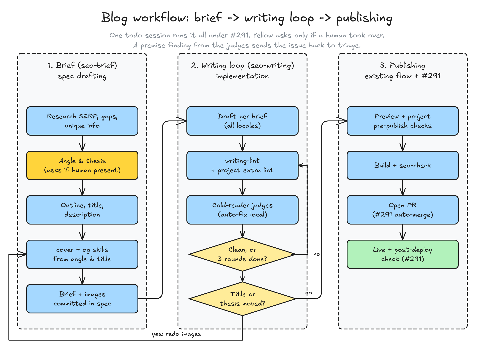
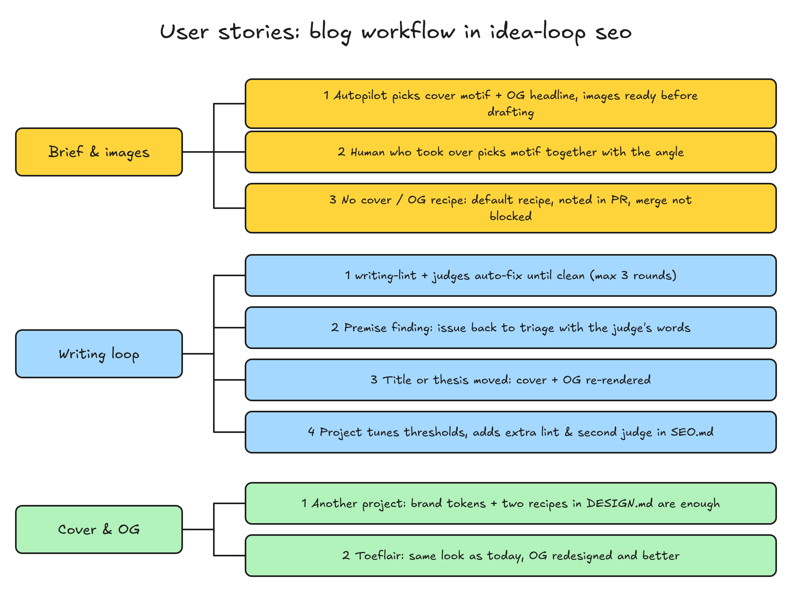

# 博客 workflow 进 idea-loop 的 seo 组：brief 出图、写作循环、通用写作 lint

> #163 存在：Toeflair 的 `.claude/skills/blog-publisher/` 一个 skill 同时装着写正文的通用规则和 Toeflair 的取值，idea-loop 的 `seo-writing` 里又有同一批通用规则；封面、OG 只有 Toeflair 自己的版本，插件里没有。详情在「问题陈述」1、2。

## 问题陈述

核对基准：Toeflair `origin/main` `b350de5d`、harold-skills `origin/main` `a032e45`，2026-11-16。分拣证据：#163 的「🤖 idea-loop：」评论（2026-11-10）。lint 规则的逐条分类由子代理对着 Toeflair `origin/main` 读脚本得出，行号抽查过。

### 1. 写正文的规则两边各一份，新规则不知道该落哪

Toeflair 写博客时同时读两份规则：

- idea-loop 的 `seo-writing`：先列问题清单（「哪个发现会推翻整篇」）、每节一种形式、标题带钩子、FAQ 用真实搜索说法、H2 标同质 / 独有且同质不超三分之一。
- Toeflair 的 `blog-publisher`（SKILL.md 250 行，7 份参考共 1232 行）：同一批规则的英文原版（`voice.md` §3 思考门、§6b FAQ、`non-commodity-scorecard.md` G1–G4），夹着 Toeflair 的取值（固定术语、About 页的创始人数据、Supabase 查数、营销站构建命令）。

`SEO.md` 的「写作」节把 `seo-writing` 指到 `blog-publisher/references/voice.md`，于是通用规则在插件一份、在被指过去的项目文件里又一份。

例子：Tofelair#576（2026-10-29）写 `/blog/toefl-integrated-writing`，retro 出的写作规则候选分不清落 `seo-writing` 还是 `voice.md`，最后落进 `voice.md`（Toeflair 提交 `b7e0fc4d`）；Tofelair#933（中文正文的「」引号是 AI 痕迹）现在也只能加进 `voice.md` 和 Toeflair 的 `voice-lint`，别的项目拿不到。

把关的工具也全在项目里。Toeflair 的 `voice-lint`（`toeflair-app/frontend/app/scripts/voice-lint.mjs`，636 行）有 21 条判错规则：

| 分类 | 条数 | 例子 |
|---|---|---|
| 通用 | 3 | 表格里不用 `
`、正文不写 `~N`、数字区间用 en-dash |
| 通用，阈值或词表要配 | 15 | 一段不超过 4 句（第 80 行 `MAX_SENTENCES_PER_PARA = 4`）、每段转折词不超过 1 个、一句超过 3 个逗号、破折号每 100 词不超过 1 个、AI 套话词表、图片没图注或图注等于 alt、FAQ 答案字数下限、中英两版结构对齐 |
| 只属于 Toeflair | 3 | `cta.buttonHref` 不能是占位符、RESEARCH 类文章禁「多数评测都说」句式、正文不许出现自家题库总数 |

评委的评分表（`readability-judge-rubric.md`）13 个维度里 11 个通用、2 个要配（文章模式、中文版），只属于 Toeflair 的只有「按类别调分数线」一节。`seo-lint` 的 16 条全部通用，idea-loop 的 `seo-check.mjs` 已经覆盖。

### 2. 封面和 OG 只有 Toeflair 自己的版本，方法和取值缠在一起

Toeflair 仓库自带一个项目级插件 `.claude/plugins/content-creator/`（跟 harold-skills 的 `content-creator` 同名，但不是它），里面有独立的 `cover`（123 行）、`og`（53 行）、`hero` 和共享的 `blog-image-kit.md`（114 行）。通用做法（列表封面要能垫白字标题、居中防裁切、HTML→PNG 用浏览器渲染而不是 `rsvg-convert`、canvas 颗粒而不是 `feTurbulence`、重渲后对 md5 防缓存）和 Toeflair 的取值（磨砂底 8 色、白色线稿提示词、`mcp__toeflair__image_generate_blog_cover`、logo 路径、`marketing/public/images/blog/`、frontmatter 的 `cover:` / `ogImage:`）写在同一段里，`cover`、`og` 各有 5 行直接写着 Toeflair 的路径或工具。OG 模板 `og-card.html` 只是一张渐变底板加 logo、kicker、标题、副标题，人评价「太简单了」。

另一个项目要做博客封面和分享卡，只能把 Toeflair 的整套抄过去再挑出取值。

### 根因

没有一条「通用方法进插件、项目取值进目标仓库」的分界：`seo-writing` 写了「规则分两层」，但它指向的项目文件本身是一个完整的旧 skill；封面、OG、写作 lint 从一开始就长在 Toeflair 里，没有通用层可以分出去。

## 方案

改完：任何装了 idea-loop、配了 `SEO.md` 的项目，一个内容类 SEO issue 在一个 todo 会话里写完一篇博客，从选题、出图、写稿、改稿到合并上线，托管时中间不停；项目只写自己的取值。决定输出的输入有四样：issue 的目标词和页面类型、`SEO.md`（写作规则、lint 配置、配图工具和目录、发布前检查）、`DESIGN.md`（品牌色、字体、logo、封面和 OG 的配方）、#291 的「内容原则」。

博客 workflow 就是 #291（SEO 全托管）下的一个内容类 SEO issue，不另做直接调用的入口：人想写一篇，开一个内容类 issue 或由 `seo-scan` 扫出，跟别的 SEO issue 同一条路。

1. **brief**（起草 spec 时，`seo-brief`）：查前 10 名和缺口 → 角度和论点 → 大纲、title、description → **新增「配图」一步**：从角度推出封面主体候选、从 title 取 OG 大标题，调 `cover`、`og` 出图，结果写进 brief 的「配图」一节，图提交在 issue 分支上。
2. **初稿**（实现时，`seo-writing`）：按 brief 写各语言版本，正文图表用 excalidrawer。
3. **改稿循环**（`seo-writing` 新增一步）：通用写作 lint（`writing-lint.mjs`）加上项目的补充 lint → 冷读评委子代理打分 → `local` 问题自动改 → 回到 lint；lint 干净且评委没有 `local` 问题即完成，最多三轮，没干净的写进 PR 描述交给 `pr-review`。改稿中 title 或论点变了，调 `cover` / `og` 重出图。项目配了第二评委（另一个模型的命令），它跟冷读评委一起打分。
4. **发布**（`seo-writing` 收尾 + 现有流程）：本地预览各语言版本和图、跑项目的发布前检查、构建后 `seo-check`；开 PR、自动合并、上线自查都是 #291 已有的。

**人停的点**：选角度、挑封面主体、改稿后人改一遍，这三处「人在场才停」。人在场 = 人用 `/idea-loop:issue-session <号>` 接手这个 issue；托管时照推荐定，记进 spec 的决定（依据写「AI 照推荐定：<理由>」，跟 #291 同一写法）。评委报出 `premise`（前提错了，例如论点站不住）时，AI 不自己翻论点：已写的提交，issue 翻回 triage，评论写明评委说了什么。

**项目取值放哪**：

- 写作类取值继续走 `SEO.md`「写作」节：已有的文风、失败案例、类型字段、类型映射，加三个键：「lint 配置」（覆盖 `writing-lint.mjs` 默认阈值、词表、frontmatter 字段名、语言对的 JSON 文件路径；没写用默认值）、「补充 lint」（项目自己的 lint 命令，没有写 `无`）、「第二评委」（另一个模型的评审命令，没有写 `无`）。
- 配图的工具类取值在 `SEO.md` 新增「配图」节：图片目录、生图工具（MCP 工具名或命令）、封面和 OG 的 frontmatter 字段名。图片目录必须在 #291 的「内容路径」以内，`seo-setup` 写入时检查。
- 品牌类取值在 `DESIGN.md`：品牌色、字体用它 front matter 已有的 token；logo 路径、封面配方（底色、主体风格、生图提示词骨架）、OG 配方（版式、字号层级）写进 Components 章，作为「blog-cover」「og-card」两个组件。`cover`、`og` 开工先读它；找文件照 `design-modeling` 第 0 步（`git ls-files | grep -i 'DESIGN.md$'`，多份时读 `SEO.md`「配图」节指定的那份）。
- 项目没配「配图」节或 `DESIGN.md` 里没有这两个配方：人在场就问；托管时用插件的默认配方出图，PR 描述写一句「项目没配封面 / OG 配方，用的默认」，不阻塞合并。

**同一行为的其他入口**：

- `seo-outreach`：读「写作」节的文风文件，纳入，不另改（文件挪位置后它读到的是同一个指针）。
- harold-skills `content-creator` 的 `thumbnail-gen`：给小红书 / 视频号 / YouTube 的封面，平台和尺寸不同，排除。
- Toeflair 的 `product-shots`：驱动 Toeflair 真实产品截图，全是项目内容，排除，留在 Toeflair。
- Toeflair 的 `hero`（文章顶部大图）：纳入，并进 `cover` 作为一个分支（Toeflair 的文章页没有 `hero` 时就用 `cover`，同一套做法）。
- 人直接说「写一篇博客」（不开 issue）：排除，不做入口；依据是人的原话「我们现在大概率是在issue里面的」，开 issue 后走同一条路。

## User Stories

brief 与配图
1. 作为托管运行的 todo 会话，我想要在 brief 里照推荐定下封面主体和 OG 大标题并出图，以便写稿前图已经跟角度对上
2. 作为接手 issue 的人，我想要在选角度时一起挑封面主体，以便一次决定、不被问两次
3. 作为没配封面 / OG 配方的项目，我想要用插件默认配方出图并在 PR 里被告知，以便不因缺配置卡住合并

写作循环
1. 作为托管运行的 todo 会话，我想要通用写作 lint 加冷读评委自动改到干净（最多三轮），以便不等人就交出能合的稿
2. 作为人，我想要评委报出论点站不住时 issue 回到 triage 并写明原因，以便角度由我定、不被 AI 悄悄改掉
3. 作为改稿者，我想要 title 或论点变了时自动重出封面和 OG，以便图不落后于正文
4. 作为任一项目的维护者，我想要只在 `SEO.md` 里改阈值和词表、加自己的补充 lint 和第二评委，以便不抄一份 lint 脚本

封面与 OG
1. 作为另一个项目的维护者，我想要在 `DESIGN.md` 写下品牌色、字体、logo 和两个配方就能出博客封面和分享卡，以便不用抄 Toeflair 的整套
2. 作为 Toeflair 的维护者，我想要拆分后的封面、OG 跟现在同一套风格，且 OG 比现在更好看，以便新旧文章的图读成一组

## 实现决策

### 已定

- **顺序**：#291 合并进 main 后开工，分支从那之后的 main 重新开。依据：两边都改 `draft-spec.md` 的 SEO 分支和 `SEO.md` 的格式（#291 加「内容原则」节和「构建与检查」的「内容路径」键）；人确认「放在 #291 之后再合并实现」。新键名开工时对着 #291 合并后的 `seo-md.md` 定，不重名。
- **全在 idea-loop 的 seo 组**：`seo-brief`、`seo-writing` 改，新增 `cover`、`og` 两个 skill。依据：人的原话「我可以倾向于放到idea-loop的seo下面」「这两个可以单独做成skill」。`cover` / `og` 单独做而不写成 `seo-brief` 的参考，是因为写作循环里 `seo-writing` 也要调它们重出图，而 idea-loop 规定一个 skill 的私有参考只给它自己读（`idea-loop/AGENTS.md`「参考资料归谁」）。
- **两个 skill 都可被模型调用**：`seo-brief`、`seo-writing` 要调它们，人也会直接说「给这篇重做 OG」。依据：根 `AGENTS.md`「调用方式按出口定」。
- **通用写作 lint**：`voice-lint` 里通用和要配的 18 条做成 `idea-loop/scripts/writing-lint.mjs`，默认值取 Toeflair 现行值（例如一段 4 句、每段 1 个转折词），词表给中英两份默认。Toeflair 专属的 3 条留在项目的 `voice-lint`，由「补充 lint」键指过去。不做成 PostToolUse hook：idea-loop 已有 `seo-check` 的构建后 hook，写作 lint 在改稿循环里显式跑一次，结果是循环的输入。依据：人的原话「把项目依赖的内容升级成通用的写作相关的lint」。
- **冷读评委**：评分表的 11 个通用维度、`local` / `premise` 分流、「低于 4 分必须给 finding」、防刷分（anti-Goodhart）写进 `seo-writing` 的参考；按类别调分数线是项目取值，由「写作」节的失败案例或类型映射指过去，不进插件。
- **写手用 Claude，第二评委项目可选**：依据是 Google 官方开发者文档（2026-11-16 读）对 Gemini 4 Carbon 的描述：定位 coding、金融、法律、安全、科学，没写写作；不遵守长度目标；长输出跑好几分钟；只开放给部分地区验证过的企业客户。人确认「按照推荐」。
- **品牌取值扩 `DESIGN.md`，不新建品牌 skill**：依据：全局 CLAUDE.md「先扩展已在用的工具」；Toeflair 已有 `toeflair-app/DESIGN.md`，front matter 里已有色板与字体 token；`design-modeling` 规定「数值只在 front matter，一条规则只写一处」。`design-modeling` 的准入分层表加一句：博客封面、OG 卡这类品牌对外图的配方算 Components 章的组件。
- **OG 模板重新设计**：`og` 自带 2–3 种版式，取 `DESIGN.md` 的 token 渲染。单开一张工单：用 Toeflair 的取值把每种版式渲成真图，摆给人挑，人定了的版式作默认。依据：人的原话「og的skill可以再优化、美观一些，现在这个太简单了」。
- **托管时 `premise` 翻回 triage**：照 todo 会话现有的「冒出了要人定的」做法。依据：#291 定的「只有要人定的才进 triage」，角度是人定的东西。
- **插件里不出现 Toeflair**：默认配方、例子、词表都用通用的；`no-project-leak.test.mjs` 守着。
- **Toeflair 那一侧另开 issue**：`blog-publisher` 退役、文风文件挪到 `docs/reference/`、项目级 `cover` / `og` / `hero` 删掉、`SEO.md` 加新键和「配图」节、`DESIGN.md` 加两个配方、`voice-lint` 只留 3 条专属规则。这个 PR 合并时在 Tofelair 开 issue，正文列这些改动；Tofelair#933 跟着文风文件迁。
- **版本**：idea-loop 升 minor（新增 skill、`seo-brief` / `seo-writing` 行为变化但老用法照样能用），按 `REVIEW.md`「额外要求」，从合并时 main 上的版本往上升。

## 测试决策

| 变的是什么 | 仪器 | 本次 |
|---|---|---|
| 纯逻辑、数据转换、状态机 | TDD 单元测试 | `writing-lint.mjs` 每条规则一对夹具（中英各一）先红后绿；读配置覆盖默认值；`seo-md.mjs` 解析新键和「配图」节（含写 `无`）；`seo-setup` 的图片目录在「内容路径」内的检查 |
| API 契约（路由、schema、序列化） | TDD API 测试 | 不涉及 |
| DB schema、迁移、并发与事务语义 | 真 DB 测试 | 不涉及 |
| LLM 输出质量（prompt 改动） | eval（确定性断言） | 不涉及：本仓库对 skill 输出跳过 quantitative eval（根 `AGENTS.md` §5）；skill 文档的硬约束（新键在 `seo-md.md` 有记录、skill 引用的键存在）照 `seo-params-doc.test.mjs` 写文档测试 |
| 视觉正确性 | UI 实现环 | 不涉及冻结画布；OG 版式由人在 review 时看真图挑，记进 PR |
| 端到端用户流程 | 浏览器端到端测试 | 不涉及；用下面的增量功能测试在 Toeflair 上走一遍 |

- **seam**：`writing-lint.mjs` 的命令行（输入文章文件和配置，输出按规则分组的问题清单）；`seo-md.mjs` 的解析结果；skill 层的验收在目标仓库的 issue 会话里走。
- **增量功能测试**：
  - 前置：一篇夹具文章，某段 5 句、某句 4 个逗号、某图没图注。步骤：跑 `writing-lint.mjs`。期望：三条各报一次，行号对；配置把句数上限改成 5 后句数那条不报。覆盖：写作循环 4。
  - 前置：Toeflair 装了新版插件，`SEO.md`、`DESIGN.md` 按 Toeflair 侧 issue 配好。步骤：用一个内容类 SEO issue 走一遍托管的 todo 会话。期望：spec 的 brief 有「配图」一节且图已提交；PR 里有初稿、lint 结果、评委轮次；中间没有停下等人。覆盖：brief 与配图 1，写作循环 1。
  - 前置：一个没有 `DESIGN.md` 配方和「配图」节的空项目。步骤：同上。期望：用默认配方出图，PR 描述写明，合并不被挡；插件输出里不出现 Toeflair 的任何东西。覆盖：brief 与配图 3，封面与 OG 1。
  - 前置：夹具文章的论点被评委判为 `premise`。步骤：跑改稿循环。期望：已写的提交，issue 翻 triage，评论写明评委原话。覆盖：写作循环 2。
- **照着谁写**：`idea-loop/scripts/seo-check.test.mjs`（脚本 + 夹具）、`seo-gaps.test.mjs`（`SEO.md` 解析与缺口）、`seo-params-doc.test.mjs`（文档里的键与脚本一致）、`no-project-leak.test.mjs`。

## Out of scope

- 合并 `thumbnail-gen` 与博客封面。
- 重写 `seo-writing` 的写法规则本身（只加改稿循环和配图，不改已有规则）。
- 迁移或重做 Toeflair 已发布文章的图。
- 不经 issue 的直接调用入口。

## 关联

- raw：[[2026-11-16-blog-workflow-grill]]。
- #291（SEO 全托管，分支 `issue/291-seo-autopilot`，实现中）：本 spec 依赖它，它先合；重叠在 `draft-spec.md` 的 SEO 分支和 `SEO.md` 格式。
- #215（meta 变化误报）：在 #291 里一起做，跟本 spec 无重叠。
- #188（`seo-brief` 角度候选对照站内旧文）：都改 `seo-brief`，#188 改第 4 步，本 spec 加「配图」一步，不冲突；谁后合谁 rebase。
- #235（`seo-outreach` 直接读 `seo-setup` 的私有参考）：本 spec 也改 `seo-md.md`，不碰 `seo-outreach` 的读法，无重叠。
- #137（SKILL.md 主体超 5000 字）：`seo-writing` 加改稿循环后主体要量一次（现 3569 字），细节放参考。
- Tofelair#933（中文「」引号）：跟着文风文件迁，本 spec 不改它。
