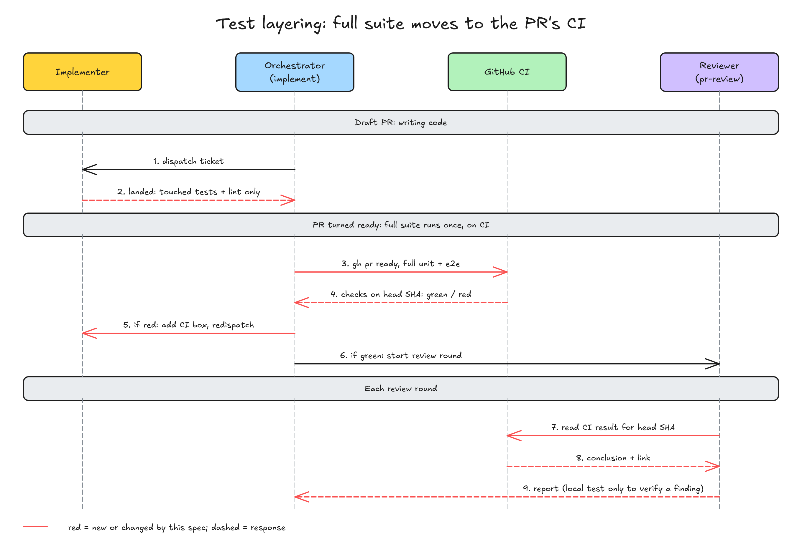

# idea-loop：测试按阶段分层，全量交给 PR 的 CI

> #303 存在：执行方交回前、pr-review 每一轮都在本机跑全量测试，CI 在 PR 上又跑同一套；Tofelair PR #957 的一张工单因此做了 4 小时 09 分，详情在「问题陈述」

## 问题陈述

### 同一个 PR 的全量测试在本机跑了很多遍，慢而且不可信

现在 idea-loop 把全量测试放在本机三处跑（对着 origin/main `d55780c`，2026-11-13 查）：

- 执行方（`idea-loop:implementer`）「做」一节：「全量套件最后跑一次」；「完成标准」第 3 条：「全量套件、typecheck、lint 都是绿的」才能提交；被叫回来修时「存量回归和全量套件照样要全绿」。
- 编排者（`idea-loop:implement`）落地时 fast-forward 不了，退回执行方「重跑全量套件」。
- 审查者（`idea-loop:pr-reviewer`）照 `review-standards` 的「机械检查」，每一轮把目标仓库 `REVIEW.md`「验证命令」的每一条在本机跑一遍。Tofelair 的 `REVIEW.md` 第 7 行写的正是「写代码时常跑前两条，提交前跑全量；review 时每一条都跑一遍」，这句出自 setup 生成 `REVIEW.md` 的模板（`setup/references/review.md` 第 5 行），装了 idea-loop 的项目都一样。

PR 转 ready 之后 CI 又在 PR 上跑同一套全量。真实例子是 Tofelair#485（PR #957）：

- 工单 06 的执行方从派出到交回 4 小时 09 分，其中全量 API 测试跑了约 6 遍，每遍约 15 分钟；最后一遍因为本机 ffprobe 卡死，拖了约 75 分钟没跑完（issue 正文，人在 Tofelair#485 的会话里记下）。
- 同一个 PR 在 CI 上：API 测试 7 分 01 秒、单元测试 9 分 12 秒，全绿（run 43429709097，`pull_request` 触发，head `991041e`，2026-11-13 本次用 `gh run view` 核过）。
- 本机同时跑着别的会话：16 GB 内存、交换区已用 20.4 / 21.5 GB、平均负载约 10，执行方的 pytest 被别的会话按进程名杀过几次（exit 144）；PR #957 第 1 轮 review 的全量单元测试也因 ffprobe 并行卡死没跑完。

本该是：写代码时只跑这次改到的测试，全量只跑一遍，跑在 CI 上。

复现材料：issue #303 正文；Tofelair `REVIEW.md` 第 7 行（2026-11-13 读）。

### 根因

插件给三个阶段写的验证要求都是「本机全量」，没有一处把全量交给 CI；setup 的模板又把「提交前跑全量；review 时每一条都跑一遍」写进了每个目标仓库的 `REVIEW.md`，执行方和审查者照它做。

## 方案

改完后，一个 PR 的全量测试只在 CI 上跑：

- **写代码时（执行方，PR 是 draft）**：只跑这张工单写的或改到的单元测试、改动涉及的那几个 API 的测试、工单选中的存量回归，加 typecheck 和 lint。交回的 `verified` 写明跑了哪些测试。全量不跑。
- **PR 转 ready 之后（编排者）**：转 ready 的时机不变（全部落地、pending 清空、review loop 没有未处理条目、没有排队中的回放）。转 ready、翻 in-review 之后，等 CI 在这个 head 上跑完；绿了才起 pr-review 第 1 轮。红了，按失败的测试找到归属工单，追加一格、派执行方修，落地推送后再等 CI。
- **review 每一轮（审查者）**：不在本机重跑全量测试，读这个 head 的 CI 结果写进机械检查；typecheck、lint 这类快的照旧本机跑（要过改动行过滤）。只为核实某条具体发现，才在本机跑对应的那几个测试。

决定每一处的输入：

1. **「改动涉及的 API 测试」怎么挑**：改动碰到哪些接口（路由、处理函数，或只有它们在用的下层代码），就跑那几个接口的 API 测试目录或文件，命令取 `REVIEW.md`「单个测试文件」那条换成这些路径。碰到被很多接口共用的底层（数据库层、公共中间件）也不扩成全量：挑直接调到它的那几个接口跑，其余交给 CI。依据：人的原话「如果改动的部分需要API测试，我觉的涉及到的API测试也需要跑，这样本地不需要跑全量的内容」。
2. **`REVIEW.md` 和插件说的不一样时**：`REVIEW.md` 只取命令，什么时候跑哪条照插件。已装的项目 `REVIEW.md` 里还留着「提交前跑全量」那句，执行方和审查者不照它跑全量；setup 的模板同步改成新说法，新装的项目不再写出这句。
3. **要真实凭据的工作**（例如重录 API 测试的假模型数据）照旧在本机跑：CI 里没有凭据。
4. **PR 上没有 CI 检查的项目**：全量没人跑就没有合并关卡，所以退回本机跑一次。编排者转 ready 后 `gh pr checks` 报没有检查，就在集成 worktree 里跑一次 `REVIEW.md` 的全量命令，结果当 CI 结果用；审查者每一轮照旧本机跑全量。真实路径：harold-skills 自己就没有 `.github/workflows`（2026-11-13 查），这个仓库的 PR 走的就是这条。
5. **CI 红了，失败跟这次改动无关**（基准分支最近一次 CI 上同一个检查也红）：开 issue，写进 Review 汇报，不回工单。依据：现存实例，`pr-review/references/deliver.md` 第 2 步对 docs 提交触发的 CI 红就是这么处理的。

同一行为的其他入口：

- **纳入**：执行方定义（「做」「完成标准」、被叫回来修的那句、交回的 `verified`）；implement 的「核对与落地」（ff 不了时重跑什么）和「全部落地」那一步；pr-review 的「前提」和「一轮之后往哪走」；pr-reviewer 定义的「机械检查」和 `review-standards` 的「机械检查」；setup 的 `REVIEW.md` 模板；插件 `README.md` 里对应的几句。
- **排除** `pr-review/references/deliver.md` 和 `merge.md`：它们已经是等 CI，不跑本机全量。
- **排除** `idea-loop:explorer`：它只把验证命令记进笔记，不决定什么时候跑。
- **排除**目标仓库自己的 `REVIEW.md`、CI workflow（draft 跳过、`ready_for_review` 触发）：issue 写明不在本次，Tofelair 的改动在插件发版后另做。

## User Stories

只修问题，不画树。

1. 期望行为（对应「同一个 PR 的全量测试在本机跑了很多遍」）：执行方交回时只跑过这张工单改到的单元测试、涉及的 API 测试、选中的存量回归、typecheck 和 lint，`verified` 列出了跑过哪些；PR 转 ready 后由 CI 跑一遍全量，绿了才进 review；review 每一轮读这个 head 的 CI 结果，不在本机重跑全量；没有 CI 的项目由编排者和审查者在本机跑全量兜底。

## 实现决策

1. **执行方的完成标准**改成：工单写的或改到的测试、涉及的 API 测试、选中的存量回归、typecheck、lint 都绿。全量不在完成标准里。被叫回来修时，已勾格对应的行为保持不坏，靠的是重跑这些格当初的测试，不是全量。
2. **交回的 `verified` 多一行**「跑了哪些测试」：测试文件或目录逐个写，没跑全量写明「全量交给 CI」。这一行是给编排者和人看范围够不够的，跟现有「读了哪几份写法规范」那行同一个形状。
3. **implement 落地时 ff 不了**：退回执行方合入最新提交、重新压成一个、重跑它这张工单的那组测试（同第 1 条），不跑全量。
4. **implement「全部落地」那一步**，在 `gh pr ready`、翻 in-review 之后、起 pr-review 之前插一步「等 CI」：`gh pr checks <PR 号> --watch` 等这次 head 的检查跑完。
   - 全绿：起 pr-review 第 1 轮。
   - 红了：`gh run view <run> --log-failed` 读失败的测试，用 `git blame` 找到引入它的提交、`ticket-ledger.mjs of` 读出工单；在工单验收末尾追加 `- [ ] CI（<日期>）：<失败的测试验的行为>`，提交 `docs(tickets): <NN> — CI 失败`，照「重派」新起执行方（已落地的工单 worktree 已回收），落地推送后回到「等 CI」。跟这次无关的照「方案」第 5 条。
   - 没有检查：照「方案」第 4 条，编排者在集成 worktree 本机跑一次全量，红了同上。
5. **pr-review 的前提**多一条：每个 PR 的 head 上 CI 已跑完且全绿（或没有检查）。还在跑就 `--watch` 等；红了照第 4 条的「红了」处理，修完再起这一轮。「一轮之后往哪走」里修复落地推送后，起下一轮之前同样等 CI。
6. **审查者的机械检查**：`REVIEW.md` 的全量测试命令、以及 CI 已在这个 head 上跑过的测试，不在本机跑，读 CI 结论写进 `checks.md`（`<检查名> | CI 结论 | 链接`，没跑完的写「CI 未完成」，不算通过）；typecheck、lint 照旧本机跑并过改动行过滤。PR 上没有检查时照旧本机跑全量。核实某条发现要跑测试时，只跑那几个。
7. **setup 的 `REVIEW.md` 模板**第 5 行改成：写代码时常跑前两条和 lint，测试只跑改动涉及的；全量由 PR 转 ready 后的 CI 跑，review 读 CI 结果。
8. **版本**：idea-loop 升 patch，`0.1.12` → `0.1.13`（人要求，issue 写明）。合并前主分支已被别的 PR 升到 `0.1.13`，这次跟着升到 `0.1.14`。

## 测试决策

| 变的是什么 | 仪器 | 本次 |
|---|---|---|
| 纯逻辑、数据转换、状态机 | TDD 单元测试 | 规则写在 skill 和 agent 定义的文字里，能机械判定的部分（旧说法删掉了、新说法在对的小节里）做成文档检查，见下 |
| API 契约（路由、schema、序列化） | TDD API 测试 | 不涉及 |
| DB schema、迁移、并发与事务语义 | 真 DB 测试 | 不涉及 |
| LLM 输出质量（prompt 改动） | eval（确定性断言） | 不涉及：改的是流程规则，不是产出质量；执行方「跑哪些测试」是可机械核的文字规则，不做回放 |
| 视觉正确性 | UI 实现环 | 不涉及 |
| 端到端用户流程 | 浏览器端到端测试 | 不涉及 |

- **seam**：插件里 skill、agent 定义、setup 模板这几份文件的文字。一个文档检查（`node --test`）按小节读它们，断言旧说法没了、新说法在。能抓到：哪处漏改、小节里还留着「全量套件最后跑一次」之类；漏掉：执行方实际跑的时候会不会照做，这一点要等 Tofelair 下一个 PR 看。
- **增量功能测试**（文档检查，先对着改前的文字跑一遍看到它红）：
  - 执行方定义的「做」「完成标准」里没有「全量套件」，有「改动涉及」的测试和「交给 CI」；交回格式的 `verified` 有「跑了哪些测试」一行；有真实凭据的例外。覆盖：期望行为 1。
  - implement 的「核对与落地」没有「重跑全量套件」；「全部落地」那段在 `gh pr ready` 之后、起 pr-review 之前有 `gh pr checks`，写了红了回工单、没有检查本机跑一次。覆盖：期望行为 1。
  - pr-review 的「前提」写了 CI；`review-standards` 的「机械检查」写了全量测试读 CI 结论、没有检查才本机跑。覆盖：期望行为 1。
  - setup 的 `REVIEW.md` 模板没有「提交前跑全量」。覆盖：期望行为 1。
  - `idea-loop/.claude-plugin/plugin.json` 的版本是 `0.1.14`（原定 `0.1.13`，见实现决策第 8 条）。
- **照着谁写**：`idea-loop/scripts/dreaming-incremental-doc.test.mjs`（按小节读 skill 文字、断言必含与禁用的说法）。

## Out of scope

- 目标仓库的 `REVIEW.md` 改写、CI workflow 改成 draft 跳过和 `ready_for_review` 触发（issue 写明另做）。
- 「涉及的 API」做成脚本按 diff 自动算：这次靠执行方判断并在 `verified` 里写出来，人和审查者看得到范围。

## 关联

- 相关 spec：[[implement-resume-landed]]（同样改 implement 的「核对与落地」，已合并，不重叠）。
- 相邻还没完成的 spec 与 issue：查过 `docs/spec/index.md` 和 open 的 `type:idea-loop/engineering` issue（2026-11-13），`docs-ride-code-pr`、`seo-draft-reads-principles` 不碰测试与 CI，没有重叠。
- 出处：Tofelair#485 的 issue 会话，人的决定（2026-11-13）。
