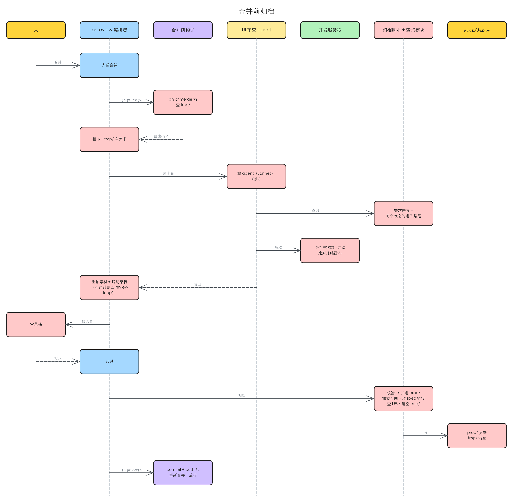

# 线上 UI 状态档案：docs/design 分 tmp / prod，设计与验证共用一张状态图

> 需要 grill：这是一个新能力（按页面维护的线上 UI 状态档案、合并前归档、查询入口、UI 审查 agent），issue 自己列了三处待定——`notes.md` 的条目格式、`DESIGN.md` 的写入标准、`tmp/` 只在本地时中途放弃的需求丢画布是否可接受——另外 §4 还有几处修法分歧要人定。

## 1 问题

本次复现在 2026-10-16 做，对象是 main（idea-loop 0.0.24）和用 idea-loop 的真实项目 Toeflair（本地 TOFEL-demo）。这几条都是「缺一个能力」，没有可截的界面，证据是对现状的核对。

### 1.1 想知道「某个页面现在长什么样、有哪些状态」，没有一处能查

**复现到的**：Toeflair 的设计档案里有两个目录，一个按「录音上传链路」这份 spec 命名、一个按「报告页音频预取」这份 spec 命名。两份冻结记录都在描述**报告页**：前一份列了题目 tab 的五个状态、详情卡的三种形态和 tab 内重录两个阶段；后一份列了报告页各个播放入口的下载中 / 失败、题位重录的准备阶段、Interview 各态。要回答「报告页的题位重录现在一共有几个状态」，得知道这两个 spec 名、两份都翻、自己拼——而且两份都是**冻结时的画布**，不是上线后实现跑出来的样子。

**本该是**：按页面（和多个页面共享的组件）各一份，列全它现在的状态、状态之间怎么跳、每个状态怎么在真实应用里进去，人和 agent 都从这一处读。

### 1.2 冻结画布的进入方式进不了真实应用，复现和测试没有能直接执行的路径

**复现到的**：冻结记录写的进入方式是画布地址加 `?state=<名字>`（例如报告页的 `report-slot`），它只在设计画布里有效；真实应用里要到「报告页某一题分析失败」这个状态，前置条件（什么账号、什么报告数据、要拦哪个请求）没有任何地方记。grill 复现、implementer 写测试、review 走流程时都要各自重新摸一遍。

**本该是**：每个状态的进入方式能直接执行（地址 / 用角色和名字定位的操作步骤 / 开发环境的状态参数，加前置条件，加「到了应该看到什么」）；进不去的写明缺什么前置条件、试过哪些路线。

### 1.3 一次 UI 改动合并后，没有任何步骤把它写回档案

**复现到的**：插件现在的钩子只有三个，都挂在「写文件之后」（设计 lint、`DESIGN.md` lint、术语表检查），合并前没有任何拦截。冻结记录在设计阶段写完就不再动：实现时偏离了画布、review 轮次里又改了 UI，档案都不知道。没走设计流程的小 UI 改动（implementer 直接改的）则完全不进档案。

**本该是**：合并前把这次的 UI 改动对着实现核一遍、写回档案，核不过不写；没走设计流程的 UI 改动同样进。

### 1.4 `DESIGN.md` 的写入口分散

**复现到的**：现在能写 `DESIGN.md` 的有三处——单独一个 `design-modeling` skill（新建 / 蒸馏 / 对账）、`uiux-imagine` 选定语言后当场调它新建、designer 动效段签字后把新动效模式**直接**写进 `DESIGN.md` 的动效先例库。最后一处没有经过人确认措辞这一步。Toeflair 目前还没有 `DESIGN.md`。

**本该是**：只有两处写（项目还没有 `DESIGN.md` 时由 `uiux-imagine` 写第一份；其余由 `dreaming` 蒸馏 / 对账 / 新建），都先读同一份规则、都交人确认；其他想改的地方一律先写成「设计法候选」等 `dreaming` 处理。

### 1.5 档案没有人定期核对，会悄悄漂移

**复现到的**：`dreaming` 现在写的是「手动或 weekly，不挂定时」，对账范围是 spec / 工单 / ADR / 术语表，不碰设计档案，也不对线上 UI 做任何重新驱动。

**本该是**：每天定时跑，对 main 上的档案逐个状态在开发环境重新驱动、抓漂移（发现是产品坏了就报告，不在档案里遮过去）；档案为空时做一次全站初扫；处理设计法候选、对账 `DESIGN.md`。定时那次只出提议表，人批了才执行。

复现材料：`.tmp/to-spec/ui-state-archive/repro/2026-10-16-code-state.md`

### 1.6 根因

- 1.1、1.2：设计档案是**按 spec 组织**的冻结记录，记录的是「这次要改成什么样」，不是「线上现在是什么样」；没有按页面 / 组件的结构，也没有面向真实应用的进入方式。
- 1.3：档案只在设计阶段写一次，流程里没有「实现定型之后写回」的节点；而 PR open 之后 review 还可能改 UI，所以这个节点只能放在合并前。
- 1.4：`design-modeling` 被做成一个可以被多处调用的独立 skill，designer 又另开了一条直写的路，规则散在两处。
- 1.5：`dreaming` 当初按「没有外部时钟压力，定时跑会变成噪音」定成手动，那时还没有需要每天对着线上核的东西。

## 2 方案

把 `docs/design/` 拆成两半：`tmp/<spec-slug>/` 放进行中需求的全部设计过程产物（只在本地、不进 PR），`prod/` 放线上现在的样子（提交），按页面和组件各一份，核心是一张**状态图**——节点是状态、边是触发、动效挂在边上、用户路径是图上一条有名字的路线。设计侧读它拿基线，验证侧读它按路径进状态，读的是同一份东西。

写入只在一个时刻发生：**合并前归档**。本地钩子在合并命令前看到 `tmp/` 还有东西就拦下，由 pr-review 的编排者起一个 UI 审查 agent，对着实现逐个进状态、走流程、比对，通过后重拍截图、起草说明交人审，人通过才并进 `prod/`。同一个 agent 也在 pr-review 每一轮里跑，拿实现出来的流程对冻结的流程，抓漏掉的。

读取走一个查询入口（脚本模块 + 一层 MCP 包装），按页面 / 单个状态 / 单条路径 / 需求差异四种视图返回；给人看的是脚本生成的一个浏览页。

`DESIGN.md` 的规则从 `design-modeling` 里拆出来变成一份 reference，skill 删掉；只有 `uiux-imagine`（项目还没有时写第一份）和 `dreaming` 两处写，都交人确认。

`dreaming` 改成每天定时，加上 `prod/` 对账、全站初扫、候选蒸馏、`DESIGN.md` 对账，定时那次只出提议表。

完整的目录、视图表、生命周期和归档流程见 #28 原文（§8），审核时以它为准。

## 3 User Stories

backlog 模式不画场景树，每条问题一行期望行为，编号对应 §1。

1. **按页面查得到线上 UI**：作为 grill / uiux-imagine / 人，我能按页面（或共享组件）一次拿到它的全部状态、状态间的触发、动效、用户路径和说明，不用知道当初是哪几份 spec 改过它。
2. **状态能直接进**：作为 implementer / 复现者 / UI 审查 agent，我能拿到任一状态在真实应用里的进入方式（前置条件 + 步骤 + 应看到什么）并照着执行进去；进不去的状态写明缺什么、试过什么。
3. **合并前写回档案**：作为合并 PR 的人，本地还有没归档的 UI 改动时合并会被拦下；UI 审查 agent 对着实现核过、我审过说明之后，改动才并进 `prod/`，交互图挪到页面目录、spec 里的链接同步改写；没走设计流程的 UI 改动同样经过这一步。
4. **`DESIGN.md` 只有两处写**：作为项目负责人，`DESIGN.md` 只会被 `uiux-imagine`（项目还没有时）和 `dreaming` 写，每次都先给我看措辞；其他地方提出的规则先作为候选记进页面说明。
5. **每天核对档案**：作为项目负责人，我每天收到一份提议表（档案漂移、初扫结果、候选处置、`DESIGN.md` 对账），逐行批准后才执行，执行结果单独开一个只改知识库的 PR。

## 4 实现决策

issue 里已经定下的（状态图模型、目录、notes 两节、收录规则、真值与生命周期、合并前归档、`DESIGN.md` 两个写入口、`dreaming` 每天跑、读取的四种视图）不在这里重复，以 #28 原文为准。下面只列还没定、或修法有分歧的。

### 4.1 issue 自己列的待定项（grill 时定）

- **说明文件的条目格式**，尤其「决策思考」怎么写。
- **`DESIGN.md` 的写入标准**：issue 写明由 Harold 读完几份现成的 `DESIGN.md` 后给，不由起草方代填。
- **`tmp/` 只在本地**：中途放弃的需求会丢掉画布。issue 目前判断可接受，grill 时确认。

### 4.2 是否一次做完，还是拆成几份 spec 分批落

这份 spec 动到十来个 skill / agent / 脚本。两种落法：

- **A**：整份一次做完，一个 PR。
- **B**：审核时拆成三份按顺序落——先「档案结构 + 查询入口 + 合并前归档 + UI 审查 agent」（问题 1–3），再「`DESIGN.md` 写入口收拢」（问题 4），最后「`dreaming` 每天对账」（问题 5，依赖前两份）。

推荐 B：问题 4 与前三条独立，可以先合；问题 5 要等档案有东西才有得核。拆的话在审核会话里做（同一个 issue 只能挂一份 spec，拆出的另两份在 §8 互相关联）。

### 4.3 现有的 `docs/design/<spec-slug>/` 冻结记录怎么迁

Toeflair 已有两份按 spec 命名的冻结记录（都覆盖报告页）。

- **A**：不迁，留作历史；`prod/` 由 `dreaming` 的全站初扫从实现建出来。
- **B**：写一次性迁移，把冻结记录里的状态拆进 `prod/pages/` 下对应页面。

推荐 A：冻结记录记的是画布，不是实现，按 §1.2 的规则搬过来的进入方式本来就进不了真实应用，迁过去也要重拍、重写进入方式，等于初扫。

### 4.4 `design-modeling` 删掉后，人想口述一条视觉规则走哪

issue 写的是「改成往说明文件写候选，等 `dreaming` 处理」。分歧在于没有 `dreaming` 定时那次之前人是否要能当场落：

- **A**：一律等每天那次；
- **B**：人可以手动调 `dreaming` 只处理这一条。

推荐 B：`dreaming` 本来就支持手动调用，不另开入口。

### 4.5 浏览页的形态

浏览页（按页面拼状态 / 路径 / 组件 / 说明，默认看截图与动图，「实时」开关用内嵌框架开开发服务器的对应状态）是脚本生成的工具页，不是产品 UI，本 spec 不走 `uiux-imagine` / `uiux-refine`。如果审核时认为它要单独设计，就把它拆成一份碰 UI 的 spec。

## 5 技术方案总览

### 5.1 后端

这里的「后端」是插件里的钩子、agent、脚本和目标仓库的 `docs/design/`。

红色是本 spec 新增的消息，虚线是响应。

- 新增本地钩子：挂在合并命令之前，只看本地 `docs/design/tmp/` 是否为空（钩子只能跑脚本，起 agent 由编排者接着做）。
- 新增 UI 审查 agent：输入是这个需求的 `tmp/` 相对 `prod/` 的差异；输出截图、动图、文字描述和说明草稿；比对用现有的界面比对脚本的容差。不通过不写入，回 review loop。
- pr-review 每一轮也起它，结果并进汇报的 Spec 一节；Codex 只审代码，不读设计档案。
- 新增查询脚本模块 + MCP 包装（读取入口，四种视图）、归档脚本、浏览页生成脚本。
- 交互图拼图脚本的输入加状态 id 引用，冻结时 designer 把交互图写成对 `prod/` 的差异。
- 设计 lint 钩子的监视路径改到 `docs/design/tmp/<spec-slug>/`。

读路径：所有 Claude 侧 agent 经 MCP 调查询模块读 `prod/`（和某个需求的 `tmp/`）；本地钩子直接调 CLI。

### 5.2 前端内部

不涉及。

### 5.3 前端交互

不涉及。浏览页是脚本生成的工具页，见 §4.5。

## 6 测试决策

| 变的是什么 | 仪器 | 本次 |
|---|---|---|
| 纯逻辑 / 数据转换 | TDD 单元 | 碰到：查询模块（四种视图的组装、`usedBy` 反向生成）、状态图校验（每个状态至少在一条路径上、每个异步动作写明加载 / 失败 / 空分支或标「不适用」、进不去的状态写明缺什么）、归档脚本（`tmp/` 差异并入 `prod/`、交互图挪位与 spec 链接改写）、合并前钩子（`tmp/` 空 / 非空的放行与拦截）、拼图脚本的状态 id 输入。照现有脚本旁的 `*.test.mjs` 写（`node --test`）。 |
| API 契约 | TDD API 测试 | 碰到：MCP 包装的工具入参与返回形状，对着查询模块同一组夹具测。 |
| DB schema / 迁移 / 并发 | 真 DB 测试 | 不涉及。 |
| LLM 输出质量 | eval | 碰到但不新建套件：UI 审查 agent 与改动的 skill 是提示词改动，按仓库约定走 vibe 迭代；`uiux-imagine` / `uiux-refine` 改了产物路径，要对 `idea-loop/evals/` 的 baseline 重跑一次，断言「环还接着」。 |
| 视觉正确性 | UI 实现环 | 不涉及（不改产品 UI）。 |
| 端到端用户流程 | 浏览器测试 | 碰到：在一个有真实页面的项目（Toeflair）上手动走一遍「改一处 UI → 合并被拦 → UI 审查 → 人审 → 并进 prod/ → 放行」。 |

- **seam**：查询模块的公共函数（四种视图）是读侧唯一的 seam；写侧是归档脚本的命令行入口和合并前钩子的退出码。MCP 包装只做转发，测它的入参与返回形状即可。
- **增量功能测试**：
  - 页面视图：前置——夹具里两个页面共享一个组件；步骤——查其中一个页面；期望——返回页面状态、各区域的组件状态、路径、动效、说明，组件的 `usedBy` 列出两个页面。覆盖 1。
  - 状态进入方式校验：前置——一个状态既没写进入步骤也没写缺什么；期望——校验报错并点名这个状态。覆盖 2。
  - 合并前拦截：前置——`docs/design/tmp/` 下有一个需求目录；步骤——跑合并命令；期望——被拦下并提示先归档；清空后放行。覆盖 3。
  - 归档：前置——`tmp/` 里有一份新增两个状态、改一条边的差异，spec 引用了交互图；期望——`prod/` 多出两个状态、边更新，交互图在页面目录、spec 链接已改写，`tmp/` 清空。覆盖 3。
- **prompt / eval 变动**：新增 UI 审查 agent 的定义；改 `uiux-imagine`、`uiux-refine`、designer、implement / implementer、pr-review、`dreaming` 的说明；删 `design-modeling`。不新建 eval 轴，只重跑现有 baseline。
- 先例：`spec-status.test.mjs`、`flow-compose.test.mjs`、`design-lint-hook` 相关测试。

## 7 Out of scope

- Codex 读设计档案（明确不读）。
- 设 CI 检查拦未归档的 UI 改动（`tmp/` 不进 PR，CI 看不到）。
- 视觉回归基线库 / 自动像素回归（截图是派生物，随时可重拍）。
- 迁移现有按 spec 命名的冻结记录（见 §4.3 推荐）。
- 替 Harold 定 `DESIGN.md` 的写入标准。

## 8 关联

- #28 idea-loop：docs/design/ 分 tmp / prod，维护产品状态图（页面 / 组件 / 状态 / flow / 动效），设计与验证共用——本 spec 的来源，目录、视图表、生命周期与归档流程的完整描述（含架构图）以它为准。
- [[0002-design-loop-v2-imagine-refine]]：现在 imagine / refine 的产物落点与冻结方式由它定，本 spec 改动它。
- issue 原文提到的相关 issue：#25（交互图与拼图脚本）、#26、#27。
