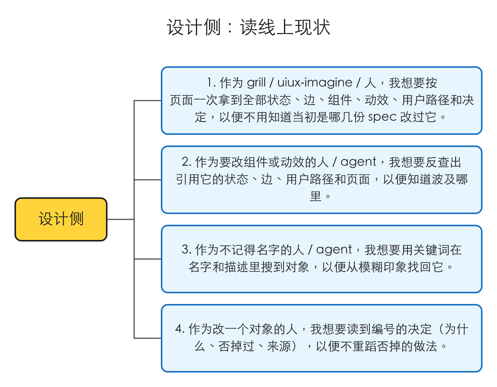
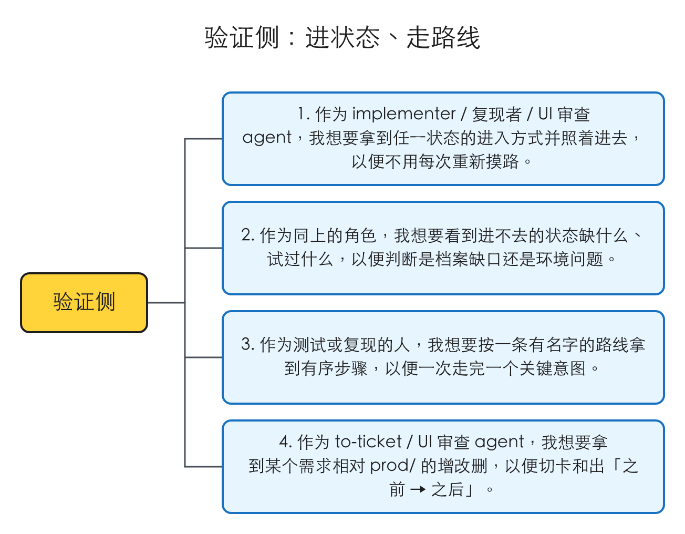
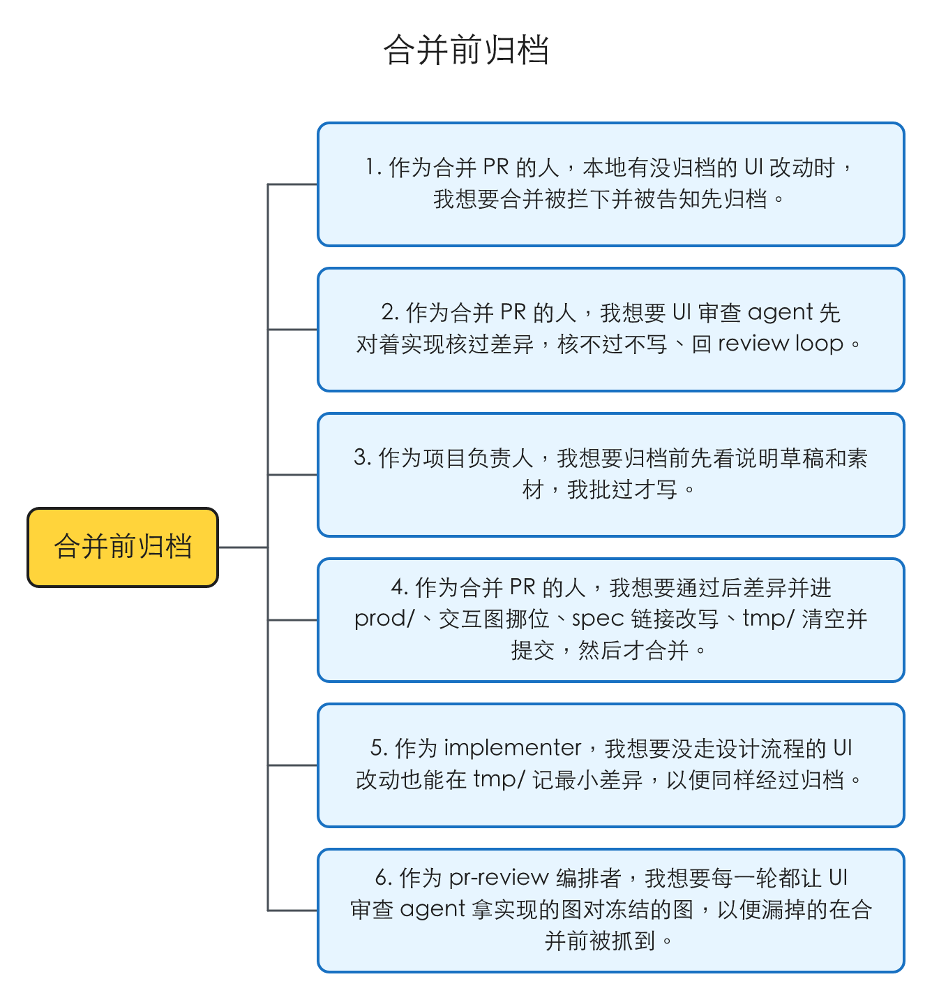

# 线上 UI 状态档案：docs/design 分 tmp / prod，设计与验证共用一张状态图

## 1 问题

复现在 2026-10-16 做，对象是 main（idea-loop 0.0.24）和用 idea-loop 的真实项目 Toeflair（本地 TOFEL-demo）。这几条都是「缺一个能力」，没有可截的界面，证据是对现状的核对。

### 1.1 想知道「某个页面现在长什么样、有哪些状态」，没有一处能查

**复现到的**：Toeflair 的 `docs/design/` 下有 5 个目录，都按 spec 命名。其中「录音上传链路」和「报告页音频预取」两份冻结记录都在描述**报告页**：前一份列了题目 tab 的五个状态、详情卡的三种形态和 tab 内重录两个阶段；后一份列了报告页各个播放入口的下载中 / 失败、题位重录的准备阶段、Interview 各态。要回答「报告页的题位重录现在一共有几个状态」，得知道这两个 spec 名、两份都翻、自己拼——而且两份都是**冻结时的画布**，不是上线后实现跑出来的样子。

做过的取舍也一样难找：分析页完成徽章的对勾用 ease-out-sine、不用站内默认曲线（默认曲线开头 40ms 就画完约 75%，读起来是跳出来），这条理由和被否掉的做法只写在那份 spec 命名的冻结记录里。下次有人改这个徽章，不知道 spec 名就找不到它。

**本该是**：按页面查，一次拿到它现在的全部状态、状态之间怎么跳、用到哪些组件和动效、当初为什么这样定；也能反过来从一个组件或动效查到哪些地方用了它。

### 1.2 冻结画布的进入方式进不了真实应用，复现和测试没有能直接执行的路径

**复现到的**：冻结记录写的进入方式是画布地址加 `?state=<名字>`（例如报告页的 `report-slot`），它只在设计画布里有效；真实应用里要到「报告页某一题分析失败」这个状态，前置条件（什么账号、什么报告数据、要拦哪个请求）没有任何地方记。grill 复现、implementer 写测试、review 走流程时都要各自重新摸一遍。

**本该是**：任一状态的进入方式都能直接执行（入口地址加前置条件，再加沿途每一步做什么，最后到了应该看到什么）；进不去的写明缺什么前置条件、试过哪些路线。

### 1.3 一次 UI 改动合并后，没有任何步骤把它写回档案

**复现到的**：插件现在的钩子只有三个，都挂在「写文件之后」（设计 lint、`DESIGN.md` lint、术语表检查），合并前没有任何拦截。冻结记录在设计阶段写完就不再动：实现时偏离了画布、review 轮次里又改了 UI，档案都不知道。没走设计流程的小 UI 改动（implementer 直接改的）则完全不进档案。

**本该是**：合并前把这次的 UI 改动对着实现核一遍、写回档案，核不过不写；没走设计流程的 UI 改动同样进。

复现材料：`.tmp/to-spec/ui-state-archive/repro/2026-10-16-code-state.md`

### 1.4 根因

- 1.1、1.2：设计档案是**按 spec 组织**的冻结记录，记录的是「这次要改成什么样」，不是「线上现在是什么样」；没有按页面 / 组件的结构，也没有面向真实应用的进入方式，理由和否掉的做法跟着 spec 走、不跟着它说的对象走。
- 1.3：档案只在设计阶段写一次，流程里没有「实现定型之后写回」的节点；而 PR open 之后 review 还可能改 UI，所以这个节点只能放在合并前。

## 2 方案

把 `docs/design/` 拆成两半：`tmp/<spec-slug>/` 放进行中需求的全部设计过程产物（只在本地、不进 PR），`prod/` 放线上现在的样子（提交）。

`prod/` 是**一张图**。节点是页面状态（完整的一屏），每个状态一份 markdown；边写在出发状态的文件里，是用户在某个组件上的一次操作，或者一个系统行为（几秒后、下载失败）。组件按代码组件划分、每个单独一份；动效、用户路线也各自单独一份，都是可以被引用的对象。对象之间用 Obsidian wikilink 关联，所以人在 Obsidian 里打开 `docs/` 就能顺着链接逛这张图。每份文件的 frontmatter 放机器读的结构，正文放给人看的描述、截图和说明。

进入方式不逐个状态手写：只有入口节点（地址可直达的状态）写地址和前置条件，任一状态怎么进去 = 从入口节点沿边走到它的路径，由查询脚本算出来。

读取走一个查询入口，六种问法：页面、单个状态、单条路线、需求差异、反查（谁引用了这个组件 / 代码路径 / 动效）、关键词。所有 Claude 侧 agent 经 MCP 调它；本地钩子与脚本直接调命令行。

写入只在一个时刻发生：**合并前归档**。本地钩子在合并命令前看到 `tmp/` 还有东西就拦下；pr-review 的编排者起 UI 审查 agent，对着实现逐个进状态、走边、比对，通过后重拍素材、起草说明交人审，人通过才由归档脚本并进 `prod/`。同一个 agent 也在 pr-review 每一轮里跑，拿实现出来的图对冻结的图，抓漏掉的。

`DESIGN.md` 怎么写、谁能写，不在这份 spec 里（[[design-md-write-entry]]）；`dreaming` 怎么每周核对这张图（[[dreaming-design-reconcile]]）也不在。这份 spec 只给它们留好读取入口和「设计法候选」这个交接格式（§4.12）。

## 3 User Stories

### 设计侧：读线上现状



1. 作为 grill / uiux-imagine / 人，我想要按页面一次拿到它现在的全部状态、状态之间的边、用到的组件和动效、经过它的路线、以及挂在这些对象上的决定，以便不用知道当初是哪几份 spec 改过它。
2. 作为要改一个组件或动效的人 / agent，我想要反查出引用它的所有状态、边、路线和页面，以便知道这次改动会波及哪里。
3. 作为不记得名字的人 / agent，我想要用一个关键词在对象的名字和描述里搜到它，以便从模糊的印象找回对象。
4. 作为改一个对象的人，我想要在它的文件里读到编号的决定，每条带为什么、否掉过什么、来源是哪份 spec，以便不重蹈已经否掉的做法。

### 验证侧：进状态、走路线



1. 作为 implementer / 复现者 / UI 审查 agent，我想要拿到任一状态的进入方式（入口地址 + 前置条件 + 沿途每一步 + 到了应看到什么）并照着执行进去，以便不用每次重新摸路。
2. 作为同上的角色，我想要在一个进不去的状态上看到缺什么前置条件、试过哪些路线，以便判断是档案缺口还是环境问题。
3. 作为测试或复现的人，我想要按一条有名字的路线（一个关键用户意图，可跨页面）拿到有序步骤，以便一次走完一个完整意图。
4. 作为 to-ticket / UI 审查 agent，我想要拿到某个需求的 `tmp/` 相对 `prod/` 新增、改动、删除了哪些对象，以便切卡和出「之前 → 之后」。

### 合并前归档



1. 作为合并 PR 的人，本地还有没归档的 UI 改动时，我想要合并被拦下并被告知先归档，以便档案不会漏掉这次改动。
2. 作为合并 PR 的人，我想要 UI 审查 agent 先对着实现核过这次的差异，核不过就不写、回 review loop，以便档案里不写进和实现对不上的东西。
3. 作为项目负责人，我想要在归档前看到这次要写进档案的说明草稿（决定、设计法候选、素材），我批过才写，以便早期每次写入都经过人。
4. 作为合并 PR 的人，我想要通过后差异并进 `prod/`、交互图挪到对应页面、spec 里的图片链接同步改写、`tmp/` 清空并提交到 PR 分支，然后才真正合并。
5. 作为 implementer，我想要没走设计流程的 UI 改动也能在 `tmp/` 记一份最小差异，以便它同样经过归档。
6. 作为 pr-review 的编排者，我想要每一轮 review 都让 UI 审查 agent 拿实现出来的图对冻结的图，以便漏掉的状态和边在合并前就被抓到。

## 4 实现决策

### 4.1 档案是一张图

- **节点 = 页面状态**：一个页面在某一刻的完整一屏，已经包含其中每个组件当时的样子。组件自己的状态不单独建模——「播放按钮在下载中」就是「报告页 · 题位下载中」这一屏的一部分。
- **边 = 从一个状态到另一个状态的一次触发**，两类：
  - **用户行为**：在某个组件上做某个操作（点、输入、拖、按键）。边上引用这个组件，并写出用 ARIA 角色和名字定位它的方式。
  - **系统行为**：不经过组件的变化（2 秒后、下载失败、轮询发现完成）。边上写怎么让它发生（拦哪个请求、等多久）。
- **可引用对象**：组件、动效、路线。节点和边都可以引用组件和动效来补充描述。
  - **组件按代码组件划分**：一个前端组件 = 一份组件文件，挂代码路径。**所有代码组件都单独存**，不论几个页面用；页面只记「哪个区域用哪个组件」。被第二个页面用到时不迁移、不改写任何引用。展示类组件（不承载操作的）同样存档，但不出现在边上。
  - **档案组件和 `DESIGN.md` 的 Components 章是两层**：后者是系统级基础件（按钮、输入框）的配方；档案组件是代码里的具体组件，可以引用基础件的 token，不重抄配方。
  - **动效**：每个具体动效单独一份，写参数与理由。时长和缓动能引用 `DESIGN.md` 的 token 就引用，偏离的必须写为什么。边引用的是「切换时怎么动」，节点引用的是「这一屏常驻的动」（加载转圈）。
  - **路线**：有名字的一串状态，表达一个关键用户意图（「重听一道题的示范音频」），可以跨页面。路线只表达意图，**不承担「怎么进状态」**。
- **每类对象都有自己的 markdown 文件**：页面、页面状态、组件、动效、路线各一份（§4.2）。只有页面状态是图上的节点；其余是被节点和边用 wikilink 引用的对象，不进图的拓扑。素材（截图、GIF）挂在各自对象的 `assets/` 下。
- 具体动效只落在这张图的节点、边和动效文件上，不进 `DESIGN.md`（[[design-md-write-entry]] 的写入标准第十章）。

### 4.2 目录与文件

```
docs/design/
├── tmp/<spec-slug>/            进行中的需求，只在本地（目标项目 .gitignore），不进 PR
│   ├── imagine/                uiux-imagine 的工作区与方向说明（原 worktree 根 .tmp/uiux-imagine/<spec-slug>/）
│   ├── canvas/                 uiux-refine 的画布、冻结记录、完整验收矩阵、交互图（原 docs/design/<spec-slug>/）
│   └── delta/                  这个需求对 prod/ 的差异：与 prod/ 同构的新增 / 改动对象文件 + removed.md
└── prod/                       线上现在的样子，提交
    ├── index.md                脚本生成：页面、组件、动效、路线四张清单
    ├── pages/<page>/
    │   ├── <page>.md           页面对象
    │   ├── <page>--<state>.md  页面状态（节点），一个状态一份，边写在这里
    │   └── assets/             状态截图、动效 GIF、交互图（flows/）
    ├── components/<Component>/<Component>.md (+ assets/)
    ├── motions/<motion>.md (+ assets/)
    └── routes/<route>.md
```

- **页面变成目录，每个状态一份文件**。状态如果只是页面文件里的一节，页面内的流转在 Obsidian 图上全变成自环，图就没用了。
- **状态文件名带页面前缀**（`<page>--<state>`）：wikilink 按 basename 解析，不同页面都有 `loading` 时要靠前缀区分。组件文件用代码组件名。`docs/` 下 basename 全局唯一（wiki-conventions §4），由校验脚本查。
- **`tmp/` 只在本地**（grill 已定，接受中途放弃的需求丢画布）。放弃的需求不上线，有价值的结论写回 spec 或 issue。
- **差异的形态**：`delta/` 和 `prod/` 同构——新增或改动的对象放它改完之后的**全文**，删除的对象 id 列在 `removed.md`。这样归档 = 覆盖 + 删除，需求差异视图 = 逐个对象比对，都不用解析补丁格式。
- **素材走 Git LFS**：目标仓库的 `.gitattributes` 管 `docs/design/prod/**/assets/` 下的 png / gif / webm。归档脚本首次归档时检查，没配就提示要加哪一行，**不代改**。
- **`prod/` 只存精简矩阵**：每个状态一张主视口截图（主视口、主题、语言写在 `prod/index.md` 的 frontmatter 里，项目定一次），每个有动效的边或节点一张 GIF。完整矩阵（主题 × 视口 × 语言 × 动效偏好）只在 `tmp/<spec-slug>/canvas/`，随 `tmp/` 清掉。截图是派生物，随时可重拍。

### 4.3 frontmatter：机器读的结构

每份对象文件照 wiki-conventions §3 带 `type` / `tags` / `summary`，加各自的结构字段。引用一律写成 `"[[<basename>]]"` 字符串，Obsidian 和脚本读的是同一个东西。下面的形状是决策载体（出处：本 spec），字段名在实现时可以微调，结构不变。

**页面** `type: design-page`

```yaml
code: [<页面入口代码路径>]
regions:                         # 区域 → 组件
  - { name: 题目 tab, component: "[[QuestionTabs]]" }
```

页面有哪些状态不在这里列——看哪些文件带这个页面前缀，一条事实只存一处。

**状态（节点）** `type: design-state`

```yaml
page: "[[report]]"
entry:                           # 只有入口节点有
  url: /report/<id>
  preconditions: { account: …, data: …, flags: … }
components: ["[[RecordingSlot]]"]   # 这一屏要特别说明的组件（可选）
motions: ["[[spinner-ring]]"]       # 这一屏常驻的动效（可选）
edges:
  - id: retry
    to: "[[report--slot-retrying]]"
    kind: user
    component: "[[RetryButton]]"
    locate: { role: button, name: 重新加载 }
    action: click
    motion: "[[retry-collapse]]"     # 可选
  - id: download-ok
    to: "[[report--slot-ready]]"
    kind: system
    trigger: 下载完成
    how: 放行音频请求
  - id: from-history
    to: "[[report--slot-failed]]"
    kind: user
    blocked: { missing: 一份分析失败的报告数据, tried: [拦分析接口返回 500, 测试账号的历史报告] }
async:                           # 这一屏发起了异步动作时必填
  loading: "[[report--slot-loading]]"
  failure: "[[report--slot-failed]]"
  empty: 不适用
```

**组件** `type: design-component`：`code`（代码路径）、`tokens`（引用的 `DESIGN.md` 基础件或 token，可选）、`usedBy`（**归档脚本反向生成**，不手写；单个页面用也生成）。

**动效** `type: design-motion`：`duration`、`easing`（`{token}` 引用或字面值，字面值必须配 `deviates:` 一句为什么偏离）、`properties`、`iterations`、`reducedMotion`（减少动效下怎么退）、`usedBy`（生成）。

**路线** `type: design-route`：`intent`（一句话的用户意图）、`path`（有序状态列表；相邻两个之间有多条边时写 `{ state, via: <边 id> }`）。

### 4.4 正文：给人看的内容与说明格式

- **状态文件**只写两节：「这一屏」（描述 + 截图 / GIF）和「应看到什么」（可判定的几条，进状态之后拿它核对）。状态文件不写决定。
- **页面、组件、动效、路线文件**写描述，加两节说明：「决定」「设计法候选」。不设独立的 notes 文件：决定跟着它说的那个对象走，改那个对象的人打开文件就看到。
- **「决定」按编号写**（决定 1、决定 2……），每条：

  ```markdown
  ### 决定 2：对勾用 ease-out-sine 写出来，不用站内默认曲线
  规则一两句。
  - 为什么：（必填）
  - 否掉过：（必填，写被否的做法和否的理由；确实没有备选写「无」）
  - 来源：[[<spec-slug>]]（dreaming 蒸馏成 ADR 后改链到 ADR）
  ```

  不写日期；规则改了**原地改写**，不追加新条目；编号不复用。
- **「设计法候选」单列**，每条写成 `DESIGN.md` 可以直接收的形态（无日期、无页面名、可照做），加「并进：<章名>」和「证据：<引用了这种做法的对象 wikilink>」。由 dreaming 处理，处理完即删；这一节空了就是处置完了。候选「该不该进、怎么进」的判据归 [[design-md-write-entry]]，这里只定形状。

### 4.5 进入方式从图上推导

- 只有入口节点写 `entry`（地址 + 前置条件）；边写怎么触发；每个状态写「应看到什么」。
- 任一状态的进入方式 = 查询脚本算出的**从某个入口节点到它的最短路径**（跳过标了 `blocked` 的边）：返回入口地址与前置条件、沿途每条边的定位与操作（或怎么让系统行为发生）、终点的「应看到什么」。
- **进不去** = 没有路径，或者唯一的路径上有 `blocked` 边；返回时带上每条 `blocked` 边的「缺什么 + 试过什么」。一个状态既没有路径、入边上也没写 `blocked`，校验报错——漏写前置条件本身就是漂移。
- 校验规则（脚本，可机械判定）：
  1. 每个状态都能从某个入口节点到达，或者它的入边里有 `blocked`。
  2. 发起异步动作的状态写全 `async` 三项，各项是一个状态或「不适用」。
  3. 所有 wikilink 能解析；边的 `component` 指向组件、`motion` 指向动效；`docs/` 下 basename 不重复。
  4. 路线的 `path` 相邻两个状态之间有边；有多条时写了 `via`。
  5. 状态文件没有「决定」一节；其余对象的每条决定都有为什么、否掉过、来源；每条候选都有并进与证据。
  6. 动效的字面值都带 `deviates`；`usedBy` 与反向引用一致。

### 4.6 召回：一个查询模块，六个入口

- 核心是一个脚本模块（读 `prod/`，也能叠上某个需求的 `tmp/<spec-slug>/delta/` 读「改完之后的样子」），外面两层薄包装：命令行（本地钩子和其他脚本用）与 MCP（所有 Claude 侧 agent 用）。**MCP 声明在插件自己的 `.mcp.json` 里**，目标项目零配置；仓库根取当前会话的 git 顶层。Codex 不配、不读档案。
- 引擎是读文件加文本匹配，不用 embedding。
- **MCP 只管读**。写入不提供 MCP 工具：设计侧、implementer、UI 审查 agent 直接编辑 `tmp/<spec-slug>/delta/` 下的文件；`prod/` 只由归档脚本（命令行，人批过之后由编排者跑）写，见 §4.8。这样任何 agent 都绕不过人审和校验去改 `prod/`。
- 六个入口：

  | 入口 | 给什么 | 返回什么 | 主要谁用 |
  |---|---|---|---|
  | 页面 | 页面名 | 页面对象、区域与组件、全部状态及其边、经过它的路线、引用到的动效、所有决定与候选 | uiux-imagine 拿基线、grill 了解现状 |
  | 单个状态 | 状态名 | 进入方式（§4.5 推导）、应看到什么、截图 | grill 复现、implementer 进状态写测试、UI 审查 |
  | 单条路线 | 路线名 | 意图 + 有序步骤，每一步怎么触发、到了应看到什么 | 测试、复现、to-spec 画交互图 |
  | 需求差异 | spec 名 | `delta/` 相对 `prod/` 新增 / 改动 / 删除的对象，改动的给出字段级差异 | to-ticket 切卡、UI 审查对图和出「之前 → 之后」 |
  | 反查 | 组件名或代码路径、动效名 | 引用它的状态、边、路线、页面 | 改组件 / 动效前看波及面 |
  | 关键词 | 一段文字 | 名字与描述匹配的对象，按命中位置排序 | 不记得名字时找回对象 |

- 插件级 reference 解释这张图的结构、frontmatter 形状和六个入口，各 skill 引用它 + 调工具，按场景组合给人看的内容。

### 4.7 谁往 `tmp/` 写什么

- **uiux-imagine**：工作区与方向说明从 worktree 根的 `.tmp/uiux-imagine/<spec-slug>/` 搬到 `docs/design/tmp/<spec-slug>/imagine/`，方向说明校验脚本跟着改路径。开工时用页面入口拿线上基线。
- **uiux-refine / designer**：画布、冻结记录、完整矩阵、交互图落 `tmp/<spec-slug>/canvas/`；冻结时**额外**把冻结结果写成 `delta/`——新增 / 改动的状态与边、动效、组件，冻结记录里的理由与被否的做法按 §4.4 拆成对应对象的「决定」，Distill-back 写成「设计法候选」。designer 动效段签字后的新动效**只进动效文件和候选**，不再直接写 `DESIGN.md`（写入口的收拢本身归 [[design-md-write-entry]]，这里只改落点）。交互图拼图脚本的输入加状态 id 引用，让交互图上的每一格都能对回 `delta/` 里的状态。
- **implement / implementer**：没有设计稿的 UI 工单，implementer 在 `delta/` 里记最小差异（改了哪些状态、边、组件）。implementer 在自己的 worktree 里干活，而 `tmp/` 不进 git，所以**编排者把集成 worktree 里 `tmp/<spec-slug>/` 的绝对路径交给 implementer**：冻结画布从那里读，最小差异写到那里，只写本工单碰到的对象文件。进状态写测试时走查询入口的「单个状态」。
- design-lint 钩子的监视路径改到 `docs/design/tmp/<spec-slug>/canvas/`。
- 冻结记录本身只在 `tmp/` 里，合并后随 `tmp/` 清掉；它要长期留下的东西（状态、动效、决定、候选）在归档时已经进了 `prod/`。spec §4 冻结摘要里的指针改成指向 `tmp/<spec-slug>/canvas/` 的路径，不写 wikilink（目标不进 git）。

### 4.8 写入：合并前归档

- **触发**：插件级 PreToolUse 钩子挂在 Bash 上，命令里有 `gh pr merge` 且本地 `docs/design/tmp/` 下还有非空的需求目录就拦下，提示先归档并点名是哪几个需求。钩子只跑脚本、起不了 agent。**不设 CI 检查**（`tmp/` 不进 PR，CI 看不到）。
- **pr-review 的合并步骤**（§4 合并）在执行合并命令前先查 `tmp/`，有东西就走归档：
  1. 起 **UI 审查 agent**（新 agent，Sonnet · high）：按 worktree 约定起开发服务器，拿需求差异，对 `delta/` 里每个新增或改动的状态用 §4.5 推导的路径进去、走每条新增或改动的边，画面和冻结画布用界面比对脚本的现有容差比对。进不去或对不上 → 不写入，结果回 review loop。
  2. 通过后它在实现上**重拍**精简矩阵、录动效 GIF，补齐状态的「这一屏」和「应看到什么」，把要写进对象文件的决定与候选整理成草稿，**停下交回编排者**。
  3. 编排者在会话里给人看草稿（早期每次写入都要人看过）；要改就把批示转回同一个 agent 改完再看。
  4. 人通过后，编排者跑**归档脚本**：先校验（§4.5），再把 `delta/` 覆盖进 `prod/`、按 `removed.md` 删对象、重新生成 `usedBy` 与 `prod/index.md`；交互图挪进 `prod/pages/<page>/assets/flows/`，把 spec 里指向它们的链接改写成新路径（spec 在被 dreaming 蒸馏成 ADR 之前一直看得到图）；首次归档时查 LFS 配置；清空 `tmp/<spec-slug>/`。
  5. commit + push 到 PR 分支，重新执行合并（钩子这次放行）。
- 归档只保证「不写错」，不负责发现漏掉的状态——那靠 §4.9。

### 4.9 每轮 pr-review 也跑 UI 审查

- `tmp/` 有需求目录时，pr-review 编排者每一轮在起 pr-reviewer **之前**先起 UI 审查 agent（子 agent 起不了子 agent，所以由编排者串起来）：拿实现走出来的图对 `delta/` 里冻结的图，找漏掉的状态、对不上的边和画面。
- 它的发现写成文件交给 pr-reviewer，并进汇报的 Spec 一节，格式、证据要求和校验脚本都沿用现有的。**Codex 只审代码**，不读设计档案。
- PR 描述「之前 → 之后」的「之前」从 `prod/` 取。

### 4.10 现有按 spec 命名的冻结记录：不迁，删掉

- Toeflair 现有 5 份按 spec 命名的冻结记录**不迁进 `prod/`，也不当初扫的输入**。`prod/` 由 dreaming 的首次全站初扫从实现从头建（[[dreaming-design-reconcile]]），旧目录删掉，git 历史里还在。
- 插件不写迁移脚本。校验脚本遇到 `docs/design/` 下 `tmp/`、`prod/` 以外的目录时报一条提示（旧布局，建议删），不报错、不读它。

### 4.11 浏览页：不在本 spec 做

- 档案主要的人类读者是 Harold；agent 靠文档内容和对象之间的关联自己把 flow 拼出来，不需要浏览页。本 spec 不做 `viewer.html`。
- 人现在用 Obsidian 顺着 wikilink 和内嵌截图逛这张图。之后单独做一块按档案内容渲染的专门画布，另开一份 spec，它的数据来源就是 §4.6 的查询模块。

### 4.12 与另两份 spec 的接缝

- **[[design-md-write-entry]]**：本 spec 定「设计法候选」的**形状和住处**（对象文件的一节，§4.4）；它定「该不该进 `DESIGN.md`、怎么进」与谁来写。designer / uiux-imagine 里 `DESIGN.md` 写入行为的改动归它，本 spec 只改这些 skill 里的产物路径。
- **[[dreaming-design-reconcile]]**：它通过本 spec 的查询模块读 `prod/`，用 §4.5 的进入方式重新驱动抓漂移，处理候选后删掉候选、把决定的「来源」改链到 ADR。它的全站初扫和重拍产物先写进 `tmp/`、人审后由本 spec 的归档脚本并进 `prod/`——写入 `prod/` 只有归档脚本一条路。
- 接口细节写在共享笔记 `archive-interface.md`，供另两个会话读。

## 5 技术方案总览

### 5.1 后端

这里的「后端」是插件里的钩子、agent、脚本和目标仓库的 `docs/design/`。


红色是本 spec 新增的消息，虚线是响应。

- 新增：合并前钩子（§4.8）、UI 审查 agent（§4.8、§4.9）、查询模块及其命令行与 MCP 包装（§4.6）、归档脚本（含校验、`usedBy` 与索引生成，§4.5、§4.8）、插件级档案结构 reference。
- 改动：uiux-imagine / uiux-refine / designer 的产物路径与冻结时写 `delta/`，交互图拼图脚本的状态 id 输入，design-lint 钩子监视路径，implement / implementer 的最小差异与绝对路径（§4.7）；pr-review 的每轮 UI 审查与合并前归档（§4.8、§4.9）；wiki-conventions 的 `docs/design/` 目录与 type 闭集。

读路径：Claude 侧 agent → MCP → 查询模块 → `prod/`（叠加某个需求的 `delta/`）。本地钩子与归档脚本直接调模块。写路径只有一条：归档脚本把 `delta/` 并进 `prod/`。

### 5.2 前端内部

不涉及。

### 5.3 前端交互

不涉及（本 spec 不做浏览页，§4.11）。

## 6 测试决策

| 变的是什么 | 仪器 | 本次 |
|---|---|---|
| 纯逻辑 / 数据转换 | TDD 单元 | 碰到：查询模块六个入口、进入方式推导（最短路径、`blocked` 处理）、校验六条规则、归档脚本（覆盖 / 删除 / `usedBy` 与索引生成 / 交互图挪位与 spec 链接改写 / LFS 检查 / 清空 `tmp/`）、合并前钩子（命令识别、`tmp/` 空与非空）、拼图脚本的状态 id 输入、方向说明校验的新路径。照现有脚本旁的 `*.test.mjs` 写（`node --test`）。 |
| API 契约 | TDD API 测试 | 碰到：MCP 包装的工具列表、入参与返回形状，对着查询模块同一组夹具测（起子进程走 stdio）。 |
| DB schema / 迁移 / 并发 | 真 DB 测试 | 不涉及。 |
| LLM 输出质量 | eval | 碰到但不新建套件：UI 审查 agent 与改动的 skill 是提示词改动，按仓库约定走 vibe 迭代；`uiux-imagine` / `uiux-refine` 改了产物路径，`idea-loop/evals/` 的 baseline 断言跟着改路径，重跑交给 Harold 晚上跑。 |
| 视觉正确性 | UI 实现环 | 不涉及（不改产品 UI）。 |
| 端到端用户流程 | 浏览器测试 | 碰到：在一个临时目标仓库夹具上手动走一遍「`tmp/` 有差异 → 合并命令被钩子拦 → 归档脚本并进 `prod/` → 钩子放行」；UI 审查 agent 在真实项目上的那一段延后到集成 PR 的交付验收。 |

- **seam**：读侧是查询模块的六个公共函数；写侧是归档脚本的命令行入口与合并前钩子的退出码。MCP 与命令行只做转发，测入参与返回形状即可。
- **增量功能测试**：
  - 页面入口：前置——夹具里两个页面共用一个组件、一条路线跨两个页面；步骤——查其中一个页面；期望——返回它的全部状态与边、区域与组件、经过它的那条路线，组件的 `usedBy` 列出两个页面。覆盖「设计侧 1」。
  - 反查与关键词：前置——同一夹具；步骤——按组件代码路径反查、按描述里的一个词搜；期望——反查返回引用它的状态、边、路线、页面；关键词返回描述命中的对象。覆盖「设计侧 2、3」。
  - 进入方式：前置——入口 A → B → C，另有一个只能从 `blocked` 边进的 D、一个什么都没写的 E；步骤——查 C、D，跑校验；期望——C 返回入口地址、前置条件、两步操作和应看到什么；D 返回「进不去」与缺什么、试过什么；校验点名 E。覆盖「验证侧 1、2」。
  - 需求差异：前置——`delta/` 新增两个状态、改一条边、`removed.md` 删一个状态；期望——三类分别列出，改动给字段级差异。覆盖「验证侧 4」。
  - 合并前拦截：前置——`docs/design/tmp/` 下有一个非空需求目录；步骤——喂钩子一条 `gh pr merge 12` 命令；期望——拦下并点名该需求；清空后放行；非合并命令始终放行。覆盖「合并前归档 1」。
  - 归档：前置——上面那份差异，spec 引用了 `tmp/` 里的交互图；期望——`prod/` 多两个状态、边更新、被删的状态没了、`usedBy` 与索引刷新，交互图在页面的 `assets/flows/`、spec 链接已改写，`tmp/<spec-slug>/` 清空；目标仓库没配 LFS 时提示、不改 `.gitattributes`；校验不过时什么都不写。覆盖「合并前归档 4」。
- **prompt / eval 变动**：新增 UI 审查 agent；改 `uiux-imagine`、`uiux-refine`、designer、implement、implementer、pr-review、pr-reviewer 的说明。不新建 eval 轴，baseline 断言改路径，重跑交给 Harold。
- 先例：`spec-status.test.mjs`（命令行入口与夹具目录）、`flow-compose.test.mjs`、`design-lint-hook` 与 `direction-note-check` 的测试。

## 7 Out of scope

- `DESIGN.md` 的写入标准、写入口收拢、删 `design-modeling`（[[design-md-write-entry]]）。
- `dreaming` 每周对账、全站初扫、候选蒸馏（[[dreaming-design-reconcile]]）。
- Codex 读设计档案（明确不读）。
- 设 CI 检查拦未归档的 UI 改动（`tmp/` 不进 PR，CI 看不到）。
- 视觉回归基线库 / 自动像素回归（截图是派生物，随时可重拍）。
- 组件自身的状态机（组件状态包含在页面状态里，§4.1）。
- 浏览页 / 按档案内容渲染的专门画布（之后另开 spec，§4.11）。
- 迁移现有按 spec 命名的冻结记录（不迁，§4.10）。
- 插件版本号与仓库 `CLAUDE.md` / README 的描述更新：三份 spec 集成时由集成会话统一改一次。

## 8 关联

- #28 idea-loop：docs/design/ 分 tmp / prod，维护产品状态图——本 spec 的来源。#28 原文里「节点分页面与组件两类」「page.json + notes.md」「只有共享组件单独一份」「每个状态至少在一条 flow 上」四处已被 grill 推翻，以本 spec 为准。
- #48：本 spec 对应的子 issue。
- [[design-md-write-entry]]（#49）：同一次拆分的第一份，先集成；本 spec 依赖它定下的 `DESIGN.md` 写入标准，交给它「设计法候选」的形状（§4.12）。
- [[dreaming-design-reconcile]]（#50）：同一次拆分的第三份，依赖本 spec 的查询模块与归档脚本（§4.12）。三份集成到同一个 PR、只升一次版本。
- [[0002-design-loop-v2-imagine-refine]]：现在 imagine / refine 的产物落点与冻结方式由它定，本 spec 改动它。
- 相关 issue：#25（交互图与拼图脚本）、#26、#27。
