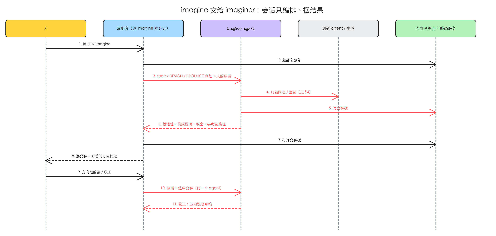

# uiux-imagine 抽成专职的 uiux-imaginer agent，会话只编排和摆结果

> 已 grill（2026-10-19，在审核会话里）：issue 列的六处细节、方向说明放哪、交接方式都已由人定，见 §4 各节的「已定」。审核中新加的决定：执行者叫 `idea-loop:uiux-imaginer`；imagine 选中的那一版当 refine 的起始画布，构成清单里的项标为人选定、评委要动就摆给人判（§1.4、§4.8–§4.10）。

## 1 问题

本次复现在 2026-10-18 做，对象是 main（idea-loop 0.0.24）和 2026-10-17 Toeflair（本地 TOFEL-demo）里两场真实的 imagine → refine 会话。这几条都是「缺一个能力」，没有可截的界面，证据是对会话记录的统计和对插件现状的核对。

### 1.1 一场 imagine 把会话上下文从十几万撑到四十万

**复现到的**：按会话里调用 `uiux-imagine` 和 `uiux-refine` 的时刻把记录切成两段，数每段会话亲自做的事：

| spec | 阶段 | 会话的工具调用 | 其中 Refero / 看图 / 生图 | 会话上下文 |
|---|---|---|---|---|
| 结束练习确认（`qb-app-lr-end-session-confirm`） | imagine，约 1.5 小时 | 160 次 | 13 / 28 / 9 | 13.6 万 → 41.0 万 |
| 同上 | refine | 39 次 | — | 41.4 万 → 47.1 万 |
| 报告页失败状态（`qb-app-analysis-stream-unmount`） | imagine，约 1.5 小时 | 140 次 | 7 / 20 / 5 | 17.6 万 → 40.0 万 |
| 同上 | refine | 22 次 | — | 40.4 万 → 43.2 万 |

第一场在 refine 之后续开的会话里压缩了一次。imagine 一段就占了会话增长的绝大部分；之后 to-ticket、implement 还要在这个会话里接着用。

**本该是**：imagine 的思考、写变种板、截图、调研、渲染都留在一个专职 agent 里，会话每轮只收一份短交回（板地址、每个变种的构成说明、改了什么、要人判的取舍、参考图路径）。

### 1.2 refine 已经这样拆过，拆完会话这边很轻

**复现到的**：同两场的 refine 段，干活的是 designer 子代理：一场 219 次工具调用、上下文峰值约 50 万；另一场 203 次、峰值约 45 万。会话这边同期只有 39 次和 22 次，上下文只涨了 5.7 万和 2.8 万。人的交互没变：会话在内嵌浏览器里打开画布、转人的意见。

imagine 现在没有对应的执行者：插件自带的六个 agent 里没有它，imagine 的全部步骤写给调用会话执行；唯一交出去的是「每个随机种子独立派一个子代理想方向」，只出想法，不渲染。

**本该是**：imagine 照 refine 的结构做，一个 agent 活过整个 imagine 阶段，人的每条意见都转给同一个 agent。

### 1.3 会话被压缩或重开后，imagine 没有恢复点

**复现到的**：imagine 的工作目录里，方向说明只在收工时才写；每一轮人选了什么、变种板改了什么没有约定的落盘位置。其中一场会话临时写了一个记第一、二轮裁决的文本文件，另一场没有。refine 的恢复点（画布、ledger、方向说明）是写明了的。

**本该是**：每轮的交回落盘在 `.tmp/uiux-imagine/<spec-slug>/`，新起的 agent 从变种板和这些记录接着做。

复现材料：`.tmp/to-spec/uiux-imagine-agent/repro/2026-10-18-findings.md`

### 1.4 refine 照着文字把 imagine 后半段重做一遍，还做丢了人选过的东西

**复现到的**（2026-10-19 审核时补，同两场会话逐轮对照）：

- 两场都在第 2–3 轮定了方向，之后又在 imagine 里跑了 3–4 轮对比页，调的全是执行层：插图风格、关闭按钮摆在哪、插图多大、文案、暂停后怎么恢复。收工时最后一版对比页已接近终稿，方向说明的构成清单写到像素级（卡片圆角 20px、关闭按钮偏出卡片右上角 12px、失败页插图 240px）。
- 然后对比页按约定删掉，refine 的 designer 只读文字，从零重建：
  - 线上组件的基线克隆又做一遍，两场各花 15–17 分钟才出第一版画布。
  - 关闭按钮被评委拉到卡片正上方，人问「现在的设计为什么不是卡片的右上角」才改回（方向说明里写着右上角，能确认是回退）。另据方向说明与对话推断：插图与标题的顺序写反、失败页插图重建成 200px 要人再说一遍「再大一些」。
  - 评委只看截图，不知道哪些是人亲手选的，连扣几轮后，人在 imagine 第 3 轮选的失败标记被改成了短弧版。两场 refine 里约一半的意见在改方向说明本身，不是在打磨。
- 种子子代理一场只在第 1 轮派过一次，另一场一次没派；方向定下之后的轮次都是会话自己接着改。

**本该是**：人在 imagine 里看过、选过的那一版原样交给 refine 当起点；refine 只做 imagine 没做的事（状态矩阵、动效、减法、AI tells、各道检查、冻结）；人选定的项不被评委悄悄改掉。

### 1.5 根因

- 1.1、1.2：imagine 写成了「调用会话亲自执行」的 skill；refine 在 #27 时拆成了编排者加 designer，imagine 没跟着拆。
- 1.3：执行都在会话里，会话本身就是记忆，所以从没需要过落盘的每轮记录。
- 1.4：ADR 0002 让 refine「从方向说明重建」，本意是不继承发散阶段的低保真半成品；但实际用法里 imagine 后半段已经把高保真做到了近终稿，交接只留文字，等于把最费时的那段重做一遍，而且文字往返有损。评委按设计看不到「哪些是人选的」，没有东西挡住它重议已定的项。
- 修正：issue 说「生图不能放进 agent」，依据是子代理里跑 `codex exec` 生图会被自动化权限拦下。实测这条只针对 `codex exec`：两场 imagine 的生图用的都是 Toeflair 项目自己的生图工具（一个 MCP 工具），2026-09-22 一个后台子代理调这个工具 5 次、5 次都成功。所以项目有这类工具时，agent 可以自己生图；只有 `codex exec` 这条路要交回编排者。插件本身没有生图工具，这一点不变。
- 修正：issue 写「收工时 agent 写方向说明并写回 spec」。现在的约定是方向说明**不写进 spec**，只放 `.tmp/uiux-imagine/<spec-slug>/direction-note.md`，refine 冻结后删；见 §4.1。

## 2 方案

插件新增一个 imagine 的执行者（`idea-loop:uiux-imaginer`），做法照 refine 的 designer：

- 调 imagine 的会话当编排者：起静态服务、起 uiux-imaginer、每轮在内嵌浏览器里打开变种板、把人的意见分流后转回同一个 uiux-imaginer。
- uiux-imaginer 的生命周期等于整个 imagine 阶段：定高度、出变种、写变种板、调研、摆 frontier 要的内容、收工时写方向说明草稿并跑校验。每轮交回一份短结果，同时落盘作恢复点。
- 人这边不变：只和会话对话，在内嵌浏览器里看变种板。
- **交接改成交画**（§1.4）：收工时选中的那一版不删，连同它的基线克隆交给 refine 当起始画布；方向说明照旧写，构成清单里的项标为人选定。refine 的 designer 从这张画布接着做，不再从文字重建；评委的 finding 要动人选定的项，designer 不自己改，摆给人判。

imagine 的 SKILL.md 改成只写调用机制（同 refine 现在的写法），设计的活搬进 agent 定义。

## 3 User Stories

backlog 模式不画场景树，每条问题一行期望行为，编号对应 §1。

1. **会话只编排**：作为跑 imagine 的人，我照旧在会话里看变种板、说方向性的话；会话里每轮只多出一份交回（板地址、每个变种一两句构成说明、这轮改了什么、要我判的取舍和推荐、参考图路径），imagine 跑完之后会话还能直接接 to-ticket / implement，不用先压缩。
2. **同一个执行者接着改**：作为跑 imagine 的人，我的每条意见都转给同一个 uiux-imaginer，它在上一轮的基础上改，不重来；跟方向本身有关、要回 spec 或 grill 的意见，编排者先判断，拿不准就问我。
3. **能从中断处接上**：作为跑 imagine 的人，会话压缩或重开后，新起的 uiux-imaginer 读变种板和每轮的交回记录就能接着做，不用我把前几轮重新说一遍。
4. **refine 从我选的那一版接着做**：作为跑 imagine → refine 的人，refine 第一版画布就是我在 imagine 最后选中的样子，不用等它重抓线上组件、也不用再指出「这里本来是右上角」；评委想改我选定的东西时，designer 停下来问我，我说保留就不再被这条 finding 拖住。

## 4 实现决策

issue 已经定下的（编排者 / agent 的分工、生命周期、每轮交回的内容、不跟人对话、不提交、不改 spec 状态、不在 imagine 之外被调用）不在这里重复，以 #47 原文为准。下面列的是 issue 没定、或修法有分歧的，2026-10-19 审核时人逐条按推荐定了。

### 4.1 方向说明写回 spec，还是照旧只放 `.tmp`

issue 写「写回 spec」。ADR 0002 当初定的是写进 spec §4，后来改成了现在的约定（imagine 收工第 3 步）：不写进 spec，只交给 refine。

- **A**：照旧。方向说明只在 `.tmp/uiux-imagine/<spec-slug>/`，uiux-imaginer 写完跑校验、交回编排者核对；spec 不动。
- **B**：改成写回 spec。要改 refine 读方向说明的位置、冻结时的清理，和 [[ui-state-archive]] 正在改的产物位置冲突。

**已定 A**（2026-10-19，按推荐）。理由：issue 要的「写全、refine 能重建」由现有的七节加构成清单和校验脚本保证，跟写在哪无关；B 会把一份中间产物变成 spec 的常驻内容。

### 4.2 生图

- **A**：uiux-imaginer 自己调项目里能用的生图工具（MCP 工具）；只有走 `codex exec` 的才交回编排者，由编排者生成后把图放进约定目录、告诉 uiux-imaginer。
- **B**：照 issue 的流程，一律交回编排者生成。

**已定 A**（2026-10-19，按推荐）。理由：§1.5 的修正说明 MCP 生图在子代理里能跑；一律交回会让插图风格探索（这次试了线稿、卡通、黏土 3D）每轮多一次来回。生图会话的 id 和 prompt 照现有规则记录，不管谁生成。

### 4.3 调研谁起

和 [[design-research-agent]] 的 §4.1 是同一个决定。**已定**（2026-10-19，按推荐）：uiux-imaginer 自己起调研 agent，参考图落 `.tmp/uiux-imagine/<spec-slug>/research/`，路径放进交回，编排者摆给人。那份 spec 的 §4.1 要写成同一个答案，两边落地时对齐。

### 4.4 种子子代理

imagine 现在每个随机种子独立派一个子代理想方向。uiux-imaginer 本身是子代理，再派就是子代理的子代理（designer 起 ui-master 已经这样跑着）。

- **A**：uiux-imaginer 照旧每个种子派一个；
- **B**：uiux-imaginer 自己连着想。

**已定 A**（2026-10-19，按推荐）。理由：独立派是为了避免「第三套是前两套的平均」，这个理由跟谁来派无关。

### 4.5 模型

issue 写「不降级，继承会话的模型和思考强度」；refine 的 designer 是钉在定义里的 `opus` · high。

- **A**：继承会话（issue 的写法）；
- **B**：钉 `opus` · high，跟 designer 一致。

**已定 B**（2026-10-19，按推荐），在定义里钉 `opus` · high。理由：refine 的经验是「换成较弱的模型，同一个基准从能冻结退成连续 plateau」，钉住比跟着会话走更不容易被悄悄降级；要临时换版本用环境变量覆盖别名。

### 4.6 预览服务与每轮记录

**已定**（2026-10-19，按下面的写法）。

- 静态服务归编排者，活到 imagine 收工；uiux-imaginer 自己起的服务（抓线上组件时的开发服务器、接收抓取的服务）自己停。app 在回合结束时会停掉 `preview_start` 起的服务，所以编排者每次打开变种板前先探端口，不通就重起。
- 每轮交回原文追加进 `.tmp/uiux-imagine/<spec-slug>/` 下一份固定的记录文件，作为 §1.3 的恢复点；收工时随渲染物一起删，方向说明和 §4.8 的交接画布留着。

### 4.7 人的意见怎么分流

**已定**（2026-10-19，按下面的写法）。

照 refine 的分流表写一份 imagine 版：「改这个变种 / 再推一格」转给 uiux-imaginer；「这个问题本身要重新想」回 spec 或 grill；拿不准问人。执行层的意见（字号、颜色）怎么处理见 §4.10。

### 4.8 交接画布：交什么、放哪

人已定：选中的那一版交给 refine 当起始画布。形状和位置二选一：

- **A**：收工时 uiux-imaginer 把选中的变种导出成一张独立页面（去掉对比页外壳、`?variant=` 切换和别的变种，保留 `?state=` 状态切换、真动效和基线克隆来的组件与 CSS），放 `.tmp/uiux-imagine/<spec-slug>/handoff/`；refine 开工时 designer 把它复制成 `docs/design/<spec-slug>/` 下的画布，冻结后 `handoff/` 随 `.tmp` 一起删。
- **B**：uiux-imaginer 直接把选中的那一版写到 `docs/design/<spec-slug>/` 当未冻结的画布。

**已定 A**（2026-10-19，按推荐）。理由：`docs/design/` 只放冻结过的东西，人在 refine 签字前它不该出现；而且 [[ui-state-archive]] 正在改 `docs/design/` 下的产物位置，A 只碰 `.tmp`，不和它抢同一处。

连带的改动：

- imagine 收工「清掉渲染物」改成：对比页、落选变种、style tile、两个本地服务清掉，`handoff/` 留着。
- refine 开工的前置从「方向说明在、过校验」加上「`handoff/` 在」；方向说明找得到而画布找不到（旧流程留下的 spec），退回现在的从文字重建，并明说。
- designer 不再重抓线上组件：基线已在 `handoff/` 里。designer 定义里「不读发散那一段的任何渲染物」改成「只读交接画布，不读对比页和落选变种」。
- 部分冻结、其余回 imagine 的情况：第二轮 imagine 以冻结画布为基线（现状不变），收工交出的 `handoff/` 只含重开的那几块。

### 4.9 人选定的项怎么挡住评委

人已定：构成清单里的项标为人选定，评委要动就摆给人判。评委本身保持现在的盲评（只看截图、意图那一句和 rubric），不告诉它哪些是人选的——否则它会顺着已定的项打分，失去「新眼睛」的作用。挡在 designer 那一层：

- 构成清单每一项后面标 `（人选定）` 或 `（模型代填）`；后者就是 imagine 收工时摆给人确认过的那几格。`direction-note-check.mjs` 加一条：选中变种的构成清单每项都带这两个标记之一。
- designer 每轮拿到评委的 finding，先对照构成清单：碰到人选定项的 finding 不执行，标成「与人选定冲突」随这一轮交回编排者，编排者摆给人判「保留 / 改」。
- 人说保留：designer 把这条记进 ledger 和方向说明（「人保留（日期）」），之后同一项的 finding 不再进这一轮的分数——`critic-score.mjs` 加一个「已被人保留」的排除集，从分数里扣掉并在结果里列出，不静默丢掉。人说改：照「人的方向修订」处理（refine §4 现有那一行）。

同一项被人保留过之后怎么办：

- **A**：同一项人保留过之后，后续轮次评委再提，designer 直接排除、只在交回里列一行「已按人保留排除 N 条」；
- **B**：每次都重新摆给人。

**已定 A**（2026-10-19，按推荐）。理由：B 会让人每轮重复判同一件事，正是 §1.4 里那种被拖住的轮次。

### 4.10 imagine 里的执行层意见

纪律 1 写「执行层的话停进待打磨清单，不当场改」，但两场实际都在方向定下后用对比页调了 3–4 轮执行层（§1.4）。现在交接画布会原样进 refine，这些调整不再白做。

- **A**：方向没定之前照旧拦进待打磨清单；方向定下（人点名留下某一版）之后，人明说「这里改一下给我看」的执行层意见，uiux-imaginer 改在选中的那一版上，构成清单里对应项记成人选定。人没说要看的，照旧进待打磨清单交给 refine。
- **B**：纪律 1 不变，执行层一律进清单。

**已定 A**（2026-10-19，按推荐）。理由：这是人的实际用法，交接改成交画之后它是有效工作；方向没定前仍然拦，保住「发散不偷偷变收敛」。这条改的是 imagine 的纪律，所以 §7 里「不改三条纪律」相应放开这一处。

## 5 技术方案总览

### 5.1 后端

这里的「后端」是插件里的 agent、调研与生图、内嵌浏览器和静态服务。

红色是本 spec 新增的消息，虚线是响应。

- 新增 uiux-imaginer 的定义：输入是 spec 路径、`DESIGN.md` / `PRODUCT.md` 路径、人的原话（编排者不改写），第一轮之后加上一轮选中的变种；每轮交回板地址与 `?variant=` / `?state=` 参数、每个变种的构成说明、本轮改动、取舍与推荐、参考图路径；收工交回方向说明草稿和校验结果。
- imagine 的 SKILL.md 改成编排者的说明：什么时候跑、起服务、起 uiux-imaginer、每轮摆给人、意见分流、恢复。
- 第 4 步的调研与生图按 §4.2、§4.3 的决定走。
- 交接改成交画（§4.8–§4.10）：uiux-imaginer 收工时导出交接画布；refine 的 SKILL.md 改开工前置与起步，designer 定义改「从交接画布接着做」（保留从文字重建作退路）和「与人选定冲突」的分流；`direction-note-check.mjs` 加构成清单的来源标记，`critic-score.mjs` 加人保留排除集。
- 上面的时序图还是只拆执行者时画的，没画交接画布与「与人选定冲突」那一来一回；切工单前按 spec-figures 重画。

### 5.2 前端内部

不涉及。

### 5.3 前端交互

不涉及。变种板是 imagine 已有的产物，本 spec 只改谁来写它，不改它给人的样子。

## 6 测试决策

| 变的是什么 | 仪器 | 本次 |
|---|---|---|
| 纯逻辑 / 数据转换 | TDD 单元 | 碰到：`direction-note-check.mjs` 加构成清单来源标记（缺标记、标记不在两者之内都失败）；`critic-score.mjs` 加人保留排除集（排除项不计分、在结果里列出、排除集为空时分数与现在一致）。都照现有脚本旁的 `*.test.mjs` 写。若为每轮交回记录加形状校验，同样写法。 |
| API 契约 | TDD API 测试 | 不涉及。 |
| DB schema / 迁移 / 并发 | 真 DB 测试 | 不涉及。 |
| LLM 输出质量 | eval | 碰到：imagine 的执行搬进 agent、refine 的起步改成接交接画布，两个都是 `idea-loop/evals/` baseline 钉住的 skill；改完对 baseline 重跑，断言「环还接着」改成：方向说明过校验、`handoff/` 在且能打开、refine 第一版画布从它来（不重抓线上组件）。不新建 eval 轴。 |
| 视觉正确性 | UI 实现环 | 不涉及。 |
| 端到端用户流程 | 浏览器测试 | 碰到：在 Toeflair 上对一份碰 UI 的 spec 跑一次完整 imagine → refine，imagine 至少两轮、中途重开一次会话，refine 至少跑到第一次评委交回。 |

- **seam**：编排者与 uiux-imaginer 之间的交回（每轮一份文本加变种板地址）；收工时的方向说明文件和 `handoff/` 交接画布（imagine → refine）；designer 交回里的「与人选定冲突」条目（refine → 人）。方向说明沿用现有的校验脚本，加来源标记检查。
- **增量功能测试**：
  - 会话只编排：步骤——跑两轮 imagine；期望——会话里没有写变种板、截图、Refero 调用，只有起服务、起 uiux-imaginer、打开变种板、转意见；会话上下文的增长远小于 §1.1 的量级。覆盖 1。
  - 同一个执行者：步骤——第一轮后说「往 B 那边再推一格」；期望——转给的是同一个 uiux-imaginer，新板在 B 的基础上改。覆盖 2。
  - 意见分流：步骤——说一句「这块要不要存在都得重想」；期望——编排者不转给 uiux-imaginer，先问人是否回 spec / grill。覆盖 2。
  - 恢复：步骤——第二轮后重开会话再调 imagine；期望——新 uiux-imaginer 读交回记录和变种板接着第三轮。覆盖 3。
  - 收工：期望——方向说明过校验、交回编排者核对后 uiux-imaginer 才结束；对比页和落选变种清掉，方向说明和 `handoff/` 留着。覆盖 1、4。
  - 交接：步骤——收工后调 refine；期望——designer 第一版画布与 `handoff/` 打开的样子一致（在相同 viewport 下截图比对），过程里没有重抓线上组件。覆盖 4。
  - 挡评委：步骤——找一条评委 finding 要动构成清单里人选定的项（比如关闭按钮的位置）；期望——designer 不改，交回里列成「与人选定冲突」，编排者摆给人；人说保留后，下一轮同一项的 finding 不进分数、在交回里列一行。覆盖 4。
  - 方向定下后的执行层意见：步骤——人点名留下 B 之后说「插图再大一点给我看」；期望——uiux-imaginer 改在 B 上，构成清单里插图尺寸记成人选定；方向没定前说同样的话，进待打磨清单。覆盖 4。
  - 退路：步骤——对一份只有方向说明、没有 `handoff/` 的 spec 调 refine；期望——designer 从文字重建，交回里明说走了退路。覆盖 4。
- **prompt / eval 变动**：新增 uiux-imaginer 的定义；imagine 的 SKILL.md 改成编排说明；refine 的 SKILL.md 与 `agents/designer.md` 改起步与冲突分流；README 与仓库 CLAUDE.md 里对 imagine / refine 的描述同步（现在写的是「designer 只从方向说明重建画布」）。重跑 imagine 与 refine 的 baseline。
- 先例：`agents/designer.md` 与 refine 的 SKILL.md（编排者 + 执行者的写法、SendMessage 转意见、恢复点）。

## 7 Out of scope

- 调研 agent 本身（#46，另一份 spec [[design-research-agent]]）。
- 改方向说明的七节和构成清单的六项（只给每项加来源标记，§4.9）。
- 改 imagine 的高度表和结束判据；三条纪律只放开 §4.10 那一处。
- 改评委（ui-master）的输入和 rubric：盲评不变，挡人选定项在 designer 那层做。
- 给插件加生图工具。

## 8 关联

- #47 idea-loop uiux-imagine：抽成专职 agent，生命周期同整个 imagine 阶段，会话只做编排和摆结果——本 spec 的来源。
- [[design-research-agent]]（#46）：调研抽成 agent；§4.3 要和它一起定。
- [[ui-state-archive]]（#28）：改 imagine / refine 产物的位置，影响 §4.1、§4.6、§4.8（交接画布放哪）。
- [[0002-design-loop-v2-imagine-refine]]：imagine / refine 的结构；它原本把方向说明写进 spec §4，后来改成只放 `.tmp`（§4.1）；它定的「refine 从方向说明重建、不读发散渲染物」被 §4.8 改掉，落地时 ADR 要补一条修订。
- issue 原文提到的相关 issue：#26（imagine 默认在内嵌浏览器里开）、#27（refine 起专职执行者）。
