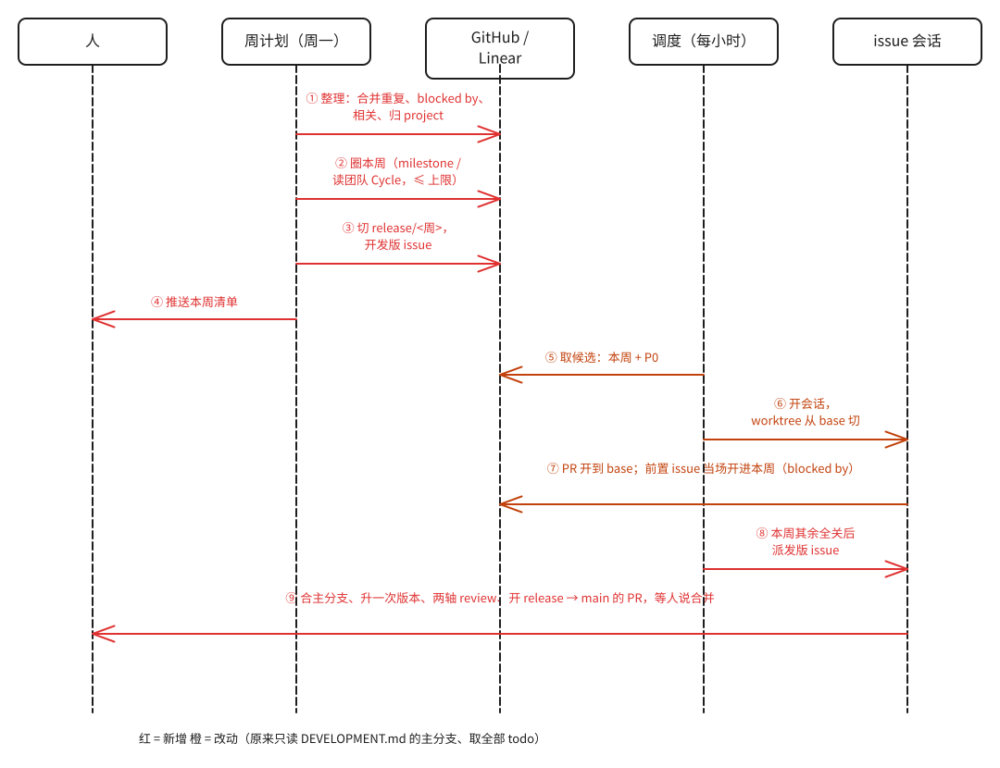

# 每周计划：issue 的关系、本周做哪些、怎么一起发版，由 idea-loop 管

> #334 存在：issue 之间的重复、依赖、相关没人整理，调度不分本周，每个 PR 合进 main 就发一次版；8 天里插件版本被改 53 次，0.2.0 的子 issue #295 会被从 main 开工，详情在「问题陈述」

## 问题陈述

### 一：相关、会冲突的 issue 各走各的

每周分拣（`idea-loop:issue-triage`）只查「同一个问题」：`issue-triager` 的第 1 步拿关键词搜开着的 issue，搜到同一个问题就建议关成重复。前后依赖、改同一处会冲突、该一起做的，都不查。

例子（2026-11-20 对着 harold-skills 开着的 31 个 issue 看标题，疑似，未逐条核）：#418 与已关的 #350 讲同一句「只问两类」；#437 与 #356 都讲 skill 写死 gh/git 命令；#398 与 #386 都改调度的名额；#340 与 #341 都讲 skill 越写越长。它们各自分拣、各自派会话，讨论时看不到彼此。

另一种：讨论中长出新的前置 issue。人举的 listen & repeat 重构：重构提示词之前要先重建样本、先做期望标注。现在会话里开出的新 issue 落进 backlog，等下一次每周分拣，跟原来那个 issue 之间没有任何关系。

### 二：没有「本周做哪些」，每个 PR 合进 main 就是发一次版

调度（`idea-loop:issue-dispatch`）每小时从全部 todo / triage 里挑，没有「本周」这个范围。每个 PR 都直接合进 main，而插件是从 main 装的，合一个就是给所有用户发一次版。

数据（`git log origin/main -- idea-loop/.claude-plugin/plugin.json`，2026-11-22 查）：11-15 到 11-22 共 53 次版本改动，11-19 一天 14 次、11-20 一天 21 次。

归组的载体建了没人用：`idea-loop:issues` 写「版本用 milestone」，仓库里 milestone 0.2.0、0.2.1、0.2.2 都是 0 个 issue；人手动建的 GitHub Project「idea-loop 0.2.0」有 17 个 issue、「idea-loop issue 工作流」有 3 个，idea-loop 不读（0.2.0 home repo grill 的 Q22 定过「Project、milestone 只作看板」）。

### 三：要一起发的一批，基准分支和最后的合并靠人手动

0.2.0 的父 issue #331 正文写着集成分支 `release/idea-loop-0.2.0`。子 issue #295 此刻是 todo、没被挡，在 `issues candidates docs 20` 里排第 11（2026-11-19 对着 main `38622d38` 跑）。调度派到它时，worktree 从 `origin/main` 切（两份 runtime reference 的「怎么交出 issue」写死 `origin/<基准分支>`，只读 `DEVELOPMENT.md`），PR 用 `--base main` 开（`idea-loop:pr`「开 draft PR」第 2 步）。本该是集成分支。现在只能由人手动开会话、在第一句话里点明基准分支（#331 正文原话）。

最后把集成分支合进 main（先合 main 解冲突、升一次版本、开 PR）没有哪个会话管。集成分支用过三次，三次都靠人：`release/idea-loop-0.1.8`（#176）、`release/idea-loop-0.1.10`（#260）、`release/idea-loop-0.2.0`（进行中，#331 下 8 个子 issue）。

### 根因

- 分拣只认「同一个问题」：`agents/issue-triager.md`「五步」第 1 步。
- `idea-loop:issues` 写「不用父子关系归组」「版本用 milestone」，但没有流程读写 milestone 或 Project；`issues.mjs` 文件头写「There is no parent / child logic」。
- 调度的候选是全部 todo / triage（`issues candidates`），没有时间范围。
- 基准分支只有一个来源：`DEVELOPMENT.md` 的「分支」节；`issue-session`「接分支」、`pr`「开 draft PR」、runtime 的建 worktree 都从这里读。

## 方案

改完之后，每个用 idea-loop 的项目（自己的仓库和公司的 Linear 项目）每周一早上有一份「本周」：

- 指派给人、能做的 issue，最多 N 个（每个项目自己定，默认 15）；
- 重复的已合并，依赖已标好，相关的已互相链上，一个 issue 装不下的已归进 project；
- 发版走集成分支的项目，本周有一条集成分支和一个发版 issue；
- 一份推送清单：本周是哪些、合并了哪些、哪些没挑上。

这一周里调度只派本周的 issue；P0 走急修，不进本周、不进集成分支，直接从主分支做。本周全部做完，发版 issue 的会话把集成分支合进主分支，人说合并。

决定一个 issue 走什么的输入：它在不在本周、项目的发版方式（`DEVELOPMENT.md`）、它是不是 P0。

### 一周的样子

1. **周一早上，周计划**（每周分拣的定时任务改到周一早上、调度第一个白天时段之前，扩成周计划）：
   1. 分拣 backlog，照旧。
   2. **整理**：对全部开着的 issue 看重复、依赖、相关、该不该归 project。每个动作在 issue 上留评论写依据。
   3. **收上周**：上周的范围里还开着的：没开工的（todo、triage，没有 PR）移进本周；做到一半的（in-progress、in-review）留在上周，上周的发版等它们。
   4. **圈本周**：指派给人、开着、不在 backlog 的 issue 按顺序取前 N 个（顺序见「实现决策」）。
   5. **开集成分支**：发版方式是「每周集成分支」的项目，从 `origin/<主分支>` 切出本周的集成分支并 push，开发版 issue。
   6. **推送**清单。
2. **这一周，调度**：候选只取本周的（加上 P0）。本周的 issue 在走集成分支的项目里，worktree 从集成分支切、PR 开到集成分支；P0 和直接进主分支的项目照旧。
3. **周中长出的前置 issue**：会话里发现「做这个之前要先做那个」，当场开新 issue、标 blocked by、放进本周（可以超过上限，不然本周那个做不完）；别的新 issue 等下周一。
4. **发版**：发版 issue 被本周其余 issue 挡着。全部关掉后调度照常派它：会话把主分支合进集成分支、升一次版本、跑一轮两轴 review、开集成分支 → 主分支的 PR，人说合并。

同一行为的其他入口：

- 每周分拣 `issue-triage`（不带参数）：纳入，扩成周计划。`全部`、`P0 <号>` 两种调用不变。
- 调度建 worktree（runtime 的 claude-desktop、magi 两份 reference）、`issue-session`「接分支」、`pr`「开 draft PR」、`pr-review` 给 reviewer 的基准分支、`implement` 拍「之前」的基准分支 worktree：纳入，统一读 `issues show` 给的 `base`。
- 会话里开新 issue（`issues new`）：纳入，加「前置依赖进本周」。
- `seo-scan` 开出的 SEO issue：纳入周计划的整理与圈选，跟其他 issue 一样。SEO 自动合并（`decision-rules`「SEO 例外」）不变：`type:seo/*` 的 PR 照旧检查全过就由 Claude 合进它的基准分支。
- `dreaming`、`seo-scan` 效果报告、上线自查的 revert：排除。它们不属于本周的某个 issue，对的就是主分支。

### 后端

`issues.mjs`（GitHub）：

- `plan <docs>`：机械的那一半，输出 JSON：本周与上周的容器、上周留下的、候选（按「实现决策」的顺序，带是否超过上限）。整理和判断由 LLM 做。
- `show` 加 `week`（在哪一周，没有为 `null`）和 `base`（这个 issue 的基准分支）。
- `candidates` 默认只给本周的，加上不在本周的 P0。
- `new` 加 `--week`（放进本周）、`--blocks=<号>`（新 issue 挡着那个号）。

Linear 没有脚本：`linear.md` 写怎么用 MCP 读团队当前的 Cycle、读写 Project、标 relations（blocks / related / duplicate）。

## User Stories

### 场景：周一规划

1. 作为人，我想要周一早上收到一份本周清单，以便不用自己从几十个 issue 里挑这周做什么
2. 作为人，我想要重复的 issue 已经被合并、依赖已经标好，以便讨论一个 issue 时能看到跟它相关的那几个
3. 作为人，我想要一个 issue 装不下的改动（几个互相依赖的 issue、长期的线上问题）被归进一个 project，以便在一处看到整块进度
4. 作为人，我想要上周没开工的 issue 自动进本周，以便不用每周重排
5. 作为人，我想要 LLM 的每个整理动作都在 issue 上留了依据，以便看到哪里不对时说一句就能改回

### 场景：本周调度

1. 作为调度，我想要只派本周的 issue，以便会话做的就是这周要发的
2. 作为调度，我想要给走集成分支的项目的 issue 从集成分支开 worktree、PR 开到集成分支，以便这周的改动攒在一起、不提前发给用户
3. 作为人，我想要 P0 不等周一、不进集成分支，直接从主分支修，以便线上问题和流程本身坏了能当天修好

### 场景：周中长出的前置 issue

1. 作为 issue 会话，我想要发现前置工作时当场开 issue、标 blocked by、放进本周，以便原来那个 issue 这周还能做完

### 场景：发版

1. 作为人，我想要本周全部做完后有一个会话把集成分支合进主分支（合主分支、升一次版本、整体 review、开 PR），以便最后一步不再靠我记得
2. 作为人，我想要一周只发一次版，以便装插件的人不会一天收到二十次更新

## 实现决策

### 谁定、怎么防错

- **整理、圈选都由 LLM 自己做，不等人批**。依据：人的原话「也不需要我审批，是否能让 llm 自己决定」（2026-11-20），公司项目「和我们自己的项目都这么处理，在调度时再具体判断」（2026-11-23）。
- **每个动作留评论**：做了什么、依据（哪几处重叠、哪条依赖）。**每次周计划推送清单**，人一句话推翻，推翻后按人说的改回。
- **合并 = 留一个、关其余**：留下内容更全的那个，把另一个里缺的内容搬过来，其余关成「重复，并入 #N」，可以重开。
- **归组的判据是「前置依赖」「同一个功能」「一起发版」，不用「改同一个文件」**。依据：ADR-0021 的整合任务按「改同一个文件或同一个模块」挂父子，挂出的根下 27 个子 issue 多数并非真从根拆出（ADR-0022 §1）。
- **父子 issue 照常读，不当成组**。依据：ADR-0022 原句；人在用的公司 Linear 里（2026-11-23 查）父子关系既有真拆分（一个 Epic 下挂 4 个子 issue），也有「做那个时发现的」（一个 CI 测试过期的 issue 挂在一个不相关的 bug 下）。
- **合进主分支仍只由人说**：decision-rules 的护栏，这次不放开。

### 载体

| | GitHub | Linear |
|---|---|---|
| 本周 | milestone，名字 `<YYYY>-W<周>`，截止日是周日 | 团队在用 Cycle：当前 Cycle 里指派给人的就是本周，只读；团队没用 Cycle：同 GitHub 的做法，用 label `week:<YYYY>-W<周>` |
| project（一个 issue 装不下的、长期类） | GitHub Project | Linear Project |
| 依赖 | 原生 blocked by | relation `blocks` |
| 相关 | 两边正文各加一行「相关：#N」 | relation `related` |
| 重复 | 关闭 reason `duplicate` | relation `duplicate` |

- **本周用 milestone，不用 Project**：一个 issue 要同时在「本周」和「它的功能 project」里。GitHub 没有 Cycle；Projects 的 Iteration 字段也能当时间盒，但要先把 issue 放进一个排期用的 Project，改字段只能走 GraphQL，milestone 是仓库原生字段、`gh` 直接带 `--milestone`。Linear 上一个 issue 只能在一个 Project 里，所以本周不能是 Project（Linear 文档「Project milestones」2026-11-20 查：milestone 只在 Project 内、不能跨 Project 共用）。
- **公司团队在用两周一个的 Cycle**（指派给人的 issue 大多挂在当前 Cycle 里；2026-11-23 查），idea-loop 只读它，不建、不改团队的排期。
- **project 什么时候建**：三个以上互相依赖或要一起发版的 issue，或一类长期开着的（线上问题）。单个 issue 照常单独做。依据：人的原话「一个 issue 无法承载的改动……或者长期类项目（比如线上问题）都用 project」（2026-11-20）。

### 圈本周

- **顺序**：先挡着别人的，再 P0 → P1 → P2 → 没有，同一级里等得久的在前。指派给别人的不圈。
- **上限**：每个项目一个，写在 `ISSUE_TRACKER.md` 新的「周计划」节，不写就是 15。依据：人的原话「将当前所有的 issue 全部放入本周，但是有一个很大的上限（比如 10 个、15 个）」「每个项目 10 个或 15 个」。
- **哪些状态能进**：triage、todo；上周留下的 in-progress、in-review 不重圈，留在上周。
- **周中长出的前置 issue 进本周，可超上限**；别的新 issue 等下周一。

### 发版

- **发版方式按项目配**：`DEVELOPMENT.md`「分支」节加一行「发版：每周集成分支」或「发版：直接进主分支」。没写的，周计划第一次跑时由 LLM 按项目判（看主分支是不是直接发给用户、团队有没有自己的发版流程），写进这一行并在清单里说明。依据：人的原话「自己的项目都是集成分支，然后所有 issue 完成之后合并进入主干分支」「在调度时再具体判断」。harold-skills 写「每周集成分支」。
- **集成分支名 `release/<YYYY>-W<周>`**，周计划从 `origin/<主分支>` 切。
- **发版 issue**：周计划开，标题「<YYYY>-W<周> 发版」，正文写集成分支，标成被本周其余 issue 挡着。挡它的全部关掉，调度照常派它。
- **发版的 PR 跑一轮两轴 review**：依据：Matt Pocock 的 `implement-spec` 在集成分支上再跑一轮完整 code-review 再转 ready；Fowler 的语义冲突（文本能合上、行为变了）只在合到一起时暴露（调研，2026-11-19）。
- **版本号一周升一次**：子 PR 不升，发版的 PR 升一次，档位取本周各 PR 里最高的那档。本仓库规则，写进本仓库 `REVIEW.md`「额外要求」，插件里不写。依据：0.2.0 的人的决定（`home-bootstrap` spec「版本号」，2026-11-17）。
- **急修**：P0 不进本周、不进集成分支，候选里一直有它，基准是主分支。依据：人的原话「急修通道，就走单独的 issue 调度逻辑就行，不用进集成分支」。
- **上周的发版等做到一半的**：上周留下 in-progress、in-review 的，上周的发版 issue 一直被挡着，等它们合完再发；本周的集成分支照常从主分支切，两周的改动不混。

### 改在哪

都是扩已有的，不新增 skill：

- `issue-triage`（不带参数）扩成周计划；定时从「每周」改到周一早上。
- `issue-triager` 的查重扩成「重复、依赖、相关」三种。
- `issue-dispatch` 候选只取本周加 P0；runtime 两份 reference 建 worktree 读 `base`。
- `issue-session`、`pr`、`pr-review`、`implement` 读 `base`。
- `issues`：「实体」加「本周」「project」两个字段，「不用父子关系归组」那段改成上面「载体」的规则；`github.md`、`linear.md` 各写一份做法。
- `setup`：问发版方式和周计划上限。
- ADR-0022 的「版本用 milestone」「不用父子关系归组」两句、0.2.0 grill 的 Q22「Project、milestone 只作看板」被这份 spec 改写；ADR 的订正交给 `/idea-loop:dreaming`。

## 测试决策

| 变的是什么 | 仪器 | 本次 |
|---|---|---|
| 纯逻辑、数据转换、状态机 | TDD 单元测试 | `issues.mjs`：`plan` 的圈选顺序与上限、上周留下的分法、`base` 的三种结果（本周 + 集成分支 / P0 / 直接进主分支）、`candidates` 只给本周加 P0、`new --week --blocks` |
| API 契约（路由、schema、序列化） | TDD API 测试 | `plan`、`show` 的 JSON 字段 |
| DB schema、迁移、并发与事务语义 | 真 DB 测试 | 不涉及 |
| LLM 输出质量（prompt 改动） | eval（确定性断言） | 改 `issue-triage`、`issue-triager`、`issue-dispatch`、`issue-session`、`issues`、`pr`、`pr-review`、`implement`、`setup` 和两份 runtime reference 的文字；用已有的 `*-doc.test.mjs` 断言关键句，不加 eval。整理的判断质量（合不合、挂不挂）不做 eval：每个动作留评论，人每周看清单推翻 |
| 视觉正确性 | UI 实现环 | 不涉及 |
| 端到端用户流程 | 浏览器端到端测试 | 不涉及 |

- **seam**：`issues.mjs` 的命令行（喂假 `gh` 输出、读 JSON），已有，`issues.test.mjs` 就在这一层。能抓到：圈错、顺序错、上限没生效、基准分支算错、P0 被关进本周。漏掉：LLM 整理判得对不对、会话真的照 `base` 切 worktree，只能靠上线后第一周的清单验收。
- **增量功能测试**：
  - 前置：20 个指派给人的 todo，其中 2 个挡着别人、1 个 P0；上限 15。步骤：`issues plan`。期望：挡人的 2 个在最前，P0 不在本周、在急修；本周 15 个。覆盖：周一规划 1、本周调度 3。
  - 前置：上周 milestone 里 1 个 todo 没 PR、1 个 in-progress。步骤：`issues plan`。期望：todo 那个移进本周；in-progress 那个留在上周。覆盖：周一规划 4。
  - 前置：发版方式「每周集成分支」，issue 在本周。步骤：`issues show`。期望：`base` 是 `release/<本周>`；P0 的 `base` 是主分支；发版方式「直接进主分支」的项目，`base` 是主分支。覆盖：本周调度 2、3。
  - 前置：本周有 5 个 issue，1 个 P0 不在本周。步骤：`issues candidates`。期望：只有这 6 个。覆盖：本周调度 1。
  - 前置：`issues new … --week --blocks=<号>`。期望：新 issue 在本周 milestone 里、挡着那个号，超上限也进。覆盖：周中长出的前置 issue 1。
- **照着谁写**：`issues.test.mjs` 现有的 `candidates`、`migrate` 用例；doc test 照 `dispatch-by-period-doc.test.mjs`。

## Out of scope

- 一个 issue 改多个仓库改成按仓库拆子 issue：没有真实例子（0.2.0 grill 决议的「已知限制」），现有的一会话多 PR 保留。
- Linear Releases（要 Business 套餐并接 CI）、GitHub Projects 的 Iteration 字段。
- 把进行中的 0.2.0（#331 与 `release/idea-loop-0.2.0`）迁成本周模型：它照现在的手动方式做完；这份 spec 合进 main 之后的第一个周一开始用新模型。

## 关联

- 决定记录：[[2026-11-23-weekly-plan-grill]]；0.2.0 home repo grill（`release/idea-loop-0.2.0` 上的 `docs/raw/issue-workflow/2026-11-15-home-repo-grill.md`，Q22–Q24、Q29），这次改写了其中 Q22。
- ADR-0022（issue 模型，改其中两句）、ADR-0021（整合任务，教训见「谁定、怎么防错」）、ADR-0023（每周分拣，这次扩成周计划）。
- 相邻：
  - #331（0.2.0）：照现有方式做完，不受影响；正文里「#334 走 main 去改」那句在本 spec 合并后由 #331 的会话更新。
  - #386（一个调度管所有项目，在 0.2.0 集成分支上）：也改 `issue-dispatch` 和建 worktree 那段；后合的那个 rebase。周计划按项目各跑一份，跟它不冲突。
  - #398（调度上限的语义，triage）：也改 `issue-dispatch` 的候选和名额；本 spec 只加「本周」这层过滤，不动名额的算法，后合的 rebase。
