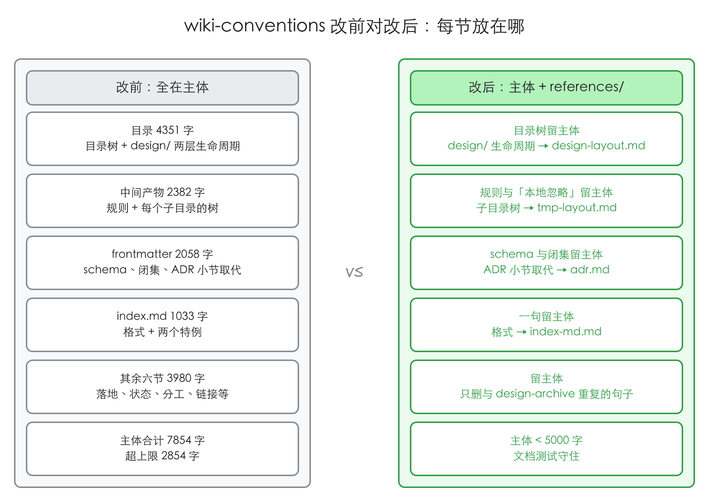

# wiki-conventions 主体缩到 5000 字以下

> #302 存在：2026-11-16 对 main（a032e45）量 `idea-loop/skills/productivity/wiki-conventions/SKILL.md` 主体 7854 字，超上限 2854 字；详情在「问题陈述」

## 问题陈述

### 1. 每个调起它的 skill 都整份读 7854 字，多数只用其中一两节

量法照仓库 `AGENTS.md`（去 frontmatter，`LC_ALL=en_US.UTF-8 wc -m`），2026-11-16 对 main（a032e45）按节量：

| 节 | 字数 | 谁指名读它（idea-loop 内 grep `wiki-conventions` 的「X」，同日） |
|---|---|---|
| 目录 | 4351 | uiux-imagine、uiux-refine 及两份画布参考、uiux-research、design-archive、agent-builder |
| 中间产物 | 2382 | implement、implementer、grill、to-spec 的图参考、pr 的交付证据参考、seo-scan（「本地忽略」） |
| frontmatter | 2058 | design-archive 的写法参考、uiux-refine 的冻结参考、dreaming 的对账参考 |
| index.md | 1033 | 没有人指名；只有 dreaming 和 `spec.mjs index` 生成它时用 |
| slug 与链接 | 971 | design-archive、seo-outreach、dreaming（link sweep） |
| 文件在不在，就是状态 | 951 | dreaming、adr-reconciler、glossary |
| 知识库落地 | 825 | to-spec、issue-session、retro、decision-rules、uiux-refine |
| 人机分工 | 485 | dreaming |
| spec 和工单怎么写 | 428 | to-spec、to-ticket（开工时整份调） |
| 从平铺布局迁移 | 320 | `spec.mjs check` 报旧布局时 |

例子：implement 开工调它只为「中间产物」（2382 字），却要连带读「目录」里设计档案两层生命周期那 950 字、index.md 的 1033 字。#298（PR #301）的 review 第 1 轮把这条报为 Standards C1，人定「这次不缩，之后单独看怎么优化，提一个 issue」，就是 #302。

### 根因

一条根因对应上表：这份 skill 是所有动 `docs/` 或 `.tmp/` 的 skill 的共同入口，几份 spec（`docs-ride-code-pr`、`design-tmp-worktree-root`、`dreaming-triage-autonomous` 等）每次把新规则直接加进主体；只有「从平铺布局迁移」挪进过 `references/`。另有一部分是重复：「`prod/` 只走归档脚本、dreaming 对账行例外」和「旧 `design/<spec-slug>/` 目录只打提示」两句，design-archive 的 SKILL.md 里各写了一遍；五种 `design-*` 类型的说明与 design-archive 的「图的实体」重叠。

## 方案

改完：调起 wiki-conventions 的 skill 读到的主体在 5000 字以下，只含每个分支都要的约定；设计目录的生命周期、`.tmp/` 每个子目录的清理时机、index.md 的格式、ADR 按小节取代，各在一份 `references/` 里，由主体里一行指针指过去。规则一条不改，节名不改（别处按「skill 名 + 节名」指过来，节名就是契约，ADR-0009 先例）。

调用方读的路径（时序）：

1. 调用方用 Skill 工具调 `idea-loop:wiki-conventions` → 读到主体（< 5000 字）。
2. 要的节在主体里 → 照做。
3. 要的细节在外置参考里（主体那一节末尾写「X 见 `references/<文件>.md`」）→ 再读那一份。

同一行为的其他入口：

- **纳入**：所有指名 wiki-conventions 某节的 skill、agent、参考、脚本的提示文案（上表第三列与 `spec.mjs` 的报错文案）。节名不变就不用改；只有指向被外置内容的（如 dreaming 对账参考指「frontmatter」看 ADR 小节取代），改指到新参考。
- **排除**：其余 10 份超长 SKILL.md（#137 在批量看）；知识库搬出代码仓库后 wiki-conventions 的内容怎么改（#333，0.2.0）。

## User Stories

只修问题、不加能力：

1. 期望行为（对问题 1）：wiki-conventions 的 SKILL.md 主体少于 5000 字，由文档测试守住；任何一条规则在主体或它的 `references/` 里仍能找到，别处按节名指过来的都指得到。

## 实现决策

- **按分支外置，不拆 skill**。依据：`writing-for-agents`「渐进披露」——每个分支都要的内联，只有部分分支走到的放到指针后面；用户级 `CLAUDE.md`「先扩展已在用的工具，不为一件事新增组件」；ADR-0009 的先例（design-archive 同样外置成 references，没拆 skill）。
- **主体留什么、外置什么**（对的杠杆标在括号里）：

  | 节 | 处置 |
  |---|---|
  | 知识库落地、人机分工、文件在不在、slug 与链接、spec 和工单怎么写 | 留在主体，原样或只删重复的句子（每个分支都要） |
  | 目录 | 留目录树和 `raw/`、`domain/`、`records/` 的归属、项目级规则文件、spec 与工单的两条；`design/` 两层的生命周期整段（tmp 各子目录谁写、冻结后提交、`research/` 不归档、`prod/` 写入规则）挪进 `references/design-layout.md`（渐进披露：只有设计类调用方读）；`prod/` 只走归档脚本和旧目录提示两句删掉，以 design-archive 为单一事实来源（去重） |
  | 中间产物 | 主体留规则：放 `<worktree 根>/.tmp/<skill>/<对象>/`、为什么不放系统 `/tmp`、设计侧过程产物不在这里、「本地忽略」小节；每个子目录收什么、什么时候删的那棵树挪进 `references/tmp-layout.md`（渐进披露：每个调用方只查自己那一行） |
  | frontmatter | 留 schema、两处豁免、`status` 闭集表（`issue-model-tripwire` 测试读它）；五种 `design-*` 的说明缩成一句指向 design-archive 的「图的实体」（去重）；「ADR 按小节取代」挪进 `references/adr.md`（渐进披露：只有 dreaming、adr-reconciler 写 ADR） |
  | index.md | 主体留一句「每层一个、表体从 frontmatter 生成」；格式、`spec/index.md` 和 `design/prod/index.md` 的特例挪进 `references/index-md.md` |
  | 从平铺布局迁移 | 节名保留（`spec.mjs` 的报错文案指它），正文已经是一行指针，不动 |

- **节名不变**：主体的 `##` 标题全部保留，外置参考用自己的标题；指名「目录」「中间产物」「frontmatter」的调用方不用改。被外置的内容如果有调用方专门指它（grep 出的只有 dreaming 对账参考指「frontmatter」看 ADR 小节取代、design-archive 指「目录」看 tmp 生命周期），这两处同一个 PR 里改成指新参考。
- **规则不改**：路径、字段、闭集、生命周期一个不动；删掉的句子要么在 design-archive 有单一事实来源，要么按 `writing-for-agents`「剪枝」判为空操作，PR 描述逐句列出删了哪些、依据哪条。
- **已有测试守的字符串留在主体**：`知识库落地` 一节与「父 issue 拆完子 issue（spec 与设计定稿）」（`knowledge-base-landing-doc`）、`status` 闭集表与 `spec.mjs`、`issues:`（`issue-model-tripwire`）、「按风险分」「dreaming` 只问两类」（`dreaming-autonomous-doc`）。
- **版本**：idea-loop `plugin.json` 升 patch（0.1.20 → 0.1.21 或合并时 main 上版本的下一个 patch）：行为不变，只是文档挪位置（`REVIEW.md`「额外要求」）。`idea-loop/README.md` 文件树里 wiki-conventions 那一行补上新的参考文件。

## 测试决策

| 变的是什么 | 仪器 | 本次 |
|---|---|---|
| 纯逻辑、数据转换、状态机 | TDD 单元测试 | 文档测试：主体字数 < 5000；指名的节都存在（见下） |
| API 契约（路由、schema、序列化） | TDD API 测试 | 不涉及 |
| DB schema、迁移、并发与事务语义 | 真 DB 测试 | 不涉及 |
| LLM 输出质量（prompt 改动） | eval（确定性断言） | 不涉及：规则不改，只挪位置；仓库对 skill 输出不做 quantitative eval（`AGENTS.md` §5） |
| 视觉正确性 | UI 实现环 | 不涉及 |
| 端到端用户流程 | 浏览器端到端测试 | 不涉及 |

- **seam**：一个文档测试，读 wiki-conventions 的 SKILL.md 和 `references/`，以及 idea-loop 下所有 `.md` 与脚本。能抓到：主体超长；别处写「`idea-loop:wiki-conventions` 的「X」」而 X 不是 SKILL.md 或其 references 的标题（节被改名、挪走后指针悬空）。漏掉：某条规则在挪的过程中被改了意思——靠 PR review 逐句对改前改后。
- **增量功能测试**：
  - 前置：main 上的 wiki-conventions。步骤：跑新测试。期望：主体字数一条红（7854 ≥ 5000）。覆盖：期望行为 1。
  - 前置：改完的分支。步骤：跑新测试和已有的三份文档测试。期望：全绿。覆盖：期望行为 1。
- **照着谁写**：`idea-loop/scripts/design-archive-skill-doc.test.mjs`（ADR-0009）同样守「主体 < 5000」和「指名的节存在」。优先把它的两个检查抽成按 skill 名参数化、让 design-archive 与 wiki-conventions 共用，而不是复制一份（扩展已有的工具）；抽不干净再另写。

## Out of scope

- 改任何知识库规则本身（目录、frontmatter、生命周期、落地方式）。
- #137 列的其余超长 SKILL.md。

## 关联

- ADR-0009（design-archive 主体外置成 references）：同类先例，本 spec 照它的「节名就是契约」和文档测试做。
- ADR-0033（量法）、ADR-0050（知识库落地一节的来源）。
- #137（其余 10 份 SKILL.md 超长）：另有会话在评估，清单里的 wiki-conventions 一行（当时 7225 字）由本 spec 管；没有文件重叠，谁先谁后都行。
- #333（0.2.0：知识库搬出代码仓库后 skill 仍只在仓库里找）：会改 wiki-conventions 的「知识库落地」和知识库位置。2026-11-16 查 `release/idea-loop-0.2.0` 相对 main 没有碰 wiki-conventions 的提交。本 spec 先在 main 上做，#333 之后在缩短后的文件上改；规则不改，所以不会跟 #333 的语义冲突，只可能有文本合并冲突。
