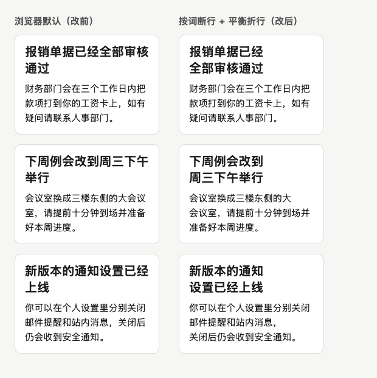

# 中文按词断行，标题平衡折行，正文末行不留一两个字

> #476 存在：设计协议里没有任何断行规则，designer 照现在的规则画出的中文卡片会在词中间断行、末行只剩一两个字，详情在「问题陈述」

## 问题陈述

### 1. 固定宽度的中文卡片在词中间断行，末行只剩一两个字

复现（2026-11-24，本机 Playwright，Chromium，卡片宽 204px，标题 20px，正文 15px）：同样三张卡片，左边是浏览器默认，右边加了本 spec 的规则。

- **词中间断开**：默认的正文「会议室换成三楼东侧的大会议室」断成「…大会议 / 室，…」，「会议室」被拆到两行。本该是：在词与词之间换行。
- **末行只剩一两个字**：默认的三个标题都折成「报销单据已经全部审核 / 通过」这种，第二行只有两个字。本该是：两行长短接近（「报销单据已经 / 全部审核通过」）。

原因：浏览器对中文默认按字断行，哪两个字之间都能换行，不认词。

现状核对（2026-11-24，对着 `origin/main` `534ba503`；分拣评论 [#476 评论](https://github.com/guohaonan-shy/harold-skills/issues/476)同日核过）：在 `idea-loop/` 和 `docs/`（不含 `docs/raw`）里搜 `text-wrap`、`断行`、`Segmenter`、`keep-all`、`wbr`，设计相关的规则文件里一处都没有。designer 画布签字前要过的排版检查在 uiux-refine 设计参考的 `critique.md`「Typography thresholds」一节，管行长、行距、字号、字距、层级比例，没有断行。

这条规则不是从零想出来的，已在别的项目里用过（2026-11-24 对着那个项目的 `origin/main` `a8fb3004` 核）：

- 一份写作报告的批注卡：spec 里定了「卡片上的中文只在词与词之间断行」，起因是人 2026-11-11 问「合并卡标题为什么会在中间词断行，这个问题需要解」；画布实测三个宽度各 30 段中文，加规则后词中间断开、末行孤字都是 0。前端代码用 `Intl.Segmenter` 切词。
- 一个营销页的冻结画布：中文标题手写 `<wbr>` 加 `word-break: keep-all`。同一份画布的注释记了一个坑：390px 宽度下，一个整句不许断的中文标题伸到了 437px，撑出了容器。
- `text-wrap: balance` 出现在 31 个文件里，`text-wrap: pretty` 10 个（含历史画布）。

复现材料：`.tmp/to-spec/zh-line-break/repro/index.html`（本地，不提交）。

### 根因

designer 签字前的排版检查只列了行长、行距、字号这些阈值，没有断行这一条，浏览器的默认行为就原样进了画布；要靠人在评审时一眼看出来。

## 方案

改完，用 uiux-refine 做设计时，designer 交出的画布里中文只在词与词之间断行；不论哪种语言，标题折成长短接近的几行，正文末行不剩一两个字（英文不剩一个词）；评审时这几项像行长、行距一样被量过，而不是靠人挑。

做法：在 `critique.md`「Typography thresholds」里加一条「中文断行」（杠杆：**就近归置**。断行跟行长、行距同属排版阈值，放在同一个标题下；那一节 designer 在 Gate 2 与签字前必读，`designer.md` 的「签字前检查」已经点名它，不用新增指针）。这一条写：

1. **什么时候算问题**：中文文本在一个词的中间换行（只对中文）；任何语言的多行标题末行只有一两个字（英文是一个词）；正文末行同样只剩一两个字或一个词。
2. **怎么做**：中文用 `Intl.Segmenter` 按词切分，单字词和收尾标点粘在前一个词上，开头标点粘在后一个词上，词与词之间插 `<wbr>`，配 `word-break: keep-all`；不分语言，短标题加 `text-wrap: balance`，正文加 `text-wrap: pretty`。
3. **两个退路**：一行放不下的长串加 `overflow-wrap: anywhere`，不让它撑破容器；浏览器没有 `Intl.Segmenter` 时文本整段原样输出，退回普通断行。
4. **怎么量**：在真 DOM 上按字取每一行（`Range.getClientRects`），用同一个切词器判断每个行尾是不是词边界，数出词中间断开的处数和末行字数，跟行长一样量，不靠看。

例子用任何项目都读得懂的卡片标题，不带别的项目的名字（`no-project-leak.test.mjs` 守着）。

同一行为的其他入口：

| 入口 | 纳入 / 排除 |
|---|---|
| `critique.md`「Typography thresholds」 | 纳入：规则本体放这里，唯一一处 |
| `static-protocol.md`（issue 原先建议的落点） | 排除：它是设计流程（澄清、复现、概念…人审），不放排版阈值；Gate 2 已经让 designer 读 `critique.md` |
| `design-law.md`（分拣评论提的另一个落点） | 排除：它每次设计开场就整份读，只带中文界面才用得上的规则放这里，不碰中文的设计也要每次读一遍；放进 `critique.md`，只在评审时读 |
| `design-lint.mjs`（画布写入时的机械检查） | 排除：要在渲染后的页面上量才知道哪里断开，正则只能看源码，判不出来 |
| uiux-imagine 的发散画布 | 排除：发散阶段比方向，不打磨细节；断行在 refine 的签字前检查里管 |

## User Stories

1. 期望行为（问题 1）：designer 打磨一张画布，签字前按 `critique.md` 量过断行：中文词中间断开 0 处；任何语言的多行标题和正文，末行都不只剩一两个字（英文不只剩一个词）；量出来不合格的，改完再交。

## 实现决策

- **落点是 `critique.md`「Typography thresholds」**：依据是已有的做法：行长、行距、字号这些要在渲染后量的排版规则都在这一节（「Measure, don't eyeball」），designer 签字前按它逐项过（`agents/designer.md`「签字前检查」）。issue 建议的 `static-protocol.md` 是流程文件，本身不放排版规则（分拣评论已核）。
- **退路写进规则本身**：`overflow-wrap: anywhere` 的依据是上面那个营销页画布在 390px 宽度下撑破容器的实例；`Intl.Segmenter` 缺失时整段原样输出，依据是写作报告实例的代码和测试就是这样做的。
- **不点名日文、韩文**：证据只有中文。
- **插件版本升 patch**：给已有的检查加一条，老用法照样能用（`REVIEW.md`「额外要求」的 patch 档）。

- **平衡折行、末行不留孤词所有语言都管；按词断行只管中文**：人 2026-11-24 在本会话选「所有语言都管」。理由：`text-wrap: balance` / `pretty` 跟语言无关，不支持的浏览器直接忽略；英文标题末行只剩一个词同样难看。例：英文设置页标题「Notification settings are now available」折成两行、末行只剩「available」，签字前会被量出来，加 `text-wrap: balance` 再交。

## 测试决策

| 变的是什么 | 仪器 | 本次 |
|---|---|---|
| 纯逻辑、数据转换、状态机 | TDD 单元测试 | 不涉及 |
| API 契约（路由、schema、序列化） | TDD API 测试 | 不涉及 |
| DB schema、迁移、并发与事务语义 | 真 DB 测试 | 不涉及 |
| LLM 输出质量（prompt 改动） | eval | 改的是 designer 读的规则文本。不加 retro 回放用例：回放从本仓库的一个提交起跑，这条规则的历史决策点在另一个项目里，本仓库没有能复现它的提交 |
| 视觉正确性 | UI 实现环 | 不涉及（不改哪个产品的界面）。规则里给的做法用复现页验过：同一组卡片，改后词中间断开 0 处、标题末行没有只剩两个字的 |
| 端到端用户流程 | 浏览器端到端测试 | 不涉及 |

- **seam**：仓库已有的文档测试（`npm test` 跑的 `*.test.mjs`），这次只依赖其中的 `no-project-leak.test.mjs`。能抓到：规则里混进了别的项目的名字；漏掉：designer 实际读不读、照不照做，这只能等下一次带中文界面的设计看画布。
- **增量功能测试**：
  - 前置：本 PR 的插件。
  - 步骤：读 `critique.md`「Typography thresholds」；打开复现页 `.tmp/to-spec/zh-line-break/repro/index.html`，按规则第 4 点量。
  - 期望：这一节有中文断行一条，含「什么时候算问题」「怎么做」「两个退路」「怎么量」四部分；复现页右栏量出词中间断开 0 处，左栏不是 0。
  - 覆盖：期望行为 1。
- **照着谁写**：`critique.md` 同一节的「Line length」「Tight leading」：一条一个可量的阈值加做法。

## Out of scope

- 不给 `design-lint.mjs` 加机械检查（理由见「方案」的入口表）。
- 不回头改已经冻结的画布和已经归档的设计档案。

## 关联

- 来源：另一个项目 2026-11-23 的 dreaming 对账蒸馏出的候选，人批了「开 issue」（见 #476 正文）。
- 相邻还没完成的：#475（动效：有先后顺序的切换带方向位移）出自同一次对账，改的是 `motion.md`，不重叠；#446（design-modeling 人读文档对不上现行规则）不碰 `critique.md`，不重叠；#288（画布的统一控制面板，含语言切换）不重叠。查过 `docs/spec/` 当前另两份未了结的 spec（`dispatch-triage-per-round`、`in-scope-legacy-fix`），都不碰设计参考。
