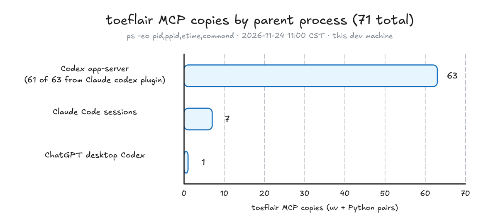
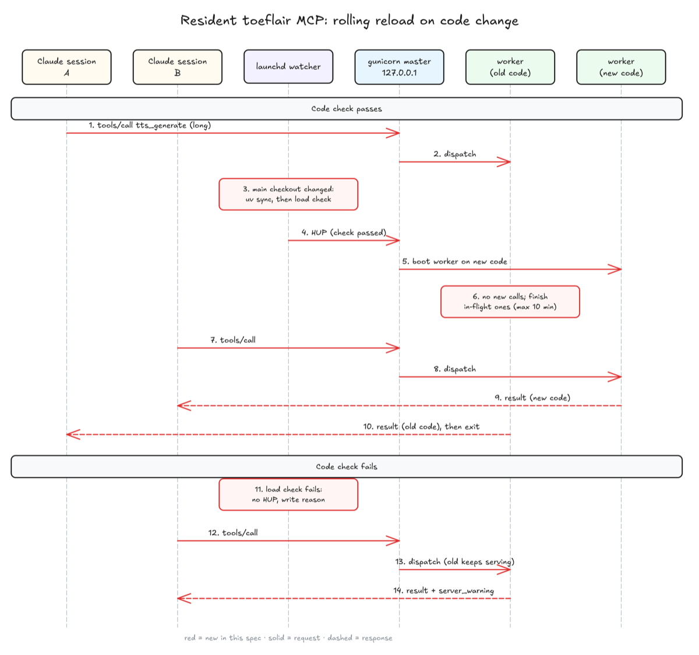
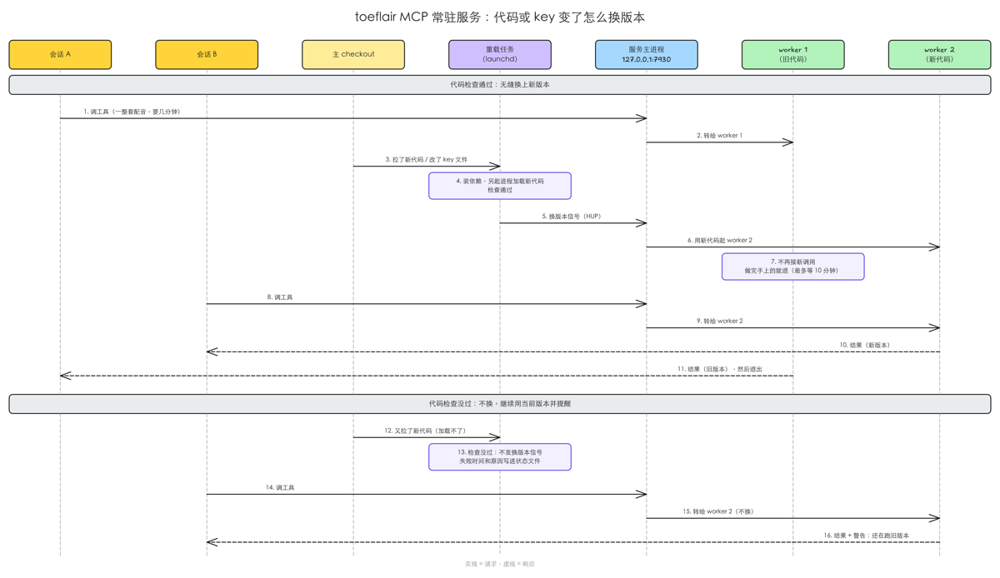

# 样本：本机服务的 PR，证据节的之前 / 之后是同一个操作在两边各做一遍

**一句话**：一个把「每会话一份」的出题工具进程改成本机常驻单个服务的 PR。问题节用线上统计证明问题真实发生过（71 份）；证据节该是同一个操作两边各做一遍（开几个会话、数出题工具进程），而不是拿 71 份去跟合并后的 1 份比。

## 出处

- guohaonan-shy/Tofelair#1136「toeflair MCP 改成本机常驻的单个服务」，2026-11-24 16:01 UTC 合并（issue #987）。PR 分支 `issue/987-toeflair-mcp-process-leak`，最后一个提交 `915ef398`，34 个文件，+3563 −42。
- #452 triage 会话里人定「证据节的之前 / 之后是什么」，决定记录 `docs/raw/decisions/452.md` 题 21。
- 材料取法同 tofelair-1072-frequency。

## 当时产出的原文

**旧描述**（PR 合并时的原文，没改一个字；十节的旧格式，下面的 `<!-- idea-loop:section … -->` 行是写入工具加的段落标记）

~~~~~markdown
<!-- idea-loop:section summary -->
## 一句话

本机所有会话共用一份常驻的出题工具服务（配音、生图、转写、导入），开再多会话也只有一份进程；主 checkout 拉了新代码或改了 key，开着的会话下一次调用就用上新的；新代码有问题时不换、旧版本继续服务，并在每次调用的返回里提醒。合并后要你在本机跑一次安装和迁移。
<!-- /idea-loop:section summary -->

<!-- idea-loop:section problem -->
## 问题

这台开发机上，每个连出题工具（配音、生图、转写、导入）的客户端都各自拉起一份进程，客户端不退它就一直挂着。11-24 上午实测 71 份，最老的跑了 11 天，其中 63 份挂在不退出的 Codex 进程下；11-19 分拣时只有 5 份，5 天涨了 66 份。每份进程的环境里都带着生产库的 key。

另一半问题：改了代码或换了 key（做 #973 时换生图 key 就碰到了），开着的会话仍用旧的，只能逐个重连，而且看不出自己跑的是哪一版。

Codex 那一侧 11-24 已手动止血（不再登记、结束了 66 份），但 Claude 这一侧仍是一个会话一份。
<!-- /idea-loop:section problem -->

<!-- idea-loop:section changes -->
## 怎么修

- **生图、转写放进后台线程**：依据是 SEO 工具已有的同样写法。共用一个进程后，一个会话生图几十秒不再卡住别的会话。
- **常驻方式用 launchd，不用 Docker**：依据是仓库已有 growth-weekly 的 launchd 先例，以及你在 grill 里的决定（2026-11-24）。
- **换版本时旧进程最多等 10 分钟做完手上的调用**：你在 grill 里定的。
- **自动重载除了代码，也看两个包的依赖声明**：依赖声明改了却不换版本，新依赖会漏掉；代价是改它也触发一次重载。
- **每次回完结果都让客户端换一条新连接**（review 第 1 轮修的）：依据是你在 grill 里定的「旧实例上还有请求就不删，新请求去新进程」；本机上多建一次连接，感受不到。

### 本机出题工具：从「每个会话各起一份」变成「一份常驻服务，自动换版本」

之前：每个会话、每个 Codex 进程各拉起一份，客户端不退它就不退（11-24 实测 71 份）；改了代码或 key 要逐个会话重连。

之后：开机起一份服务，所有会话连它；主 checkout 的代码或 key 文件一变，先检查新代码能不能加载，能就无缝换上，不能就不换并在返回里带警告。

**后端流程**：学生 app 和线上没变，只改本机开发工具。
<!-- /idea-loop:section changes -->

<!-- idea-loop:section verification -->
## 怎么验证

- 生图、转写跑着时不卡别的调用：单元测试，假接口阻塞 2 秒，改前红、改后绿（生图、转写、大文件上传、视频抽音轨、图片压缩各一条）
- 多个客户端连同一份服务：真服务（临时端口）上列工具与原来一致、调工具正常返回；别的域名的请求被拒（关掉校验再跑会红）
- 换版本不报错：进程级验收脚本在真服务上跑，8 秒的调用进行中换版本、同时每 0.3 秒一次普通调用，连跑 10 次，每次慢调用拿到旧版本结果、普通调用 0 次报错、之后返回新版本；机器重负载下也是 10/10
- 新代码加载不了：不换，服务还在，之后的调用返回里带「从几点起还在跑旧版本、原因是语法错误」；修好再重载，提醒消失；连续失败时起始时间保持第一次
- 一个调用阻塞 10 秒时，另一个客户端 0.03 秒返回（对照组卡在主循环上要 3.5 秒）
- 管理脚本：在临时 HOME、假仓库里测过安装生成的两个任务配置、迁移改写各 worktree 配置并备份、空跑不改文件且不打印 key 的值
- 没验成：真正装进这台机器的 launchd、盯文件自动触发重载、迁移本机 32 份配置——夜里不动本机，合并后由你跑，见「能否回滚」
- 本机测试：出题工具服务 70 条、共享内容库 22 条全过（这两个包不在任何 CI 里，PR 上没有检查）
- review：跑了 2 轮。第 1 轮查出 1 条已按规则修：换版本时正在跑的调用偶尔做完了却拿不到结果（21 次断 2 次）；根因是旧进程回完结果就关了被复用的连接，改为每次回包都让客户端换新连接，验收改为连跑 10 次。第 2 轮 0 条
<!-- /idea-loop:section verification -->

<!-- idea-loop:section rollback -->
## 能否回滚

**能不能撤回**：能。撤销合并即可；本机已经迁移的话，再跑管理脚本的卸载，把备份目录里的旧配置拷回各个 worktree。

**影响面**：只影响这台开发机上会话里的出题工具；学生 app、线上服务、数据库都不受影响。

**上线前要注意的**
- [ ] 合并后在主 checkout 拉代码，按 toeflair-mcp 的 README 新加的「常驻服务」一节依次跑：安装、看状态、迁移先空跑一遍核对、再正式迁移（加结束旧进程的开关会让开着的会话里出题工具断开，重连即可）——要你来跑，因为它改本机配置、结束别的会话正在用的进程
- [ ] 迁移后核对：进程里只剩一主一 worker；改一次 key 文件或拉一次代码，重载日志里有一次重载——真 launchd 的触发夜里没法验
- [ ] 迁移备份里有 key，确认无误后自己删
<!-- /idea-loop:section rollback -->

<!-- idea-loop:section night-decided -->
## 夜里替你定的

- **本机真正装服务、改各 worktree 的接法、结束旧进程，谁来跑**：选了只写好脚本并在临时目录里测过，真正在这台机器上执行留给你合并后跑，因为它会结束别的会话（包括夜里并行的会话）正在用的出题工具进程，人不在时动它会让那些会话的工具调用中途失败；另一种是夜里直接迁移（早上起来就是新接法，但可能打断夜里别的会话）。
- **key 文件和进程环境变量里有同名 key 时听谁的**：选了听 key 文件，因为改了文件就一定生效、不会被某个客户端残留的环境变量盖掉；另一种是听环境变量（临时覆盖方便，但迁移后客户端配置里不再写 key，用不上）。
<!-- /idea-loop:section night-decided -->

<!-- idea-loop:section your-todo -->
## 要你做的事

**要你审的**：无（不碰界面）。

**要你决定的**：无。夜里按推荐替你定了两件，见上面「夜里替你定的」，不同意说「推翻」。

**合并后在本机跑一次安装和迁移**：见「能否回滚」里的「上线前要注意的」。

**合并**：说「合并」即可，合并前的收尾都已经做完。
<!-- /idea-loop:section your-todo -->

<!-- idea-loop:section reference -->
## 参考

改动地图、spec 与工单、执行记录、合并后的清理

**改动地图**
- toeflair-core：生图、转写的阻塞调用移进线程（`image_gen.py`、`transcribe.py`）
- toeflair-mcp：HTTP 入口 `toeflair_mcp.asgi:app`、key 文件 `~/.toeflair-mcp/env`、`server_warning` 与状态文件 `reload-status.json`
- toeflair-mcp/scripts：`reload.py`（指纹、uv sync、加载检查、HUP）、`reload_acceptance.py`（进程级验收）、`service.py`（install / uninstall / status / reload / migrate）
- 文档：`DEVELOPMENT.md`、`toeflair-mcp/README.md`

**spec 与工单**：[toeflair MCP 改成本机常驻的单个服务](https://github.com/guohaonan-shy/Tofelair/blob/issue/987-toeflair-mcp-process-leak/docs/spec/toeflair-mcp-resident-service/toeflair-mcp-resident-service.md)

| 工单 | 提交 | 验收 | 延后 → 接手方 |
|---|---|---|---|
| 01 · 生图、转写不再卡住服务 | 17cdf136c | 4/4 | — |
| 02 · HTTP 入口、key 文件、警告 | a481ea64a | 7/7 | — |
| 03 · 自动滚动重载 + 验收脚本 | 6a8b972d3、e4218555e | 7/8 | 输出贴 PR → PR 描述「怎么验证」 |
| 04 · launchd 与迁移脚本 | dc9e16ada | 5/6 | 本机安装迁移 → 人 |

**本机测试**：toeflair-mcp 全量 70 passed；toeflair-core 22 passed；`scripts/worktree-setup.test.mjs` 3 passed。这两个包不在任何 CI workflow 里。

**合并后的清理**：工单已删（随审核报告前的 docs 提交）。
**过程记录**：Review 汇报 3 份（实现 1、review 2 轮），合并时整份贴在这个 PR 的评论里

<!-- /idea-loop:section reference -->

Refs guohaonan-shy/Tofelair#987

🤖 Generated with [Claude Code](https://claude.com/claude-code)
~~~~~

**图**（旧描述里的图，GitHub 上已经 404，素材分支合并后被删；这里是本地副本，第四轮产出里用到的图一并放在 `img/`）

**四轮产出**：四轮产出在分支上的 `idea-loop/evals/pr/rounds/tofelair-1136/`：`description-v1.md`、`description-v2.md`、`description-v3.md` 是前三轮，`description.md` 是第四轮（Harold 定的模板），`notes.md` 是每轮子代理记下的「标准没说清」和字数；每轮之间改了什么、Harold 的批示在 `docs/raw/decisions/452.md` 题 20–27。

- 第一轮 1752 字（去掉代码块；旧描述折叠区外 3577）：证据节照「同一种证据」写之前 71 份、之后 1 份，合并前拿不到「之后」。
- 第二轮 1715：问题有两件，证据写两组，材料里没有基准分支上的复现，四格全写〔缺：复现〕。
- 第三轮 2158：证据三组（多出一组生图、转写移进线程），概要三个视图（人看后说「收紧再跑」）。
- 第四轮 1486：问题节一张按父进程分的份数图（71 份）；概要一张换版本时序图加一个调用树 diff；证据节没有一组之前 / 之后——三组都没有两边都做过的复现，只剩测试伪代码、全量结果和一行「没验成」，写明开 3 个会话数进程份数、开着会话改代码或改 key 再调一次，基准分支上都没做。

## 人指出的问题

- 人的原话（题 21）：「我看了下matt的pr里面的写法，我觉的before/after 是用证据证明了之前问题是存在的，之后就是我们解决了。比如之后就是我创建了多个claude 进程，但是只有一个toeflair mcp的进程了，之前就是多个进程也有多个出题工具进程？」「你这个71和1的属佛啊，我读下来感觉意义不大」
- 起因：第一轮证据节照「同一种证据」写了「之前 71 份、之后 1 份」。71 是 11-24 在线上（本机）数出来的，合并前拿不到「之后 1 份」；而且两个数不是同一个操作的两边，读不出问题被修好了。

## 好的长什么样

- 问题节用线上统计证明问题真实发生过、有多常见：71 份进程，最老的跑了 11 天，11-19 只有 5 份，一张按父进程分的份数图，带出处和时间。这一节的数不拿去跟合并后比。
- 证据节是一次复现：同一个操作在基准分支和本分支各做一遍。例（人举的，数不是真测的）：开几个会话、数出题工具进程——基准分支上进程也有多份（每会话一份），本分支上只有一个主进程加一个 worker。之前看到问题，之后问题没了。
- 材料里没有基准分支上的「之前」时，不编数字，写进末尾「没验成」一行，说清为什么、谁补。
- 不好的样子：证据节写「之前 71 份、之后 1 份」。

## 回放这一格怎么跑

- 现场：提交 `1400d780`（Tofelair 仓库里这个 PR 合并那一刻 `main` 的第一个父提交）。回放时 `--repo` 指到 Tofelair 的克隆。
- 换过的地方：同 tofelair-1072-frequency。会话在回放里开不了真会话、数不了真进程，材料里也没有基准分支上数过进程的结果；所以这个样本看的是描述怎么写——证据组是不是「同一个操作两边」、缺的「之前」有没有标进「没验成」，不看 71 变成了几。
- 大小：large，由编排者在 PR 开出来之后照 `--run-large` 跑。
