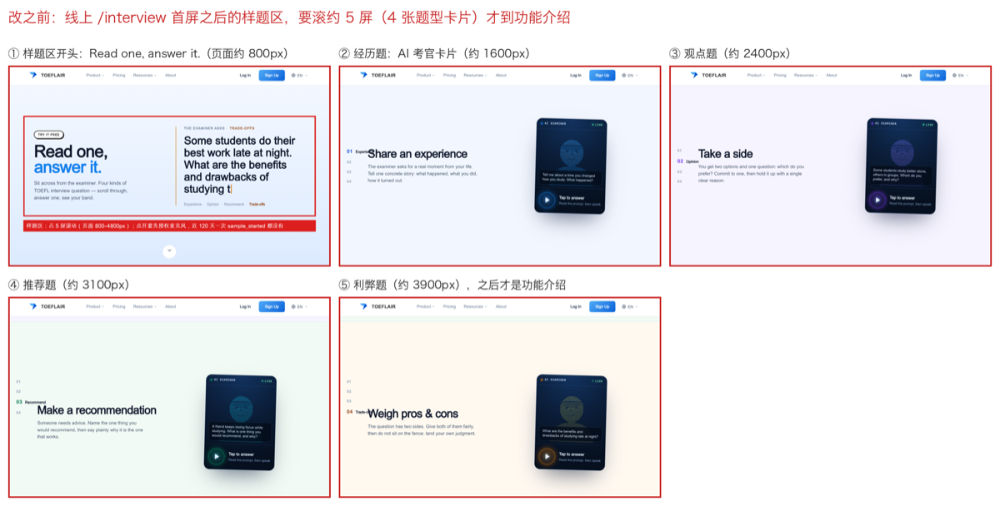
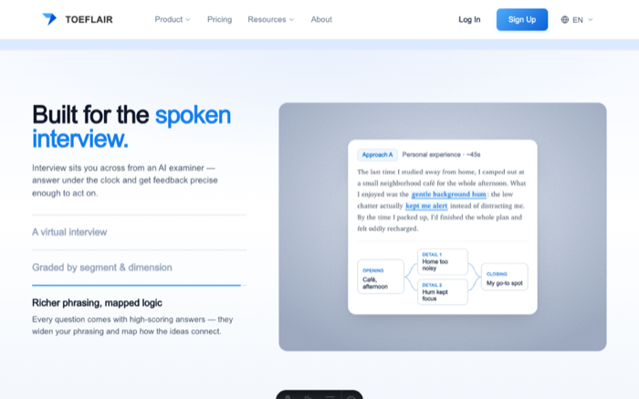
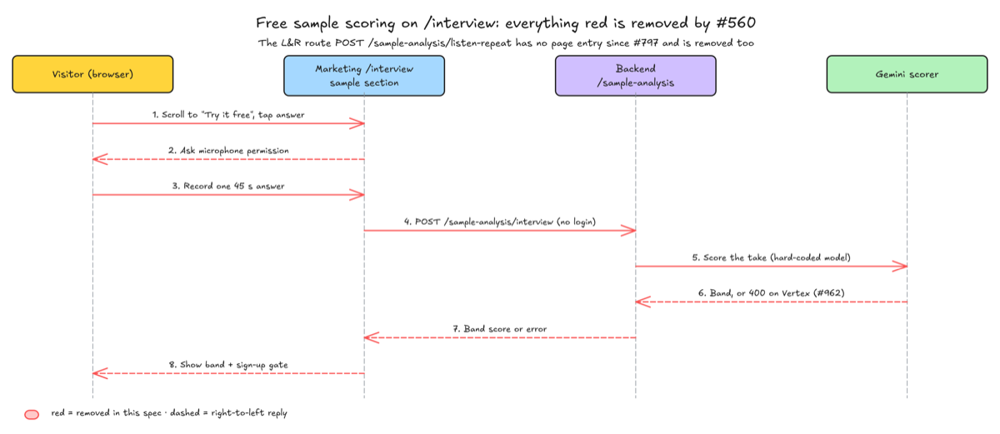
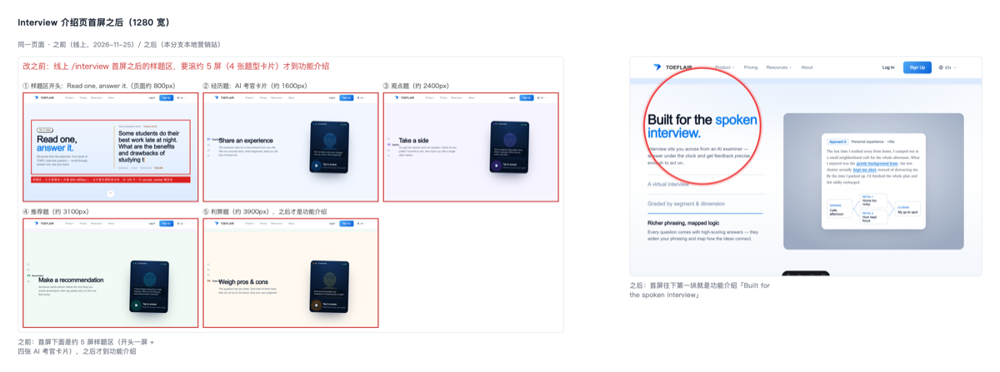

# 样本：UI 的 PR 里，没有对应问题的改动（音频包搬家）放在概要的 diff 里，证据里只写一行「行为没变」

**一句话**：一个删营销站样题的 PR，顺带把共享音频包整个搬进 app。搬家没有对应的问题可复现；它该出现在概要的 diff 里，证据里只用一行说「搬完行为没变」，不为它单立一组之前 / 之后。

## 出处

- guohaonan-shy/Tofelair#1137「下线营销站的免登录样题」，2026-11-25 01:25 UTC 合并（issue #560）。PR 分支 `issue/560-interview-intro-sample-redo`，最后一个提交 `72d62f7b`，133 个文件，+471 −3717。
- #452 triage 会话里人定「没有对应问题的改动」放哪，决定记录 `docs/raw/decisions/452.md` 题 25。
- 材料取法同 tofelair-1072-frequency；文件清单超过 40 个，prompt 里按目录合并。

## 当时产出的原文

**旧描述**（PR 合并时的原文，没改一个字；十节的旧格式，下面的 `<!-- idea-loop:section … -->` 行是写入工具加的段落标记）

~~~~~markdown
<!-- idea-loop:section summary -->
## 一句话

访客在 Interview 介绍页看完首屏就直接看到功能介绍，不再滚过 5 屏几乎没人用的样题；后端不再有不登录就能调用的打分接口。
<!-- /idea-loop:section summary -->

<!-- idea-loop:section problem -->
## 问题

线上 Interview 介绍页（https://toeflair.com/interview ，1280 宽，2026-11-24 量）首屏下面是「TRY IT FREE / Read one, answer it.」样题区，从页面 800px 排到 4800px，访客要滚过 5 屏才看到功能介绍，想试做还得先授权麦克风。几乎没人用：近 90 天 /interview 和 /zh/interview 共 59 个访客，样题开始事件只有 3 次，全是同一个人（PostHog，未过滤测试账号）。

同时后端还开着两个不用登录就能调用的打分接口（Interview 和 L&R 各一个），只有题号名单和按 IP 的进程内限流挡着，每调用一次就付一次打分费用。L&R 那个自 #797 删掉 L&R 页样题后已经没有调用方；Interview 那个在 Vertex 上会被拒（#962）。只为样题留着的共享音频包、埋点事件、种子数据也一直挂在仓库里。
<!-- /idea-loop:section problem -->

<!-- idea-loop:section changes -->
## 怎么修

照规则定下的做法（不同意哪条说「推翻」）：

- **只删样题，不重做 Interview 介绍页**：人 2026-11-24 定「这个 issue 只将 sample 删除即可」。页面其余各块样式、文案、顺序都没动。
- **两个免登录打分接口整套删，不留壳**：删完两个接口都没有调用方。
- **本地种子数据里两套样题练习都删**（含本地可练的 Study Habits Sampler）：人 2026-11-24 定「种子也删除吧」。生产库和存储不动。
- **共享音频包整个搬进 app**：项目规则「共享包只放 app 和营销站都用的代码」，样题删后营销站一处不用它。
- **只给样题用的考官点阵头像和营销站的 3D 依赖一起删**：spec「仓库里不再有只为样题留着的代码」。

### Interview 介绍页：首屏之后直接是功能介绍

之前：首屏下面是约 5 屏的样题区：先是「Read one, answer it.」开头一屏，再往下依次滚出经历、观点、推荐、利弊四张「AI 考官」卡片（点阵头像，每种题型一种配色），点开要先授权麦克风才能试做（线上截图，2026-11-25）。

之后：首屏往下直接是功能介绍「Built for the spoken interview」，后面各块原样不动；英文页总高从约 1 万像素降到约 6700。中文页同样。

**后端流程**：不登录调用 Interview、L&R 两个旧的免登录打分地址都得到 404，不会再产生打分调用。

### 学生 app 的听题和录音

用户看不到变化：音频代码从共享包挪进 app，L&R 一整套题走下来听题、录音、提交、分析都照常。换来的是营销站不再背着一个只有 app 在用的包。
<!-- /idea-loop:section changes -->

<!-- idea-loop:section verification -->
## 怎么验证

- **访客在 Interview 介绍页看不到样题区**：新加的营销站构建产物测试读 /interview、/zh/interview 的 HTML，断言没有样题文案和样题组件、首屏后第一块就是功能介绍；先在未删除的代码上见红，删除后见绿。本地起营销站用浏览器看过中英两页，控制台无报错（截图见「怎么修」）。
- **两个免登录打分接口不再存在**：新加的 API 测试不登录调两个旧地址，都返回 404；先见红（删前是 403）后见绿。
- **学生 app 听题、录音不受音频包搬家影响**：原包 33 个单元测试原样搬进 app 并通过；本地用 QA 账号走完一整套 L&R（听题、录音、提交、开始分析），控制台无报错。真实麦克风没测（无头浏览器没有麦克风，用开发模式的固定录音代替），靠录音相关的存量单元测试覆盖。
- **L&R 线上分析请求没变**：删样题预览开关后，请求快照除被删的那一条外逐字节一致。
- **本地种子数据能重建**：没在多个工作区共用的本地库上跑重建，改在临时库上跑完整种子文件无报错；后端 CI 的 API 测试起库跑迁移加种子通过。
- **全量**：后端、前端、营销站、文档四套 CI 在这个版本上全绿；类型检查、lint、死代码检查改动行 0 条。
- **review**：跑了 2 轮。第 1 轮报出 1 条：后端还留着只给样题用的「预览」提示词，夜里按推荐在这次删掉；第 2 轮 0 条。
<!-- /idea-loop:section verification -->

<!-- idea-loop:section rollback -->
## 能否回滚

**能不能撤回**：能，撤销合并即可：Interview 介绍页的样题区、两个免登录打分接口、共享音频包会原样回来。生产库和存储没动；本地种子少了两套样题练习，撤销后重建本地库就回来。

**影响面**：营销站 Interview 介绍页（中英文）和本地开发库；学生 app 里的练习、录音、报告行为不变，L&R 分析发给模型的请求和之前完全一样。

**顺带开的 issue**
- [#1138 营销站介绍页还写着「免费试一题，无需注册」，但试做入口已经下线](https://github.com/guohaonan-shy/Tofelair/issues/1138)：全站四个介绍页的搜索描述和小字，L&R 那条自 #797 起就过期；是全站文案，不在「只删样题」的范围。
- [#1140 L&R 分析模块里的旧整题分析函数没有调用方了](https://github.com/guohaonan-shy/Tofelair/issues/1140)：它不是为样题写的，删它要动线上 L&R 分析和 AI 调用点登记。
<!-- /idea-loop:section rollback -->

<!-- idea-loop:section night-decided -->
## 夜里替你定的

- **L&R 分析模块里一段旧代码在删掉样题后没人调用了，要不要在这次一起删**：选了不在这次删，另开 issue，因为这段代码不是为样题写的，删它要动线上 L&R 分析和 AI 调用点登记，跟「只删样题」的范围不一样；另一种是这次一起删（PR 更干净，但会碰线上 L&R 分析，review 和回归面更大）。
- **review 第 1 轮 S1：后端还留着只给样题用的「预览」提示词，这次删还是留给 #1140**：选了这次删，因为它就是只为样题留着的代码，线上从不打开它，删掉不碰会走的路径；另一种是留给 #1140、把工单验收改写成「留待以后」（这次不动代码，但 spec 的期望行为一直差一点）。
<!-- /idea-loop:section night-decided -->

<!-- idea-loop:section your-todo -->
## 要你做的事

**要你审的**：没有（页面变化在「怎么修」里有之前 → 之后截图，想看就看）。

**要你决定的**：没有；「夜里替你定的」两条，不同意就说「推翻」。

**合并**：说「合并」即可。合并后设计档案里 Interview 样题的两个组件和三个试做状态，由归档设计差异那一步更新。
<!-- /idea-loop:section your-todo -->

<!-- idea-loop:section reference -->
## 参考

改动地图、spec 与工单、执行记录、合并后的清理

**改动地图**
- 营销站：删 Interview 样题区组件、island、样题请求客户端、样题配色、考官点阵头像、内容数据里的样题字段；新增 `test-dist/interview-intro-content.test.ts`；去掉 `@toeflair/audio`、`three` 一族依赖
- 埋点包：删 `sample_started` / `sample_completed` / `sample_gate`
- 后端：删 `/sample-analysis` 路由、`services/sample.py`、两个 `*_sample.py`、Interview 样题提示词、IP 限流、样题错误码、`iv_sample` / `iv_asr_sample` 调用点；新增 `tests/post_sample_analysis_removed/`
- 种子数据：删「Free-Trial (Try-Sample) Practices」一节和两套练习的素材目录
- app：`packages/audio` 搬进 `app/src/hooks`、`app/src/services`；`@toeflair/dev` 导入改到新位置；相关 AGENTS.md、eslint、Dockerfile 注释同步

**spec 与工单**：[下线营销站的免登录样题](https://github.com/guohaonan-shy/Tofelair/blob/issue/560-interview-intro-sample-redo/docs/spec/interview-intro-sample-removal/interview-intro-sample-removal.md)（工单已在合并前删除，链接指向删除前的版本可在提交 812cf07b7 查看）
- [01 · 营销站 Interview 介绍页删掉样题区，样题埋点一起删](https://github.com/guohaonan-shy/Tofelair/blob/812cf07b7/docs/spec/interview-intro-sample-removal/tickets/01-marketing-interview-sample-removal.md)：可立即开工。首屏后直接是功能介绍
- [02 · 后端删掉两个免登录打分接口，种子数据删掉两套样题练习](https://github.com/guohaonan-shy/Tofelair/blob/812cf07b7/docs/spec/interview-intro-sample-removal/tickets/02-backend-sample-analysis-removal.md)：可立即开工。两个旧地址 404
- [03 · 共享音频包整个搬进 app，包删掉](https://github.com/guohaonan-shy/Tofelair/blob/812cf07b7/docs/spec/interview-intro-sample-removal/tickets/03-move-audio-package-into-app.md)：被 01 挡着。app 听题录音不变

**过程记录**：Review 汇报 3 份（来自实现 1 份、review 2 轮），第 1 轮修了 1 条，合并时贴在这个 PR 的评论里

| 工单 | 提交 | 验收 | 延后 → 接手方 | 存量回归 |
|---|---|---|---|---|
| 01 · 营销站删样题区 | [c28edd624](https://github.com/guohaonan-shy/Tofelair/commit/c28edd624) | 6/6 | — | 绿 |
| 02 · 后端删接口与种子 | [8af539939](https://github.com/guohaonan-shy/Tofelair/commit/8af539939) | 5/5 | — | 绿 |
| 03 · 音频包搬进 app | [5513e1115](https://github.com/guohaonan-shy/Tofelair/commit/5513e1115) | 5/5 | — | 绿 |

**合并后的清理**：设计档案里 `mkt-InterviewCallTile`、`mkt-InterviewTryScroll` 两个组件和 `mkt-interview` 的三个试做状态，由归档设计差异那一步更新（先例 35b83f227）；`docs/spec/interview-intro-type-label-contrast` 等对账时收。

<!-- /idea-loop:section reference -->

Refs guohaonan-shy/Tofelair#560

🤖 Generated with [Claude Code](https://claude.com/claude-code)
~~~~~

**图**（旧描述里的图，GitHub 上已经 404，素材分支合并后被删；这里是本地副本，第四轮产出里用到的图一并放在 `img/`）

**四轮产出**：四轮产出在分支上的 `idea-loop/evals/pr/rounds/tofelair-1137/`：`description-v1.md`、`description-v2.md`、`description-v3.md` 是前三轮，`description.md` 是第四轮（Harold 定的模板），`notes.md` 是每轮子代理记下的「标准没说清」和字数；每轮之间改了什么、Harold 的批示在 `docs/raw/decisions/452.md` 题 20–27。

- 第一轮 1886 字（去掉代码块；旧描述折叠区外 3193）：问题节一张四行表（页面两行、接口两行）；概要两个视图（样题链路时序图、音频包搬家的文件树 diff）；证据用页面之前 / 之后截图和接口返回码。
- 第二轮 1824：证据节改成两次复现（打开 Interview 介绍页；不登录调打分接口），接口那次的「之前」材料里没有，标〔缺：复现〕。
- 第三轮 2182：证据节从 2 组涨到 4 组，概要涨到三个视图（人看后说「收紧再跑」）。
- 第四轮 1898：概要两个视图（样题链路时序图 + 音频包、预览提示词的 diff）；证据一组页面之前 / 之后截图，加伪代码测试和一行「行为没变」（音频包搬进 app 后原有 33 个单元测试原样通过、L&R 分析请求快照逐字节相同）；没验成一段。

## 人指出的问题

- 人的原话（题 25）：「能在基准和开发分支复现的问题，可以有之前之后来说。没有对应问题的，我觉的内容理论上会在summary中的diff里面，同时之前和之后应该是不变的？」
- 起因：第一、二轮把音频包搬家写成证据里的一组，要为它找「之前」和「之后」；它没有对应的问题，找不出来，只能硬凑。

## 好的长什么样

- 概要的 diff 里画出搬家：`packages/audio/src/…` 删，`app/src/hooks/…`、`app/src/services/…` 加，只改导入。
- 证据里只有一行：音频包搬进 app 后，原有 33 个单元测试原样通过；L&R 分析请求快照除被删的预览那一条，其余逐字节相同。同一个操作两边结果一样。
- 证据里留给「之前 / 之后」的是有对应问题的那件事：样题区。同一个操作（不登录打开 Interview 介绍页往下滚）基准分支上看到样题区，本分支首屏后就是功能介绍。
- 不好的样子：音频包搬家在证据里单立一组、编出「之前 / 之后」；或者搬家哪儿都没写。

## 回放这一格怎么跑

- 现场：提交 `f51390cb`（Tofelair 仓库里这个 PR 合并那一刻 `main` 的第一个父提交）。回放时 `--repo` 指到 Tofelair 的克隆。
- 换过的地方：同 tofelair-1072-frequency（prompt 给旧描述、目录合并的文件清单、3 条 review 归档评论；材料里的 eval 一词写成 e-val）。旧描述里的图 GitHub 上已 404，prompt 里只留图的说明，本地副本在 `img/`。
- 大小：large，由编排者在 PR 开出来之后照 `--run-large` 跑。
